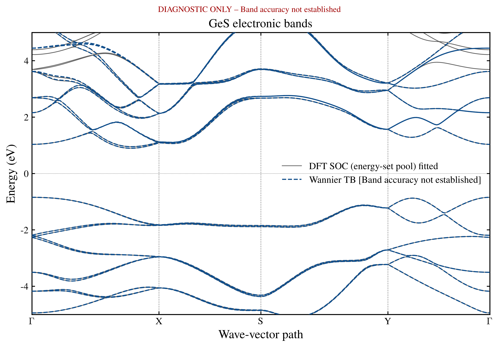
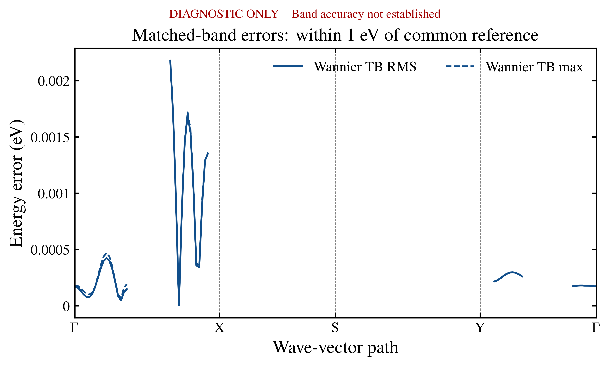

# 01 · Band structure of GeS

## In this tutorial

- Construct a reciprocal-space Hamiltonian from a Wannier tight-binding model.
- Read band energies along a high-symmetry path using one common energy reference.
- Distinguish a band-path comparison from convergence of a material response.

## Physics and model

A Wannier model stores Hamiltonian matrix elements between localized orbitals in different cells. In the cell-periodic Fourier representation, the interpolation used here has the positive-phase convention

$$
H^{(\mathrm{W})}_{ij}(\mathbf{k})
=\sum_{\mathbf R}\frac{H_{ij}(\mathbf R)}{d_{\mathbf R}}
e^{2\pi i\mathbf{k}_{\mathrm{frac}}\cdot\mathbf R}.
$$

Here $i,j$ label Wannier orbitals, $\mathbf R$ is an integer lattice vector, $\mathbf{k}_{\mathrm{frac}}$ is the fractional reciprocal coordinate, and $d_{\mathbf R}$ is the real-space degeneracy weight in the loaded model. The factor $2\pi$ belongs to fractional coordinates. Do not replace the model's replica weights by a different counting rule. The phase equals $e^{i\mathbf k_{\mathrm{cart}}\cdot\mathbf R_{\mathrm{cart}}}$ in Cartesian coordinates; the divisor accounts for the loaded finite-file representation rather than changing the Fourier convention. Center-convention transformations can change matrix representations without changing their eigenvalues.

At each point on the path, diagonalizing the Hermitian Hamiltonian gives the band energies:

$$
H^{(\mathrm{W})}(\mathbf k)U(\mathbf k)
=U(\mathbf k)\operatorname{diag}[\epsilon_n(\mathbf k)],
\qquad
\epsilon_n^{\mathrm{plot}}(\mathbf k)=\epsilon_n(\mathbf k)-E_{\mathrm{ref}}.
$$

The columns of $U$ are eigenvectors. The same $E_{\mathrm{ref}}$ is subtracted from every plotted dataset; an independently fitted offset would conceal part of the interpolation error. Energy agreement is necessary for a useful model, but does not establish accuracy of position matrix elements or optical response.

## Parameters

Use [band_structure.toml](inputs/band_structure.toml) after following the [material setup guide](../../Materials/README.md).

| Parameter | Value | Meaning |
| --- | --- | --- |
| Material model | Materials/GeS/model_tb.dat | Supplied 32-orbital GeS model |
| Path | Γ–X–S–Y–Γ | Ordered high-symmetry points |
| Points per segment | 51 | Resolution of each path segment |
| $E_{\mathrm{ref}}$ | −2.5 eV | Common energy reference |
| Sampling dimension | 2 | Current input's spatial dimension |
| Fourier backend | direct | Real-space Fourier interpolation |
| Replica policy | auto | Interpret replicas using the model representation |
| Band display window | −5 to 5 eV | Relative to the common reference |
| Error window | −1 to 1 eV | Selects matched DFT energies for error statistics |
| Matching tolerance | 0.002 eV | Near-degeneracy tolerance of the supplied comparison |

The first seven entries describe the calculation input; the last three describe the supplied comparison figure. One band run does not also generate a DFT reference.

## Run

From the repository root, check the input and calculate into a new directory:

```bash
julia --project=.runtime/env scripts/run_group.jl 01 --check
julia --project=.runtime/env scripts/run_group.jl 01 --case=band_structure --output=.runtime/band_structure
```

The check command inspects configuration and dependencies; it does not calculate bands. To change the path or sampling, edit a copy of the input and retain the same model and energy reference for a controlled comparison.

## Read the figures

The figures use supplied numerical tables. Redrawing them does not run the calculation above.

### 1. Band dispersion

<a href="figures/audited_zeroU_repaired_review_bands.png"></a>

First locate the gap and the states closest to it. Then follow the dispersion between labeled points. The DFT pool contains more bands than the Wannier model, so equal column numbers need not identify equivalent states.

[Original PNG](figures/audited_zeroU_repaired_review_bands.png) · [PDF](figures/audited_zeroU_repaired_review_bands.pdf)

### 2. Interpolation error

<a href="figures/audited_zeroU_repaired_review_errors.png"></a>

Read the RMS and maximum absolute errors together: RMS summarizes the selected states while the maximum exposes the largest mismatch. Their energy-selection window is narrower than the band-display window. No interpolation accuracy threshold is established by drawing these curves.

[Original PNG](figures/audited_zeroU_repaired_review_errors.png) · [PDF](figures/audited_zeroU_repaired_review_errors.pdf)

## Redraw and check

```bash
python examples/01_band_structure/plot.py --figure=audited_zeroU_repaired_review --output=.runtime/plot-audited_zeroU_repaired_review
```

A high-symmetry path leaves most of the Brillouin zone untested. Before quantitative use, examine additional momenta and the energy range relevant to the intended observable. The supplied material comparison is not a convergence certificate.

[Reproducibility](reproduce.json)

## Full-path view

The [full band plot](figures/audited_zeroU_repaired_full_bands.png) and [full error plot](figures/audited_zeroU_repaired_full_errors.png) show the wider path; the two figures above retain the matched review window. Both calculations use one fixed energy reference. The matching pool and the displayed energy window serve different purposes: an energy-set match checks interpolation of the retained eigenvalues, and does not prove equality of Bloch eigenvectors, optical matrix elements or a new self-consistent solution.

```bash
python examples/01_band_structure/plot.py --figure=audited_zeroU_repaired_full --output=.runtime/ges-full-bands
```

## References

- N. Marzari, A. A. Mostofi, J. R. Yates, I. Souza, and D. Vanderbilt, “Maximally localized Wannier functions: Theory and applications,” *Reviews of Modern Physics* **84**, 1419–1475 (2012). [DOI](https://doi.org/10.1103/RevModPhys.84.1419). Background for Wannier interpolation and its physical scope.
