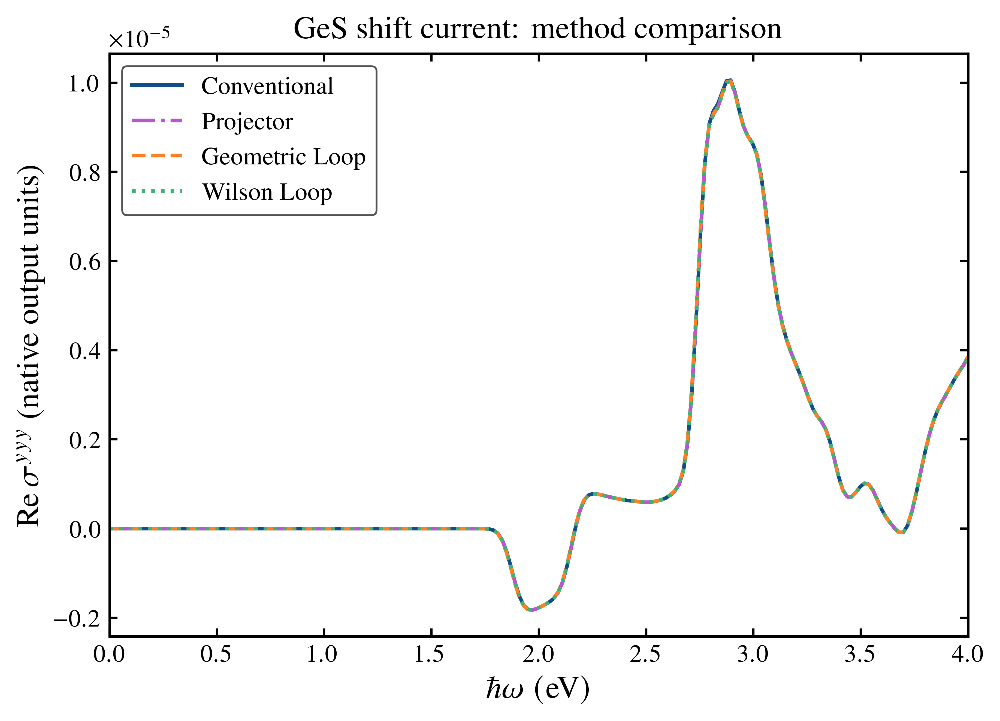
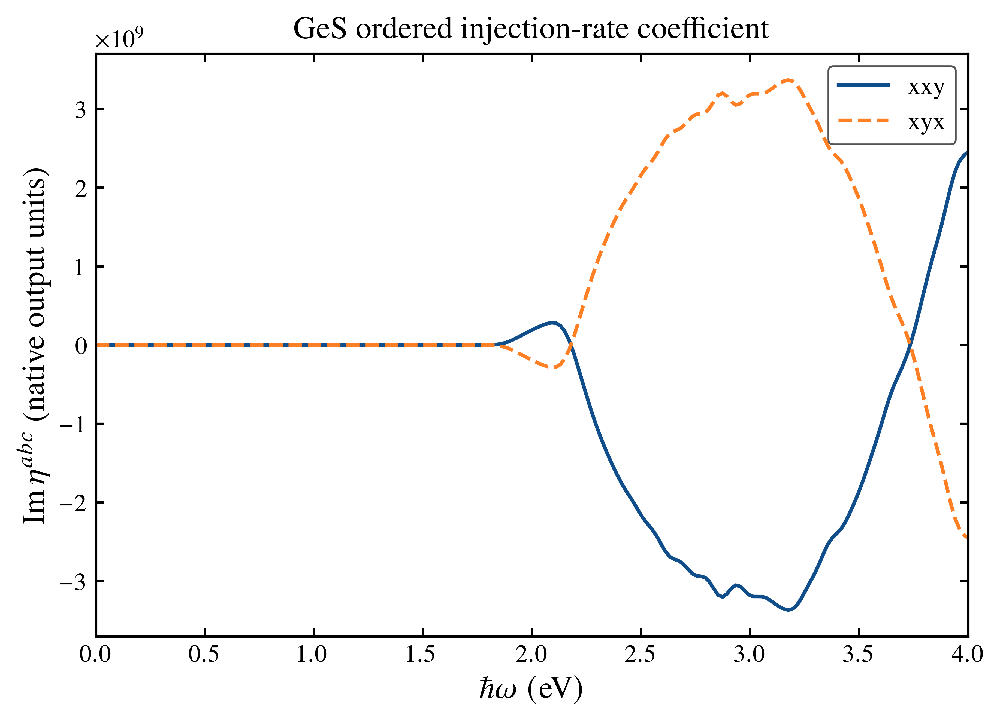

# 02 · Integral charge responses

## In this tutorial

- Distinguish the shift contribution from the injection coefficient.
- Connect optical matrix elements and energy selection to a frequency-dependent spectrum.
- Compare four shift-current methods and distinguish linear from circular optical channels.

## Physics and model

Shift current probes the displacement associated with an optical transition; injection current probes the change in current carried by the excited populations. They are distinct contributions, not two names for the same spectrum.

For the Conventional method, the stored charge-response kernels are

$$
K_{nm}^{abc,\mathrm{shift}}=-i\left(r_{nm}^{c;a}r_{mn}^{b}-r_{mn}^{b;a}r_{nm}^{c}\right),
$$

$$
K_{nm}^{abc,\mathrm{inj}}=\left(h_{mm}^{a}-h_{nn}^{a}\right)r_{nm}^{c}r_{mn}^{b}.
$$

Here $r_{nm}^{b}=i\langle u_{n\mathbf{k}}|\partial_{k_b}u_{m\mathbf{k}}\rangle$ is the Hamiltonian-gauge position matrix element, including the Wannier-basis position contribution. Following the WannierNLQG manuscript notation, $r_{nm}^{c;a}=\partial_{k_a}r_{nm}^{c}-i(r_{nn}^{a}-r_{mm}^{a})r_{nm}^{c}$ is its generalized derivative: $c$ is the position direction and $a$ after the semicolon is the derivative direction. The indices $a,b,c$ denote the current direction and the two optical-field directions. In this orthogonal Wannier model, $h_{nn}^{a}$ is the diagonal matrix element of the Hamiltonian derivative with respect to Cartesian $k_a$, in eV Å. It is an energy slope, before conversion to a physical velocity.

These are **kernels, not conductivities**: occupations, energy selection, physical prefactors, and integration normalization enter separately. The shift-kernel order follows directly by substituting $r_{mn}^{b}R_{mn}^{b;a}=i r_{mn}^{b;a}$ into $r_{mn}^{b}r_{nm}^{c}(R_{mn}^{b;a}-R_{nm}^{c;a})$. Band and optical-field labels must stay attached to their matrix elements. The expressions follow `ConventionalShiftCurrent.jl` and `ConventionalInjectionCurrent.jl` in WannierNLQG v1.2.0. In particular, the ordered-field injection-rate output does not include an external conjugate-frequency factor of two or a steady-state relaxation time.

For the current inputs, omitted `broadening_type` resolves to Gaussian. The energy-selection function has the form

$$
g_\eta(x)=\frac{\exp[-(x/\eta)^2]}{\sqrt{\pi}\eta}.
$$

Here $x$ is a photon-energy detuning and $\eta=0.06$ eV. This width is not a standard deviation; the Gaussian standard deviation is $\eta/\sqrt{2}$. The runtime also screens transitions, so this line shape alone is not a complete response formula.

The model is the GeS Wannier Hamiltonian in `Materials/GeS/model_tb.dat`; the four shift-current inputs also use the matching `Materials/GeS/operators.h5` bundle. See the [material setup guide](../../Materials/README.md) before running. A Hamiltonian alone does not establish the optical matrix elements needed by the calculation.

## Symmetry and polarization

The two optical indices are ordered: $b$ multiplies the positive-frequency field and $c$ the negative-frequency field. The real symmetric combination couples to linear polarization; the imaginary antisymmetric combination couples to helicity. Consequently, an imaginary component with $b=c$ is identically zero in the physical response tensor. A nonzero ordered array entry alone does not establish an allowed macroscopic response.

For a time-reversal-symmetric material at zero photon momentum, the integrated charge shift response can have a real symmetric part, while charge injection can have an imaginary antisymmetric part. The real charge-injection channel is forbidden: in particular, integrated injection yyy must vanish. In the GeS orthorhombic axes, the manuscript identifies the $C_{2v}$ operations $m_x$, $C_{2y}$, and $m_z$. These allow real shift yyy and, for in-plane fields, an imaginary charge-injection xxy component paired with the opposite xyx component. They do not permit a finite integrated charge-injection yyy.

The injection figure below therefore selects the allowed imaginary xxy and xyx components, rather than the forbidden real yyy channel. An imaginary response coefficient is not an imaginary measured current: contracting the antisymmetric pair with the complex field amplitudes gives the real helicity-dependent current-injection rate.

## Parameters

The [main input](inputs/shift_current_conventional.toml) is the executable specification. The companion inputs use the same sampling and occupation settings.

| Parameter | Value | Meaning |
| --- | --- | --- |
| spatial_dimension | 2 | Two-dimensional response calculation |
| k_mesh | [100, 100] | Momentum points along the two sampling directions |
| $\mu$, $T$ | −2.5 eV, 0 K | Fermi energy and electronic temperature |
| Photon energy | 0–4 eV, 200 points | Frequency axis expressed as photon energy |
| broadening | 0.06 eV | Gaussian energy width; broadening_type is omitted |
| fourier_backend | direct | Direct real-space Fourier evaluation |
| real_space_replica_policy | auto | Model replica treatment |
| Displayed shift component | Re yyy | Same tensor component for all four methods |
| Displayed injection components | Im xxy, Im xyx | Opposite ordered-field slots of the circular channel |
| finite_difference_step | 0.0001 Å⁻¹ | Cartesian reciprocal-space step for Projector and both loop methods |

## Run

From the repository root, check the inputs and run the Conventional shift case:

```bash
julia --project=.runtime/env scripts/run_group.jl 02 --check
julia --project=.runtime/env scripts/run_group.jl 02 --case=shift_current_conventional --output=.runtime/02-shift_current_conventional
```

Use a new output directory for each calculation. The check command inspects inputs and dependencies; it does not calculate a response.

Start with [shift_current_conventional](inputs/shift_current_conventional.toml). Other choices are [injection_current_conventional](inputs/injection_current_conventional.toml), [shift_current_projector](inputs/shift_current_projector.toml), [shift_current_geometric_loop](inputs/shift_current_geometric_loop.toml), [shift_current_wilson_loop](inputs/shift_current_wilson_loop.toml), replacing the case and output name in the command above.

## Read the figures

Redrawing these figures reads the supplied numerical tables; it does not run a response calculation. The four shift-current curves were computed together with WannierNLQG 1.2.0, the same GeS model/operator pair, and `real_space_replica_policy=auto`, on the 100 × 100 mesh and 200-point 0–4 eV energy grid listed above. The injection figure retains its separately recorded calculation with `real_space_replica_policy=input`; it was not part of this shift-current rerun. See the [calculation and figure records](reproduce.json) for their distinct provenance.

### 1. Shift current: four methods

<a href="figures/shift_current_methods.png"></a>

[Original PNG](figures/shift_current_methods.png)

Compare the four labeled curves for $\mathrm{Re}\,\sigma^{yyy}$ on the same native-unit scale. Conventional uses generalized position derivatives. Projector differentiates transported projectors with a central finite difference; it is not an analytic-derivative curve. Geometric loop and Wilson loop evaluate related geometric constructions through their own numerical routes.

On this common finite grid, the relative $L^2$ differences from Conventional are **0.342016% for Projector**, **0.371485% for Wilson loop**, and **0.800488% for Geometric loop**. Here the reported percentage is $100\,\lVert s_M-s_{\mathrm{C}}\rVert_2/\lVert s_{\mathrm{C}}\rVert_2$, where $s_M$ is the vector of real yyy values at all 200 photon energies and $\lVert x\rVert_2=\sqrt{\sum_j|x_j|^2}$. These are spectrum-wide differences, not maximum pointwise percentage errors. The [comparison record](../../manifests/shift_current_comparison.json) gives the numerical results.

This matched calculation measures agreement at one mesh and broadening; it does not establish convergence or independently certify the material response. Conventional is the comparison reference, not an independent correctness oracle. The three grouped methods use adjacent-gap chaining with a 0.002 eV response threshold: consecutive sorted eigenvalues join when their gap is below the threshold, including the implementation's numerical-equality safeguard. A chain can span more than 0.002 eV. Group weights do not average the individual transition energies or occupations. This response grouping does not replace the independent exact spectral guards or the 0.06 eV Gaussian width. [PDF](figures/shift_current_methods.pdf).

### 2. Circular injection: ordered field components

<a href="figures/integral_injection_current_conventional.png"></a>

[Original PNG](figures/integral_injection_current_conventional.png)

The curves show $\mathrm{Im}\,\eta^{xxy}$ and $\mathrm{Im}\,\eta^{xyx}$ in native ordered injection-rate units. The current flows along x, while exchanging the x/y optical slots reverses the sign. This antisymmetry is the circular-polarization channel allowed by the GeS symmetries above. No conjugate-frequency factor of two or relaxation time has been applied to these plotted coefficients. A physical injection rate requires contraction with the fields and the stated frequency-ordering convention; a steady-state current additionally requires a relaxation model. [PDF](figures/integral_injection_current_conventional.pdf).

## Plot saved results

Plotting uses the supplied numerical tables and does not run a material calculation. Select the figure and a new output directory:

```bash
python examples/02_integral_charge_responses/plot.py --figure=shift_current_methods --output=.runtime/plot-shift_current_methods
python examples/02_integral_charge_responses/plot.py --figure=integral_injection_current_conventional --output=.runtime/plot-integral_injection_current_conventional
```

## What to check

The available spectra are teaching examples, not a convergence study. Before quantitative use, converge the momentum mesh and broadening and check the model and operator requirements for the selected method. A comparison of Conventional, Projector, Geometric Loop and Wilson Loop must use the same physical and numerical settings. Neither visual agreement nor successful plotting establishes equivalence.

[Reproducibility](reproduce.json) records the figure inputs and calculation sources.

## Resolve the method comparison

The overlay is the primary comparison. The four individual views use the same energy axis and underlying tables:

```bash
python examples/02_integral_charge_responses/plot.py --figure=integral_shift_current_conventional --output=.runtime/sc-conventional
python examples/02_integral_charge_responses/plot.py --figure=integral_shift_current_projector --output=.runtime/sc-projector
python examples/02_integral_charge_responses/plot.py --figure=integral_shift_current_geometric_loop --output=.runtime/sc-geometric
python examples/02_integral_charge_responses/plot.py --figure=integral_shift_current_wilson_loop --output=.runtime/sc-wilson
```

Response groups join adjacent gaps below the stated threshold, including the numerical-equality safeguard; a connected group's total energy span can exceed that threshold. Grouping does not average energies or occupations. Exact spectral protections and the optical width remain separate. The comparison retains the full endpoint band selection and all intermediate bands. Differences at a fixed grid, finite loop or Projector step, and optical width are not an accuracy bound: refine these controls separately for a new quantitative use. In particular, broadening and momentum resolution cannot be traded for a method-dependent rescaling.

## References

- J. E. Sipe and A. I. Shkrebtii, “Second-order optical response in semiconductors,” *Physical Review B* **61**, 5337–5352 (2000). [DOI](https://doi.org/10.1103/PhysRevB.61.5337). Background for shift and injection optical responses.
