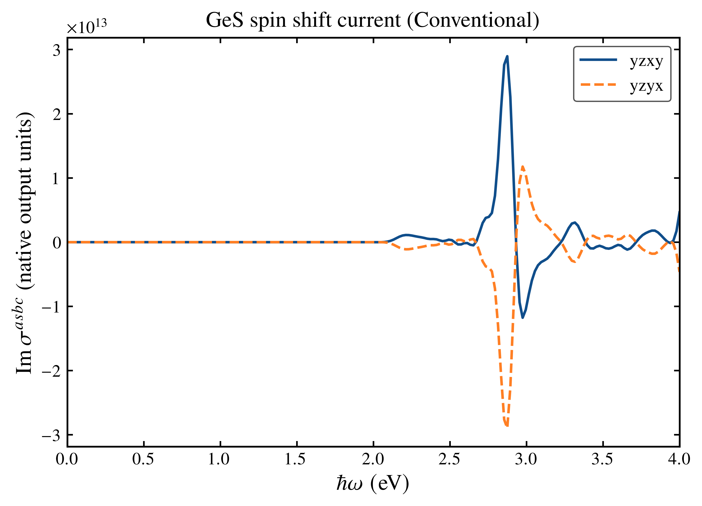
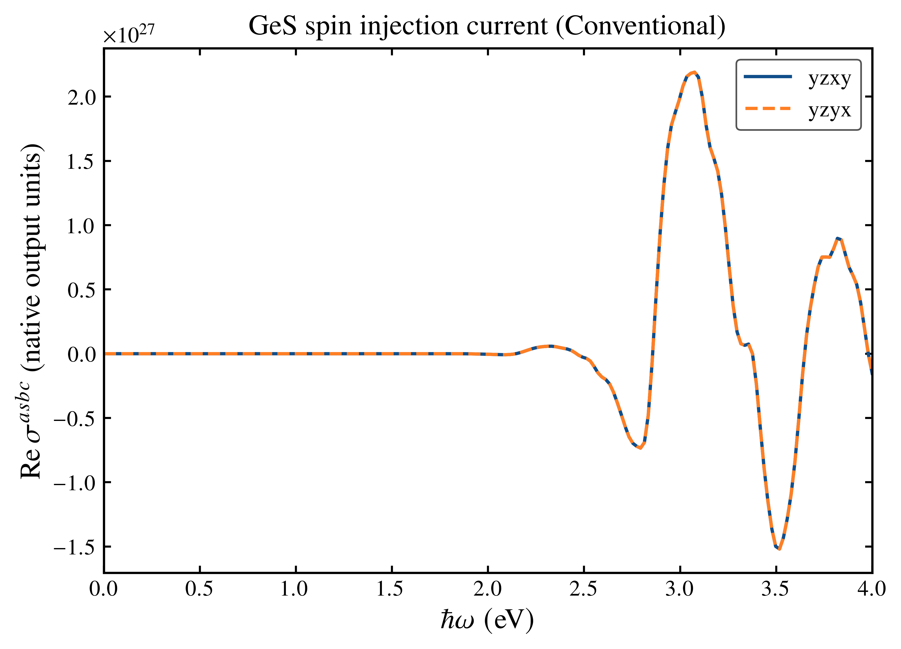

# 03 · Integral spin-current responses

## In this tutorial

- Distinguish the shift contribution from the injection coefficient.
- Connect optical matrix elements and energy selection to a frequency-dependent spectrum.
- Keep spin polarization, flow direction, and operator normalization distinct.

## Physics and model

A spin-current response distinguishes flow direction $`a`$, spin-polarization direction $`s`$, and optical-field directions $`b,c`$. To describe the stored kernel without mixing in physical-velocity units, write the symmetrized spin-current vertex as

```math
\mathcal{J}^{a,s}=\frac{1}{2}\left(V^a S^s+S^s V^a\right).
```

Here $`V^a`$ denotes the energy–length velocity vertex, in eV Å, before division by $`\hbar`$ to obtain a physical velocity. Accordingly, $`\mathcal{J}^{a,s}`$ retains energy–length times the supplied spin unit. The code assembles this vertex from energy derivatives and energy-weighted connection terms, then Hermitian-symmetrizes it; runtime response prefactors supply the remaining unit conversions. The anticommutator denotes the operator structure, not a prescription to multiply two truncated-band matrices instead of using the interpolated vertex.

$`S^s`$ is the spin matrix in the supplied operator convention, not an independently chosen normalization. WannierNLQG v1.2.0 labels the shift-spin operator convention as Pauli, with eigenvalues ±1. Keep the supplied operator normalization and runtime prefactors together; the anticommutator alone does not specify a conversion to physical angular-momentum units. With spin–orbit coupling, this conventional spin current is generally not a conserved current.

The Conventional injection kernel is

```math
K_{nm}^{asbc,\mathrm{inj}}=
\left(\mathcal{J}_{mm}^{a,s}-\mathcal{J}_{nn}^{a,s}\right)r_{nm}^{c}r_{mn}^{b},
```

Here $`\mathcal{J}`$ is the stored `spin_velocity.hamiltonian_gauge` vertex from `SpinVelocityMatrixElements.jl`, and $`r`$ is the Hamiltonian-gauge position matrix element in the manuscript convention, $`r_{nm}^{b}=i\langle u_{n\mathbf{k}}|\partial_{k_b}u_{m\mathbf{k}}\rangle`$, including the Wannier-basis position contribution. It measures the difference between the spin currents carried by two states, weighted by their optical matrix elements. Occupations, energy selection, physical prefactors, and integration normalization are applied separately. This is the stored kernel in `ConventionalInjectionSpinCurrent.jl`, not the final response coefficient.

The shift-spin response uses its own interpolated spin-current vertices and regularized energy denominators. It is not obtained by multiplying the charge shift current by a spin expectation value. Keep the matching operator bundle and the finite Wannier model window when interpreting either contribution.

For the current inputs, omitted `broadening_type` resolves to Gaussian. The energy-selection function has the form

```math
g_\eta(x)=\frac{\exp[-(x/\eta)^2]}{\sqrt{\pi}\eta}.
```

Here $`x`$ is a photon-energy detuning and $`\eta=0.06`$ eV. This width is not a standard deviation; the Gaussian standard deviation is $`\eta/\sqrt{2}`$. The runtime also screens transitions, so this line shape alone is not a complete response formula.

The model is the GeS Wannier Hamiltonian in `Materials/GeS/model_tb.dat` with its matching `Materials/GeS/operators.h5` bundle. See the [material setup guide](../../Materials/README.md) before running. A Hamiltonian alone does not establish the optical or spin-operator matrix elements needed by the calculation.

The numerical vertex uses a positive geometric width $`\eta_g=0.001`$ eV (`denominator_regularization`). The smooth connection factor $`\Delta/(\Delta^2+\eta_g^2)`$ and its complementary weight $`\eta_g^2/(\Delta^2+\eta_g^2)`$ are prepared together. This width is independent of the 0.06 eV optical Gaussian. No hard degeneracy threshold is used for these spin-current tasks.

## Symmetry and polarization

The two optical indices are ordered: $`b`$ multiplies the positive-frequency field and $`c`$ the negative-frequency field. The real symmetric combination couples to linear polarization; the imaginary antisymmetric combination couples to helicity. Consequently, an imaginary component with $`b=c`$ is identically zero in the physical response tensor. A nonzero ordered array entry alone does not establish an allowed macroscopic response.

Under time reversal, the real shift-spin channel is forbidden after complete Brillouin-zone integration; the real injection-spin channel is time-reversal even. This distinction does not remove spatial selection rules: the spin index is axial, transforming as $`\det(R)R`$, unlike the polar flow and field indices.

The GeS manuscript identifies the mirror $`m_z`$, which fixes each point of the $`k_z=0`$ plane. With all flow and field directions in-plane, spin-y changes sign under this mirror. Thus yyyy spin channels are mirror-forbidden if the model, operators, and selected subspaces preserve that symmetry. The real shift-spin yyyy channel is additionally forbidden by time reversal after integration; it is not selected for the main figures.

The figures instead select yzxy and yzyx: flow along y, spin polarization along z, and optical directions x/y in opposite orders. Under $`m_x`$, both the axial z spin and the single x field change sign, so their signs cancel. Under $`m_z`$, the axial z spin and all three in-plane polar directions are unchanged. Both slots therefore survive these GeS mirror constraints. Time reversal permits the imaginary antisymmetric shift-spin pair and the real symmetric injection-spin pair shown below. Symmetry permission does not by itself validate their numerical amplitudes.

## Parameters

The [main input](inputs/shift_spin_current_conventional.toml) is the executable specification. The companion inputs use the same sampling and occupation settings.

| Parameter | Value | Meaning |
| --- | --- | --- |
| spatial_dimension | 2 | Two-dimensional response calculation |
| k_mesh | [100, 100] | Momentum points along the two sampling directions |
| $`\mu`$, $`T`$ | −2.5 eV, 0 K | Fermi energy and electronic temperature |
| Photon energy | 0–4 eV, 200 points | Frequency axis expressed as photon energy |
| broadening | 0.06 eV | Gaussian energy width; broadening_type is omitted |
| fourier_backend | direct | Direct real-space Fourier evaluation |
| real_space_replica_policy | auto | Model replica treatment |
| Method | Conventional | Both supplied spin-response calculations |
| Displayed shift components | Im yzxy, Im yzyx | Flow y, spin z; antisymmetric optical slots |
| Displayed injection components | Re yzxy, Re yzyx | Flow y, spin z; symmetric optical slots |

## Run

The calculation snapshot and current-format model bindings are recorded in [reproduce.json](reproduce.json). These updated results use a development snapshot with the smooth spin-current prescription; the software version label alone does not select that prescription. Point `.runtime/env` to the recorded build before replay.


From the repository root, check the inputs and run the Conventional shift case:

```bash
julia --project=.runtime/env scripts/run_group.jl 03 --check
julia --project=.runtime/env scripts/run_group.jl 03 --case=shift_spin_current_conventional --output=.runtime/03-shift_spin_current_conventional
```

Use a new output directory for each calculation. The check command inspects inputs and dependencies; it does not calculate a response.

Start with [shift_spin_current_conventional](inputs/shift_spin_current_conventional.toml). Other choices are [injection_spin_current_conventional](inputs/injection_spin_current_conventional.toml), replacing the case and output name in the command above.

## Read the figures

These figures use supplied numerical data; redrawing them does not run the calculation input above.

### Shift spin-current spectrum

<a href="figures/integral_shift_spin_current_conventional.png"></a>

[Original PNG](figures/integral_shift_spin_current_conventional.png)

The Conventional result shows $`\mathrm{Im}\,\sigma^{yzxy}`$ and $`\mathrm{Im}\,\sigma^{yzyx}`$ in native output units. The two curves have opposite signs, as required for the antisymmetric optical slots. This is the time-reversal-allowed circular shift-spin channel: spin polarization z flows along y. The imaginary coefficient combines with the complex optical fields to give a real physical response; it is not itself an imaginary measured current. [PDF](figures/integral_shift_spin_current_conventional.pdf).

### Injection spin-current spectrum

<a href="figures/integral_injection_spin_current_conventional.png"></a>

[Original PNG](figures/integral_injection_spin_current_conventional.png)

The Conventional result shows the real yzxy and yzyx injection-spin coefficients in native output units. The two supplied curves coincide, consistent with symmetric optical slots in the time-reversal-allowed channel. They describe y-directed flow with z spin polarization and couple to the symmetric x/y field product. The scale and physical conversion must not be inferred from the shift-spin figure. No relaxation time or additional field-ordering factor is introduced by this plot; a steady-state interpretation requires the appropriate relaxation model. [PDF](figures/integral_injection_spin_current_conventional.pdf).

## Plot saved results

Plotting uses the supplied numerical tables and does not run a material calculation. Select the figure and a new output directory:

```bash
python examples/03_integral_spin_responses/plot.py --figure=integral_shift_spin_current_conventional --output=.runtime/plot-integral_shift_spin_current_conventional
python examples/03_integral_spin_responses/plot.py --figure=integral_injection_spin_current_conventional --output=.runtime/plot-integral_injection_spin_current_conventional
```

## What to check

The spectra use the selected GeS model and matching full operator bundle. They do not establish mesh or broadening convergence. Quantitative applications must also verify the operator convention and spin-orbit model; matching energy bands alone does not validate a spin-current response.

The supplied results were recomputed at the listed teaching mesh using a frozen v1.2.0 development candidate; its exact source identity is recorded in [Reproducibility](reproduce.json). This is a case update, not a claim of formal software promotion or material convergence.

## References

- J. E. Sipe and A. I. Shkrebtii, “Second-order optical response in semiconductors,” *Physical Review B* **61**, 5337–5352 (2000). [DOI](https://doi.org/10.1103/PhysRevB.61.5337). Background for shift and injection optical responses.
- J. Qiao, J. Zhou, Z. Yuan, and W. Zhao, “Calculation of intrinsic spin Hall conductivity by Wannier interpolation,” *Physical Review B* **98**, 214402 (2018). [DOI](https://doi.org/10.1103/PhysRevB.98.214402). Background for interpolating the spin-current operator, not a formula for these nonlinear spectra.
