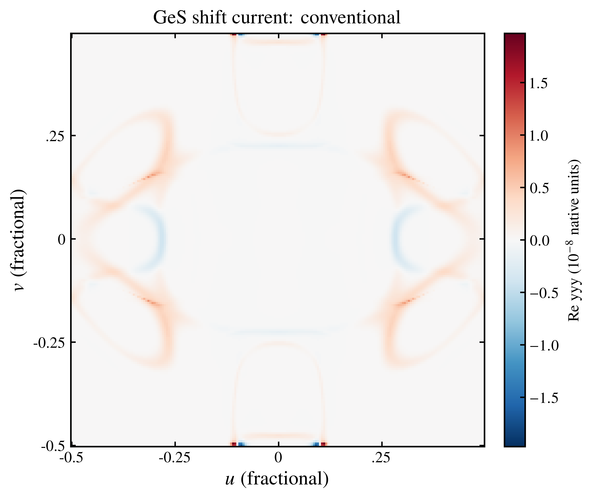
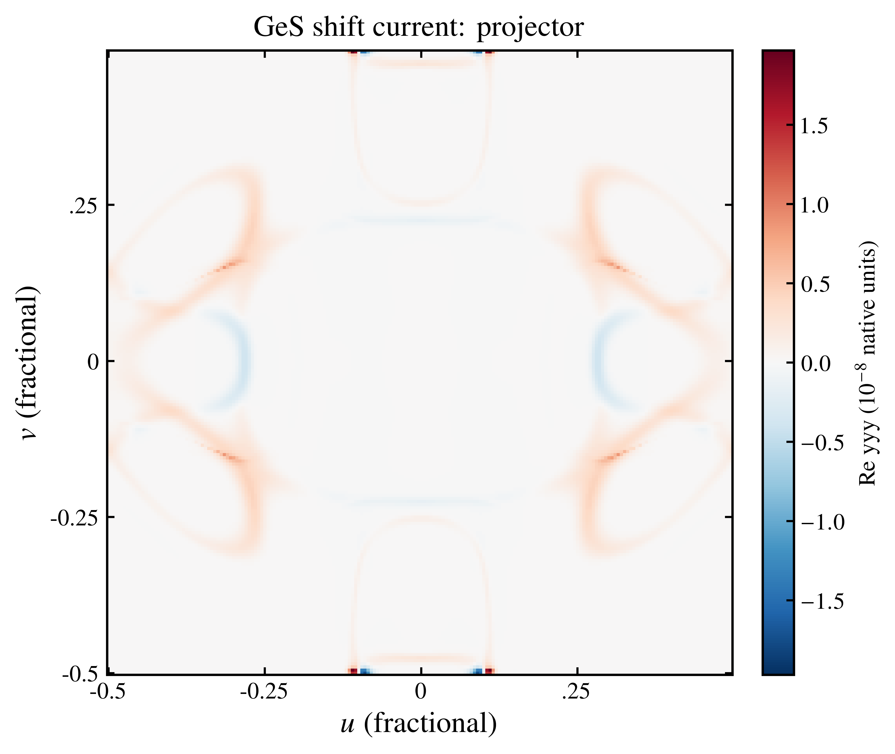
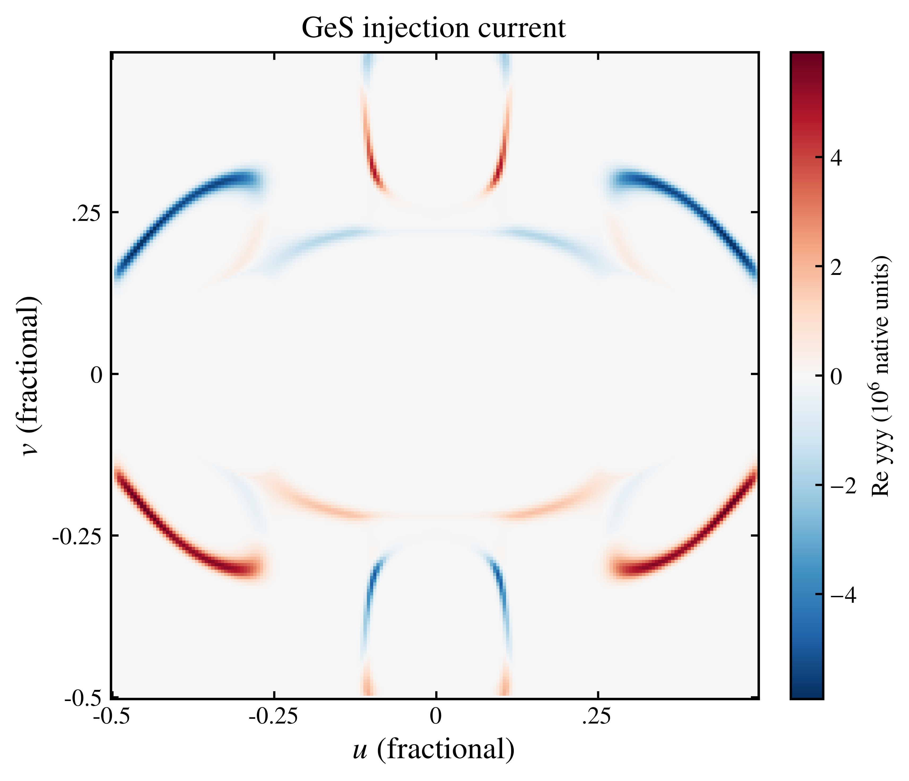

# 04 · Momentum-resolved charge responses

## In this tutorial

- Distinguish the shift contribution from the injection coefficient.
- Identify selected-band hot spots without confusing them with an integrated response.
- Read the selected yyy tensor component and compare methods at fixed parameters.

## Physics and model

Shift current probes the displacement associated with an optical transition; injection current probes the change in current carried by the excited populations. They are distinct contributions, not two names for the same spectrum.

For the Conventional method, the stored charge-response kernels are

```math
K_{nm}^{abc,\mathrm{shift}}=-i\left(r_{nm}^{c;a}r_{mn}^{b}-r_{mn}^{b;a}r_{nm}^{c}\right),
```

```math
K_{nm}^{abc,\mathrm{inj}}=\left(h_{mm}^{a}-h_{nn}^{a}\right)r_{nm}^{c}r_{mn}^{b}.
```

Here $`r_{nm}^{b}=i\langle u_{n\mathbf{k}}|\partial_{k_b}u_{m\mathbf{k}}\rangle`$ is the Hamiltonian-gauge position matrix element, including the Wannier-basis position contribution. Following the WannierNLQG manuscript notation, $`r_{nm}^{c;a}=\partial_{k_a}r_{nm}^{c}-i(r_{nn}^{a}-r_{mm}^{a})r_{nm}^{c}`$ is its generalized derivative: $`c`$ is the position direction and $`a`$ after the semicolon is the derivative direction. The indices $`a,b,c`$ denote the current direction and the two optical-field directions. In this orthogonal Wannier model, $`h_{nn}^{a}`$ is the diagonal matrix element of the Hamiltonian derivative with respect to Cartesian $`k_a`$, in eV Å. It is an energy slope, before conversion to a physical velocity.

These are **kernels, not conductivities**: occupations, energy selection, physical prefactors, and integration normalization enter separately. The shift-kernel order follows directly by substituting $`r_{mn}^{b}R_{mn}^{b;a}=i r_{mn}^{b;a}`$ into $`r_{mn}^{b}r_{nm}^{c}(R_{mn}^{b;a}-R_{nm}^{c;a})`$. Band and optical-field labels must stay attached to their matrix elements. The expressions follow `ConventionalShiftCurrent.jl` and `ConventionalInjectionCurrent.jl` in WannierNLQG v1.2.0. In particular, the ordered-field injection-rate output does not include an external conjugate-frequency factor of two or a steady-state relaxation time.

The sampling plane is specified in fractional reciprocal coordinates:

```math
\mathbf{k}_{\mathrm{frac}}(u,v)=\mathbf{o}+u\mathbf{b}_1+v\mathbf{b}_2.
```

The origin and two spanning vectors below define the plane; $`u,v`$ sample its periodic unit interval. The plots center this interval around zero. This is a display rearrangement, not a change to the underlying momentum points. The migrated shift-current inputs request source bands 1–20 and target bands 21–32 at the stated chemical potential and zero temperature. All 32 model bands remain available in intermediate-state sums. The supplied Conventional map used explicit endpoint lists; the supplied Projector, Geometric-loop and Wilson-loop maps used full-active-window execution that did not consume those lists. Their recorded sources and numerical arrays are retained; they are not results of the new group-filtered interface. The injection-current example keeps its separate transition selection.

The shift-current inputs use the unified GeS Wannier Hamiltonian in `Materials/GeS/model_tb.dat` and its matching `Materials/GeS/operators.h5` bundle. See the [material setup guide](../../Materials/README.md) before running. A Hamiltonian alone does not establish the optical matrix elements needed by the calculation.

## Symmetry and polarization

The two optical indices are ordered: $`b`$ multiplies the positive-frequency field and $`c`$ the negative-frequency field. The real symmetric combination couples to linear polarization; the imaginary antisymmetric combination couples to helicity. Consequently, an imaginary component with $`b=c`$ is identically zero in the physical response tensor. A nonzero ordered array entry alone does not establish an allowed macroscopic response.

For a time-reversal-symmetric material at zero photon momentum, the integrated charge shift response can have a real symmetric part, while charge injection can have an imaginary antisymmetric part. The real charge-injection channel is forbidden: in particular, integrated injection yyy must vanish. In the GeS orthorhombic axes, the manuscript identifies the $`C_{2v}`$ operations $`m_x`$, $`C_{2y}`$, and $`m_z`$. These allow real shift yyy and, for in-plane fields, an imaginary charge-injection xxy component paired with the opposite xyx component. They do not permit a finite integrated charge-injection yyy.

Time reversal relates opposite momenta, not each point to itself. A real injection-yyy contribution can be locally nonzero and odd between symmetry-related momenta; cancellation requires complete symmetry-related sampling and band subspaces closed under the operation. This local map must not be interpreted as a finite integrated injection-yyy response.

## Parameters

The [main input](inputs/shift_current_conventional.toml) is the executable specification. The companion inputs use the same sampling and occupation settings.

| Parameter | Value | Meaning |
| --- | --- | --- |
| spatial_dimension | 2 | Two-dimensional response calculation |
| k_mesh | [200, 200] | Momentum points along the two sampling directions |
| $`\mu`$, $`T`$ | −2.5 eV, 0 K | Fermi energy and electronic temperature |
| Photon energy | 3.0 eV | Energy selection |
| broadening | 0.06 eV | Gaussian energy width; broadening_type is omitted |
| fourier_backend | direct | Direct real-space Fourier evaluation |
| real_space_replica_policy | auto | Model replica treatment |
| origin | [0, 0, 0] | Fractional reciprocal coordinates |
| vector_1, vector_2 | [1, 0, 0], [0, 1, 0] | Fractional reciprocal spanning vectors |
| SC observable groups | [1–20], [21–32] | Source then target; all 32 bands remain in intermediate-state sums |
| component | [2,2,2] | yyy: current, field, field |
| finite_difference_step | 0.0001 Å⁻¹ | Cartesian reciprocal-space step for Projector and both loop methods |

For the Gaussian convention, the energy width $`\eta=0.06`$ eV is not its standard deviation: the latter is $`\eta/\sqrt{2}`$.

## Run

The migrated TOML inputs use `observable.kind = "kslice"` and ordered
`observable.groups = [valence, conduction]`. For the injection example this is
`groups = [[19,20], [21,22]]`; the shift-current inputs list all bands in the
two ranges above. These keys require the unified `BandSelection` reader.
Input conversion alone does not validate or replace a saved response array.
Explicit lists are never silently enlarged to complete a degeneracy block;
an inadmissible selection must be resolved before using it as a common-method
comparison. The recorded narrow Conventional injection example is not evidence
that this selection is admissible for every grouped method.


Current slice output is a local response coefficient with the route's physical
and cell prefactors, **without** a $`1/N_k`$ integration weight. On a matching
complete uniform Brillouin-zone mesh, integration averages these coefficients;
a generic slice alone is not a full three-dimensional Brillouin-zone integral.
The saved response tables and figures below instead contain the recorded
mesh-weighted cells: on their 200 × 200 mesh, sum those saved cells once. Do not
apply the saved tables' direct-sum rule or color scales to new output unchanged.
For identical kernels, endpoint contributions and cell conventions, the point
coefficient would be $`N_k`$ times a saved weighted cell ($`N_k=40{,}000`$ here).
This normalization relation alone does not establish old-to-new numerical
equivalence for the three non-Conventional selected-channel maps.

From the repository root, check the inputs and run the Conventional shift case:

```bash
julia --project=.runtime/env scripts/run_group.jl 04 --check
julia --project=.runtime/env scripts/run_group.jl 04 --case=shift_current_conventional --output=.runtime/04-shift_current_conventional
```

Use a new output directory for each calculation. The check command inspects inputs and dependencies; it does not calculate a response.

Start with [shift_current_conventional](inputs/shift_current_conventional.toml). Other choices are [injection_current_conventional](inputs/injection_current_conventional.toml), [shift_current_projector](inputs/shift_current_projector.toml), [shift_current_geometric_loop](inputs/shift_current_geometric_loop.toml), [shift_current_wilson_loop](inputs/shift_current_wilson_loop.toml), replacing the case and output name in the command above.

## Read the figures

The four shift-current maps were computed with the recorded public 1.2.0 source, the same unified GeS pair, and the original 200 × 200 grid. The injection map retains its separate recorded calculation. Redrawing a figure reads its supplied table and does not execute a response calculation.

### Momentum-resolved shift current

<table>
<tr>
<td><a href="figures/kslice_shift_current_conventional.png"></a><br>Conventional</td>
<td><a href="figures/kslice_shift_current_projector.png"></a><br>Projector</td>
</tr>
<tr>
<td><a href="figures/kslice_shift_current_geometric_loop.png"></a><br>Geometric Loop</td>
<td><a href="figures/kslice_shift_current_wilson_loop.png"></a><br>Wilson Loop</td>
</tr>
</table>


[Original PNG](figures/kslice_shift_current_conventional.png)

Read the sign and location of the full-band yyy contribution. The [Projector](figures/kslice_shift_current_projector.png), [Geometric loop](figures/kslice_shift_current_geometric_loop.png), and [Wilson loop](figures/kslice_shift_current_wilson_loop.png) maps use the same full-range color limit as Conventional. The displayed numbers equal the saved mesh-weighted native response multiplied by $`10^8`$; no cells are removed or clipped. A local peak does not by itself identify a converged contribution to the total current.

The following comparisons describe the four supplied arrays. The three non-Conventional maps used full-active-window execution, so these comparisons do not validate the new external-group filter. Their relative real-array $`L^2`$ differences from Conventional are 0.640% for Projector, 0.642% for Wilson loop and 2.408% for Geometric loop. Summing the local cells reproduces the same-grid, single-frequency native integrals to printed-output precision; do not divide by the number of points a second time. The corresponding signed integral differences are +0.0302%, +0.0304% and −0.0960%. Positive and negative local differences partly cancel, so integral agreement is not a pointwise correctness test. Finite-step, response-group and position-regularization prescriptions still differ; no formula, threshold or physical width was adjusted to force agreement.

For the recorded calculation source, the occupied/empty boundary was checked at all 40,000 original grid points: neither selection cuts a response block, and the occupation partition is unchanged. The minimum direct band-20/21 gap is 1.87824 eV, above the 0.002 eV response-group threshold. This checks the chosen finite-model band domain, not material or mesh convergence.

Projector uses transported finite-difference projectors, with the same $`h=10^{-4}`$ Å⁻¹ used by the loops. Projector and both loop methods use adjacent-gap response groups with threshold 0.002 eV; this threshold is separate from Gaussian broadening and exact spectral guards. [PDF](figures/kslice_shift_current_conventional.pdf).

### Momentum-resolved injection current

<a href="figures/kslice_injection_current_conventional.png"></a>

[Original PNG](figures/kslice_injection_current_conventional.png)

Locate the momentum regions contributing to the selected injection coefficient. Its colorbar scale differs from the shift-current figure, so the two color intensities must not be compared as absolute amplitudes. [PDF](figures/kslice_injection_current_conventional.pdf).

## Plot saved results

Plotting uses the supplied numerical tables and does not run a material calculation. Select the figure and a new output directory:

```bash
python examples/04_kslice_charge_responses/plot.py --figure=kslice_shift_current_conventional --output=.runtime/plot-kslice_shift_current_conventional
python examples/04_kslice_charge_responses/plot.py --figure=kslice_injection_current_conventional --output=.runtime/plot-kslice_injection_current_conventional
```

## What to check

These maps are examples with their stated band domains at one photon energy, not complete frequency spectra or converged transport coefficients. Periodic centering and transposition are display operations. Compare numerical arrays, band selections and color scales before drawing conclusions about agreement between methods.

[Reproducibility](reproduce.json) records the figure inputs and calculation sources.

## Compare the four local methods


These panels share the Conventional panel's complete signed color range and display factor. A common color is therefore a common value, rather than a separate per-method peak normalization. Hot spots reflect both transition resonance and optical geometry; positive and negative regions can cancel in the integral. A large local peak need not dominate the signed spectrum. The sum of each supplied local table reproduces its corresponding single-frequency integral with the recorded grid and execution settings; this is not evidence that the old non-Conventional paths applied an external band mask, or a comparison with an independently selected-band spectrum. No extra $`1/N_k`$ is applied to a table whose stored values already carry that factor.

The injection map is a separate transition-selected example and must not be used as the endpoint-band contract for the four full-band shift-current maps.

## References

- J. E. Sipe and A. I. Shkrebtii, “Second-order optical response in semiconductors,” *Physical Review B* **61**, 5337–5352 (2000). [DOI](https://doi.org/10.1103/PhysRevB.61.5337). Background for shift and injection optical responses.
