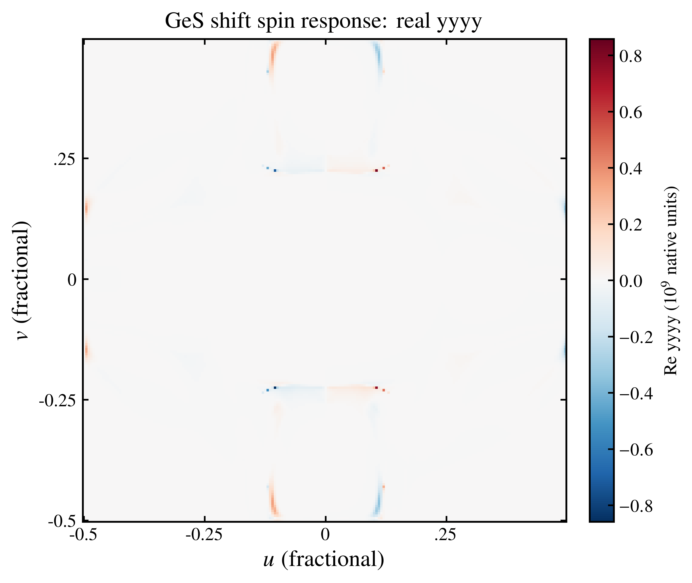
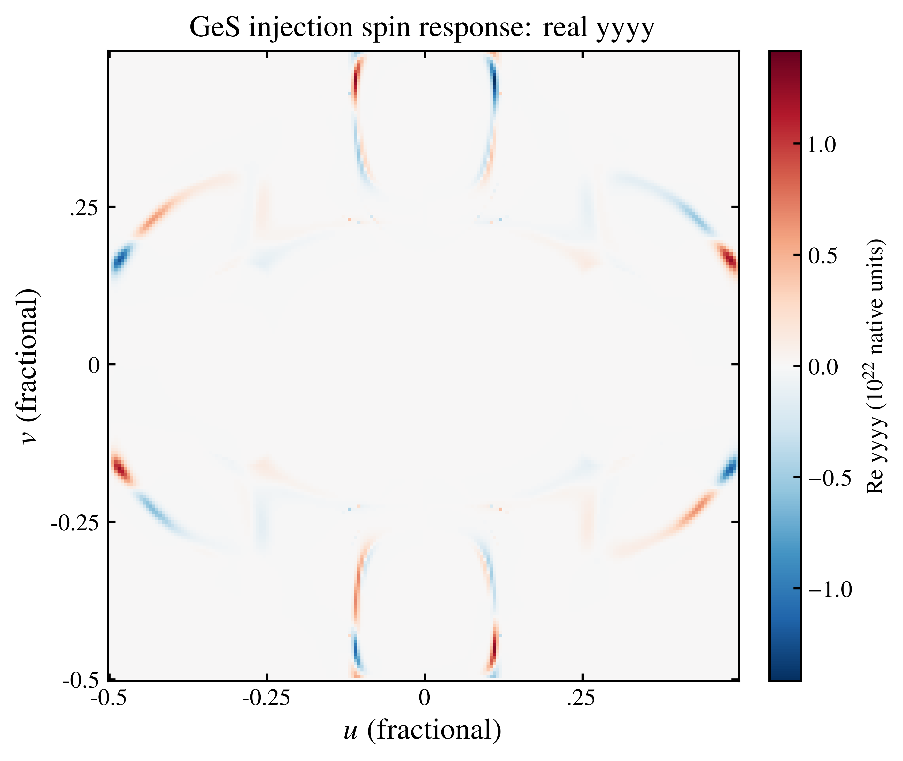
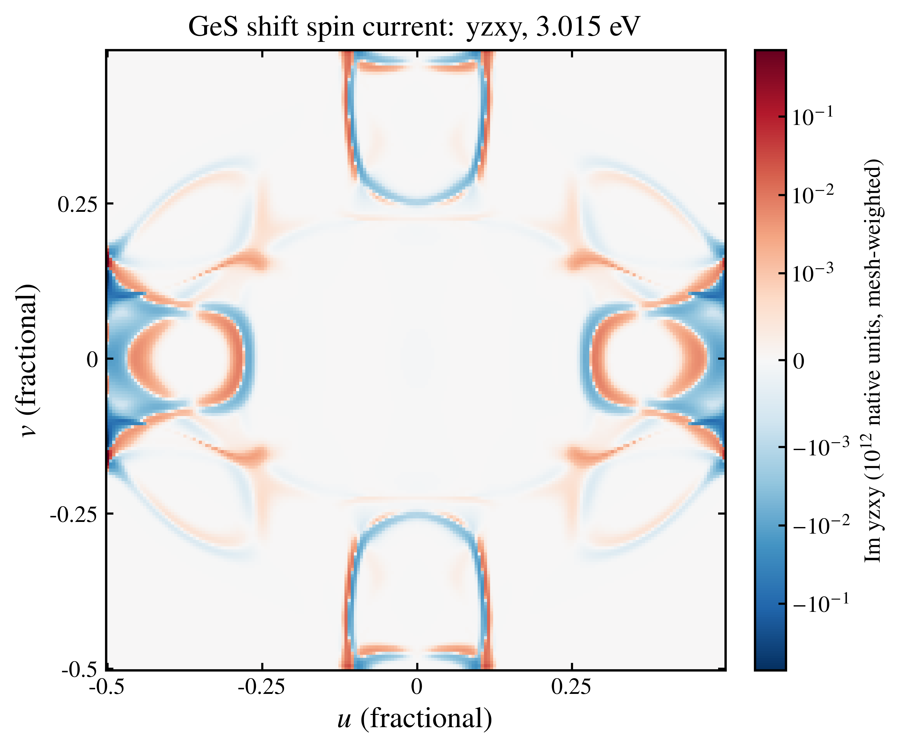
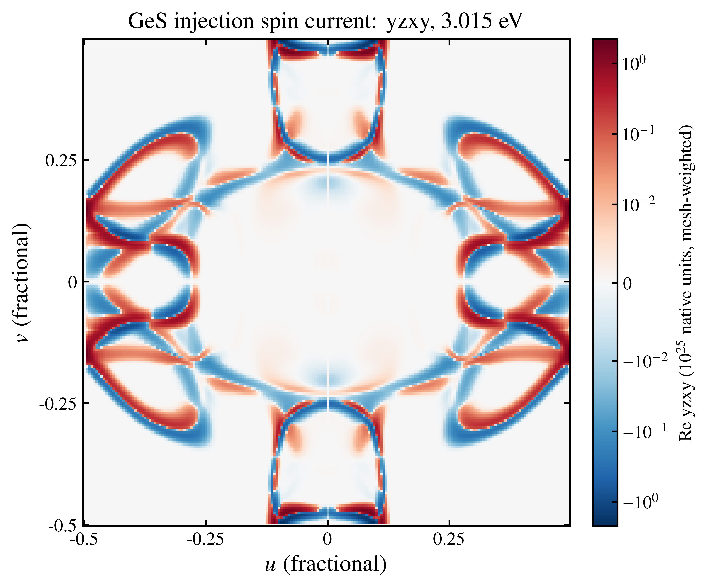

# 05 · Momentum-resolved spin-current responses

## In this tutorial

- Test a mirror-forbidden spin-current component on a momentum slice.
- Distinguish point-fixing mirror constraints from opposite-momentum time-reversal relations.
- Interpret residual arrays without relabeling them as allowed spin photocurrents.
- Compare symmetry-allowed spin-current maps with independently evaluated integrals.

## Physics and model

The yyyy maps are **symmetry-null diagnostics**: they select y-directed flow, y spin polarization, and two y-directed fields. Their stored residuals are retained and are not asserted to be exactly zero. The additional yzxy maps show a different, symmetry-allowed spin response on the same reciprocal plane.

A spin-current response distinguishes flow direction $`a`$, spin-polarization direction $`s`$, and optical-field directions $`b,c`$. To describe the stored kernel without mixing in physical-velocity units, write the symmetrized spin-current vertex as

```math
\mathcal{J}^{a,s}=\frac{1}{2}\left(V^a S^s+S^s V^a\right).
```

Here $`V^a`$ denotes the energy–length velocity vertex, in eV Å, before division by $`\hbar`$ to obtain a physical velocity. Accordingly, $`\mathcal{J}^{a,s}`$ retains energy–length times the supplied spin unit. The code assembles this vertex from energy derivatives and energy-weighted connection terms, then Hermitian-symmetrizes it; runtime response prefactors supply the remaining unit conversions. The anticommutator denotes the operator structure, not a prescription to multiply two truncated-band matrices instead of using the interpolated vertex.

$`S^s`$ is the spin matrix in the supplied operator convention, not an independently chosen normalization. WannierNLQG v1.2.0 labels the shift-spin operator convention as Pauli, with eigenvalues ±1. Keep the supplied operator normalization and runtime prefactors together; the anticommutator alone does not specify a conversion to physical angular-momentum units. With spin–orbit coupling, this conventional spin current is generally not a conserved current.

The Conventional injection kernel is

```math
K_{nm}^{asbc,\mathrm{inj}}=
\left(\mathcal{J}_{mm}^{a,s}-\mathcal{J}_{nn}^{a,s}\right)r_{nm}^{c}r_{mn}^{b},
```

Here $`\mathcal{J}`$ is the stored `spin_velocity.hamiltonian_gauge` vertex from `SpinVelocityMatrixElements.jl`, and $`r`$ is the Hamiltonian-gauge position matrix element in the manuscript convention, $`r_{nm}^{b}=i\langle u_{n\mathbf{k}}|\partial_{k_b}u_{m\mathbf{k}}\rangle`$, including the Wannier-basis position contribution. It measures the difference between the spin currents carried by two states, weighted by their optical matrix elements. Occupations, energy selection, physical prefactors, and integration normalization are applied separately. This is the stored kernel in `ConventionalInjectionSpinCurrent.jl`, not the final response coefficient.

The shift-spin response uses its own interpolated spin-current vertices and regularized energy denominators. It is not obtained by multiplying the charge shift current by a spin expectation value. Keep the matching operator bundle and the finite Wannier model window when interpreting either contribution.

The sampling plane is specified in fractional reciprocal coordinates:

```math
\mathbf{k}_{\mathrm{frac}}(u,v)=\mathbf{o}+u\mathbf{b}_1+v\mathbf{b}_2.
```

The origin and two spanning vectors below define the plane; $`u,v`$ sample its periodic unit interval. The plots center this interval around zero. This is a display rearrangement, not a change to the underlying momentum points. For the yyyy diagnostic maps, the selected transition subspaces are valence [19,20] and conduction [21,22]; those maps are not the complete band-summed Brillouin-zone integral. The allowed-channel selection is specified separately below.

The model is the GeS Wannier Hamiltonian in `Materials/GeS/model_tb.dat` with its matching `Materials/GeS/operators.h5` bundle. See the [material setup guide](../../Materials/README.md) before running. A Hamiltonian alone does not establish the optical or spin-operator matrix elements needed by the calculation.

## Symmetry and polarization

The two optical indices are ordered: $`b`$ multiplies the positive-frequency field and $`c`$ the negative-frequency field. The real symmetric combination couples to linear polarization; the imaginary antisymmetric combination couples to helicity. Consequently, an imaginary component with $`b=c`$ is identically zero in the physical response tensor. A nonzero ordered array entry alone does not establish an allowed macroscopic response.

Under time reversal, the real shift-spin channel is forbidden after complete Brillouin-zone integration; the real injection-spin channel is time-reversal even. This distinction does not remove spatial selection rules: the spin index is axial, transforming as $`\det(R)R`$, unlike the polar flow and field indices.

The GeS manuscript identifies the mirror $`m_z`$, which fixes each point of the $`k_z=0`$ plane. With all flow and field directions in-plane, spin-y changes sign under this mirror. Thus both displayed yyyy spin channels are mirror-forbidden if the model, operators, and selected subspaces preserve that symmetry. The real shift-spin yyyy channel is additionally forbidden by time reversal after integration. These displayed channels must be treated as symmetry diagnostics rather than examples of finite allowed spin photocurrents.

A generic time-reversal constraint need not make a local map vanish; it can instead relate opposite momenta. Here the additional point-fixing mirror is decisive for yyyy. Selected subspaces must be symmetry-closed before applying that local selection rule; a residual is not, by itself, evidence that the physical crystal breaks the mirror.

The numerical vertex uses a positive geometric width $`\eta_g=0.001`$ eV (`denominator_regularization`). The smooth connection factor $`\Delta/(\Delta^2+\eta_g^2)`$ and its complementary weight $`\eta_g^2/(\Delta^2+\eta_g^2)`$ are prepared together. This width is independent of the 0.06 eV optical Gaussian. No hard degeneracy threshold is used for these spin-current tasks.

## Parameters for the yyyy diagnostic

The [main input](inputs/shift_spin_current_conventional.toml) is the executable specification. The companion inputs use the same sampling and occupation settings.

| Parameter | Value | Meaning |
| --- | --- | --- |
| spatial_dimension | 2 | Two-dimensional response calculation |
| k_mesh | [200, 200] | Momentum points along the two sampling directions |
| $`\mu`$, $`T`$ | −2.5 eV, 0 K | Fermi energy and electronic temperature |
| Photon energy | 3.0 eV | Energy selection |
| broadening | 0.06 eV | Gaussian energy width; broadening_type is omitted |
| fourier_backend | direct | Direct real-space Fourier evaluation |
| real_space_replica_policy | auto | Model replica treatment |
| origin | [0, 0, 0] | Fractional reciprocal coordinates |
| vector_1, vector_2 | [1, 0, 0], [0, 1, 0] | Fractional reciprocal spanning vectors |
| valence, conduction | [19,20], [21,22] | Selected band subspaces; not a full band sum |
| component | [2,2,2,2] | yyyy: flow, spin, field, field |

For the Gaussian convention, the energy width $`\eta=0.06`$ eV is not its standard deviation: the latter is $`\eta/\sqrt{2}`$.

## Run

The migrated slice inputs use `observable.kind = "kslice"` and ordered
`observable.groups = [valence, conduction]`. The yyyy diagnostics retain
`groups = [[19,20], [21,22]]`; the allowed-channel inputs explicitly list source
bands 1–20 and target bands 21–32. The selected external contribution is a sum,
not a pair average, and all 32 bands remain available as intermediate states.
The two integral inputs omit `groups` and retain their total-response meaning.
Changing these input keys does not recalculate the supplied tables or change
their recorded source. No explicit list is automatically expanded to complete
a response degeneracy block.


Current slice output is a local response coefficient without a $`1/N_k`$ mesh
weight. Preserve the native spin convention and physical/cell prefactors.
For matching complete uniform Brillouin-zone sampling, its integral uses the
mesh average. The saved maps below use the recorded weighted-cell convention
and their original color scales; they are not unmodified current point-density
output. Do not sum new point coefficients directly or apply an extra mesh
division to the saved weighted cells. A general plane is not, by itself, a
full three-dimensional Brillouin-zone integration rule.

The supplied yyyy diagnostics were calculated with the recorded development snapshot `59c1148608cfab76e02bb1e24b6a9fd87f3b1daa688266f3344c6fd5cc0306a3`; the allowed-channel maps and integrals were calculated with source manifest `725ed8e66c2429c94bf299a5db38343ee39ba8b94d3c7fb0f35de6dae791d230`. Both used the smooth spin-current prescription; the version label alone does not select that prescription. Exact bindings and calculation records remain in [reproduce.json](reproduce.json). These hashes identify the saved results, not compatible readers for the migrated input keys. To run the migrated inputs, use a qualified build with the unified `BandSelection` reader; replaying an original recorded calculation instead requires its matching archived input and build.


From the repository root, check the inputs and run the Conventional shift case:

```bash
julia --project=.runtime/env scripts/run_group.jl 05 --check
julia --project=.runtime/env scripts/run_group.jl 05 --case=shift_spin_current_conventional --output=.runtime/05-shift_spin_current_conventional
```

Use a new output directory for each calculation. The check command inspects inputs and dependencies; it does not calculate a response. With the recorded current-source environment and matching GeS bindings, the reference-profile group check resolved all eight inputs with none unavailable. This entry check does not recalculate or replace the older yyyy results.

Start with [shift_spin_current_conventional](inputs/shift_spin_current_conventional.toml). Other choices are [injection_spin_current_conventional](inputs/injection_spin_current_conventional.toml), replacing the case and output name in the command above.

## Read the figures

These two figures use the supplied single-component yyyy arrays. Redrawing them does not execute the input above, and these arrays cannot be relabeled as another spin component.

### Momentum-resolved shift spin current

<a href="figures/kslice_shift_spin_current_conventional.png"></a>

[Original PNG](figures/kslice_shift_spin_current_conventional.png)

Inspect the retained real yyyy array as a mirror-symmetry diagnostic, not an allowed local spin-current contribution. Read the numerical scale from the colorbar; the plotted subset is not the total integrated spin current. [PDF](figures/kslice_shift_spin_current_conventional.pdf).

### Momentum-resolved injection spin current

<a href="figures/kslice_injection_spin_current_conventional.png"></a>

[Original PNG](figures/kslice_injection_spin_current_conventional.png)

Inspect the retained real yyyy injection array as a mirror-symmetry diagnostic on the same momentum slice. Its display scale and physical normalization differ from those of the shift response. [PDF](figures/kslice_injection_spin_current_conventional.pdf).

## Allowed yzxy response and integral check

For yzxy, the flow is along y, the spin polarization is along z, and the ordered optical fields are x then y. The z spin is axial and even under the point-fixing $`m_z`$ mirror, so this channel is not forbidden by the mirror argument for yyyy. The imaginary antisymmetric shift response and real symmetric injection response are allowed; the reversed field order is yzyx. An allowed channel need not be nonzero at every momentum, and the displayed response is not a proof of convergence.

The calculation uses the same GeS model and operator bundle, direct Fourier evaluation, 0 K, $`\mu=-2.5`$ eV, Gaussian width 0.06 eV and geometric width 0.001 eV. Here the 200 × 200 periodic plane is evaluated at **600/199 eV** (approximately 3.0150754 eV), an actual frequency point in the chapter 03 spectrum, not the 3.0 eV used by the yyyy diagnostics. Chapter 03 uses a 100 × 100 mesh, whereas the maps and matched single-frequency integrals here use 200 × 200; amplitudes from those two meshes are not asserted to be identical. The transition maps include valence bands 1–20 and conduction bands 21–32, with all 32 model bands available as intermediate states. This selected transition sum must be distinguished from an unrestricted band sum.

The saved complex map entries already include the mesh weight. For the recorded source, this 2D model and the matched full periodic mesh, the sum of those saved cells agrees with the separately evaluated full-band Brillouin-zone integral at the same frequency and parameters; do not divide by 40,000 again. The selected transition sum agrees in this case, but this equality should be rechecked if the occupation partition or frequency changes. Fractional $`u,v`$ are coordinates along the two reciprocal spanning vectors, not Cartesian momenta. The signed-log color scales preserve the sign and show values in the indicated scaled native response units, not a dimensionless curvature.

<a href="figures/kslice_shift_spin_yzxy_fullbands.png"></a>

Imaginary yzxy shift-spin contribution. [PDF](figures/kslice_shift_spin_yzxy_fullbands.pdf). Its complex map sum and printed integral differ by $`1.16\times10^{-9}`$ relative.

<a href="figures/kslice_injection_spin_yzxy_fullbands.png"></a>

Real yzxy injection-spin contribution. [PDF](figures/kslice_injection_spin_yzxy_fullbands.pdf). The corresponding difference is $`1.34\times10^{-8}`$ relative. The imaginary shift map is antisymmetric and the real injection map symmetric under exchanging xy and yx, with relative L2 residuals $`3.18\times10^{-12}`$ and $`2.99\times10^{-11}`$ respectively. These are consistency checks at one mesh and frequency, not convergence tests.

The [shift yzxy input](inputs/shift_yzxy_kslice.toml), [shift yzyx input](inputs/shift_yzyx_kslice.toml), [injection yzxy input](inputs/injection_yzxy_kslice.toml), [injection yzyx input](inputs/injection_yzyx_kslice.toml), [shift integral input](inputs/shift_integral.toml), and [injection integral input](inputs/injection_integral.toml) specify all six runs. For example:

```bash
julia --project=.runtime/env scripts/run_group.jl 05 --case=shift_yzxy_kslice --output=.runtime/05-shift-yzxy
julia --project=.runtime/env scripts/run_group.jl 05 --case=shift_integral --output=.runtime/05-shift-integral
```

The response arrays and integral tables, input identities, execution source and material hashes are recorded in [reproduce.json](reproduce.json). No new self-consistent electronic structure or Wannierization is implied by this response calculation.

## Plot saved results

Plotting uses the supplied numerical tables and does not run a material calculation. Select the figure and a new output directory:

```bash
python examples/05_kslice_spin_responses/plot.py --figure=kslice_shift_spin_current_conventional --output=.runtime/plot-kslice_shift_spin_current_conventional
python examples/05_kslice_spin_responses/plot.py --figure=kslice_injection_spin_current_conventional --output=.runtime/plot-kslice_injection_spin_current_conventional
python examples/05_kslice_spin_responses/plot.py --figure=kslice_shift_spin_yzxy_fullbands --output=.runtime/plot-shift-yzxy
python examples/05_kslice_spin_responses/plot.py --figure=kslice_injection_spin_yzxy_fullbands --output=.runtime/plot-injection-yzxy
```

## What to check

Nonzero residuals in these forbidden-channel maps require reviewing model and operator symmetry, closure of the selected band subspaces, and numerical settings. They do not prove a physical mirror-breaking spin photocurrent, nor does a visually small map prove a strict symmetry zero.

Chapter 03 presents symmetry-allowed yzxy/yzyx spectra; the maps above are independently calculated at one of its frequency points. Redraw commands do not recalculate the response. A steady-state interpretation of an injection coefficient requires a specified relaxation model.

The yyyy diagnostic results were computed using a recorded v1.2.0 development snapshot. The allowed-channel maps and integrals were computed separately with the current source identity recorded in [Reproducibility](reproduce.json). Neither set establishes material or mesh convergence.

## References

- J. E. Sipe and A. I. Shkrebtii, “Second-order optical response in semiconductors,” *Physical Review B* **61**, 5337–5352 (2000). [DOI](https://doi.org/10.1103/PhysRevB.61.5337). Background for shift and injection optical responses.
- J. Qiao, J. Zhou, Z. Yuan, and W. Zhao, “Calculation of intrinsic spin Hall conductivity by Wannier interpolation,” *Physical Review B* **98**, 214402 (2018). [DOI](https://doi.org/10.1103/PhysRevB.98.214402). Background for interpolating the spin-current operator, not a formula for these nonlinear spectra.
