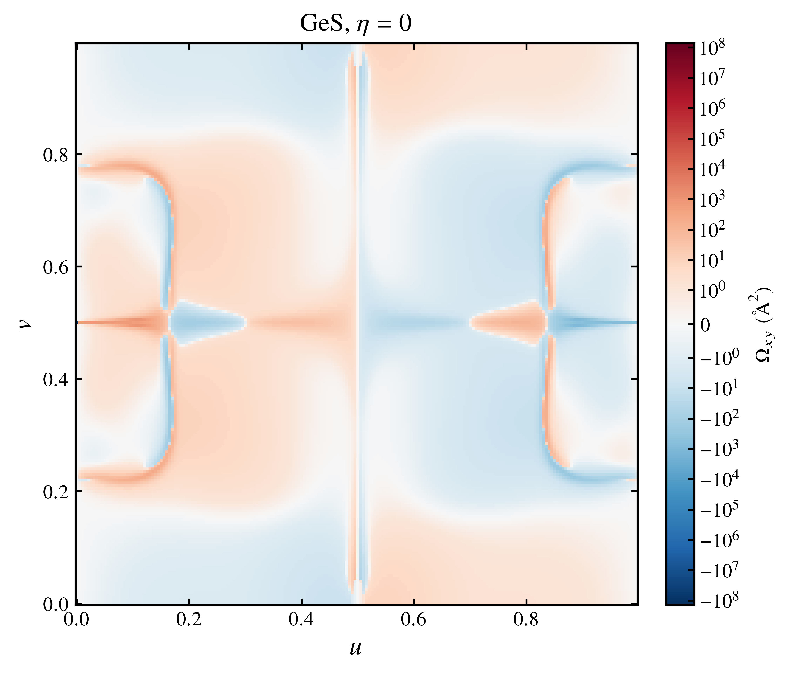
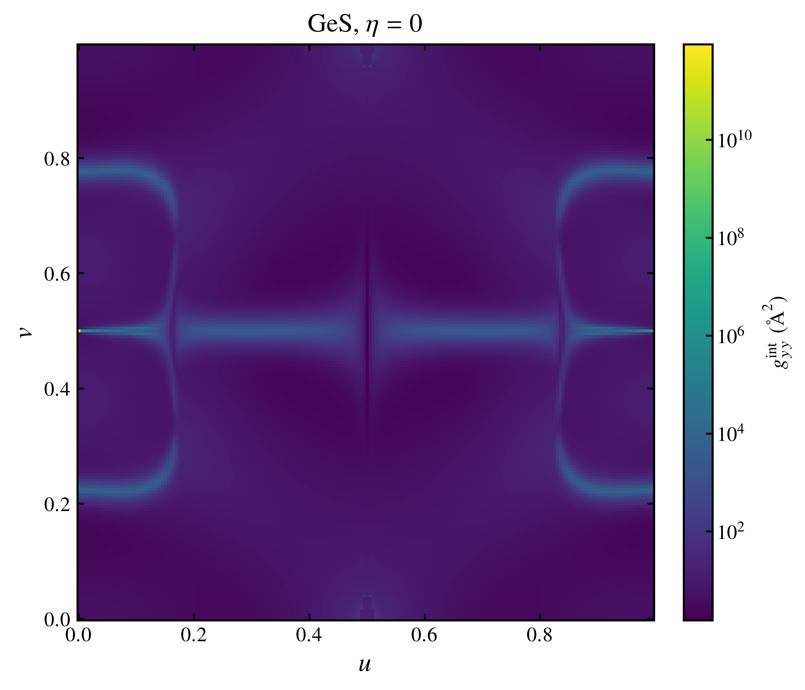
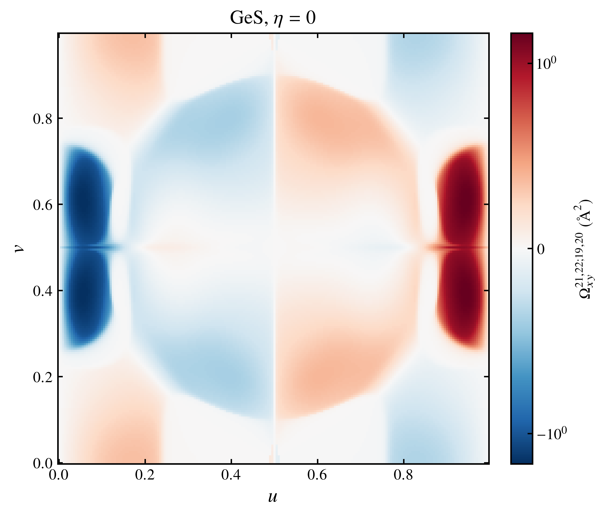
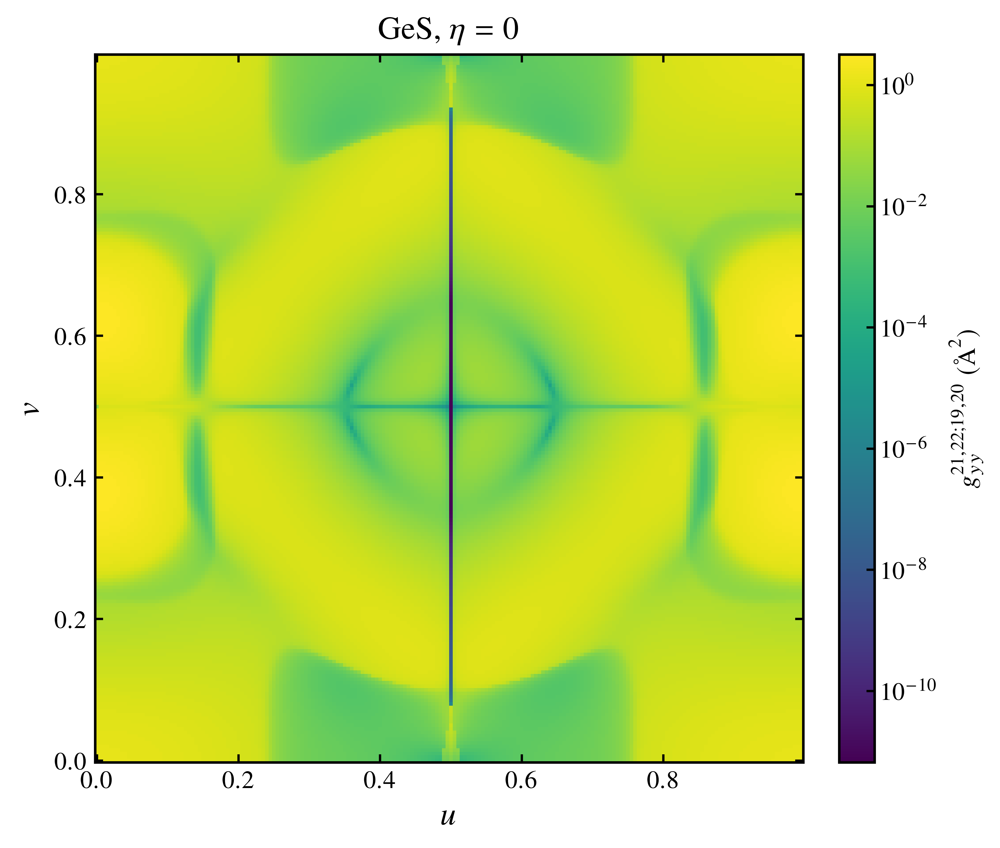

# Pairwise quantum geometry

## In this tutorial

- Relate Berry curvature and quantum metric to the quantum geometric tensor.
- Distinguish a subspace trace from a selected interband pair average.
- Read geometric maps without treating them as integrated conductivities.

## Physics and model

Use the Hamiltonian-gauge position-matrix convention $r^a_{nm}=i\langle u_n|\partial_a u_m\rangle$, with $\partial_a=\partial/\partial k_a$ and Cartesian $k_a$ in Å$^{-1}$. For an isolated normalized Bloch state,

$$
Q_n^{ab}=\langle\partial_a u_n|(1-|u_n\rangle\langle u_n|)|\partial_bu_n\rangle,
\qquad
g_n^{ab}=\operatorname{Re}Q_n^{ab},
\qquad
\Omega_n^{ab}=-2\operatorname{Im}Q_n^{ab}.
$$

The real symmetric part measures quantum-state distance; the imaginary antisymmetric part describes geometric phase. Both have units Ų. The sign of $\Omega$ follows from the stated $+i$ convention.

For the example subspace $S=\{19,20\}$, let $T$ be its complement inside the Wannier window. The subspace kernels use

$$
g_{S,\mathrm{int}}^{ab}=\operatorname{Re}\sum_{n\in S,m\in T}r^a_{nm}r^b_{mn},
\qquad
\Omega_S^{ab}=\operatorname{Re}\operatorname{Tr}_S\mathcal F^{ab}
-2\operatorname{Im}\sum_{n\in S,m\in T}r^a_{nm}r^b_{mn}.
$$

$\mathcal F^{ab}$ is the ambient Wannier-frame curvature expressed in the Hamiltonian eigenframe. The sums exclude transitions within $S$ and are **not divided by its rank**. The metric example selects only the internal finite-window contribution.

The interband examples instead average over two disjoint groups $A,B$:

$$
Q_{A,B}^{ab}=\frac{1}{N_A N_B}\sum_{m\in A,n\in B}r^a_{mn}r^b_{nm},
\quad
g_{A,B}^{ab}=\tfrac12\operatorname{Re}(Q_{A,B}^{ab}+Q_{A,B}^{ba}),
\quad
\Omega_{A,B}^{ab}=-\operatorname{Im}(Q_{A,B}^{ab}-Q_{A,B}^{ba}).
$$

$N_A,N_B$ are the group sizes. A pair average is not directly comparable in magnitude to a subspace trace. These geometry kernels in `ConventionalQuantumGeometry.jl` contain no occupation factor, optical resonance, or Brillouin-zone integration.

## Parameters

The examples use the GeS model at Materials/GeS/model_tb.dat. Metric examples also specify Materials/GeS/operators.h5. The replica policy is auto.

Set up the shared files with the [material data guide](../../Materials/README.md).

| Parameter | Value | Meaning |
| --- | --- | --- |
| Selected subspace | [19,20] | Ordinary trace, not a rank average |
| Berry / metric component | [1,2] / [2,2] | xy curvature / yy metric |
| Interband groups | first=[21,22], second=[19,20] | Four ordered pairs |
| denominator_regularization | 0.0 eV | No denominator smoothing |
| include_external | false for quantum_metric | Internal metric only |
| k mesh | [200,200] | Two-dimensional k-slice |
| Slice coordinates | origin=[0,0,0]; vectors [1,0,0], [0,1,0] | Fractional reciprocal-space sampling plane |
| Fourier backend | direct | Evaluation of the real-space model |

## Run

From the repository root, check the inputs, then run either example into a new output directory:

```bash
julia --project=.runtime/env scripts/run_group.jl 06 --check
julia --project=.runtime/env scripts/run_group.jl 06 --case=berry_curvature_conventional --output=.runtime/berry_curvature_conventional
julia --project=.runtime/env scripts/run_group.jl 06 --case=quantum_metric_conventional --output=.runtime/quantum_metric_conventional
```

The check command does not calculate the response. Use a fresh output directory for each run.

Open [Berry curvature](inputs/berry_curvature_conventional.toml) or [quantum metric](inputs/quantum_metric_conventional.toml) to inspect the complete inputs. The [interband Berry](inputs/interband_berry_curvature_conventional.toml) and [interband metric](inputs/interband_quantum_metric_conventional.toml) inputs let you examine a selected group-pair contribution.

## Read the figures

The figures below use the supplied example data. Redrawing them does not execute the calculation inputs above.

### Berry curvature

<a href="figures/kslice_berry_curvature_conventional.png"></a>

The map shows the xy component in square angstroms. Its signed-log color scale distinguishes positive and negative values while compressing their dynamic range. Read the color bar before comparing the strength of two regions. [Original PNG](figures/kslice_berry_curvature_conventional.png) · [PDF](figures/kslice_berry_curvature_conventional.pdf).

### Internal quantum metric

<a href="figures/kslice_quantum_metric_conventional.png"></a>

The yy component uses a positive-log color scale and has units of square angstroms. Compare its spatial structure with the Berry map, rather than comparing colors between the two different scales. The internal contribution shown here is not the total metric. [Original PNG](figures/kslice_quantum_metric_conventional.png) · [PDF](figures/kslice_quantum_metric_conventional.pdf).

## Redraw and check

Redraw either core figure into a new directory:

```bash
python examples/06_qg_pairwise/plot.py --figure=kslice_berry_curvature_conventional --output=.runtime/plot-kslice_berry_curvature_conventional
python examples/06_qg_pairwise/plot.py --figure=kslice_quantum_metric_conventional --output=.runtime/plot-kslice_quantum_metric_conventional
```

After reading the maps, switch to an interband input and identify which band-group selection changed. Ask whether a localized feature belongs to the full selected subspace or to one interband contribution.

With zero denominator regularization, sharp features near small gaps require mesh convergence tests. The displayed peak heights are not established converged values. A k-space map alone does not determine a Hall or optical conductivity; those responses require the appropriate occupations, weights, and integration.

[Reproducibility](reproduce.json)

## Interband geometry

<a href="figures/kslice_interband_berry_curvature_conventional.png"></a>

[PDF](figures/kslice_interband_berry_curvature_conventional.pdf)

<a href="figures/kslice_interband_quantum_metric_conventional.png"></a>

[PDF](figures/kslice_interband_quantum_metric_conventional.pdf)

Both interband maps have units Ų. Their ordered transition groups and pair average differ from the subspace trace in the first two maps: for groups of sizes $N_A,N_B$, the displayed pair quantity includes $1/(N_A N_B)$, whereas a subspace trace is not divided by its rank. Compare spatial patterns only after matching these definitions. A pair-resolved feature is not the occupied-band Hall curvature, and its integral needs the response-specific occupations and weights.

```bash
python examples/06_qg_pairwise/plot.py --figure=kslice_interband_berry_curvature_conventional --output=.runtime/interband-berry
python examples/06_qg_pairwise/plot.py --figure=kslice_interband_quantum_metric_conventional --output=.runtime/interband-metric
```

## References

- J. P. Provost and G. Vallée, “Riemannian structure on manifolds of quantum states,” *Communications in Mathematical Physics* **76**, 289–301 (1980). [DOI](https://doi.org/10.1007/BF02193559). Foundation of the quantum-state metric.
- M. V. Berry, “Quantal phase factors accompanying adiabatic changes,” *Proceedings of the Royal Society A* **392**, 45–57 (1984). [DOI](https://doi.org/10.1098/rspa.1984.0023). Background for geometric phase.
