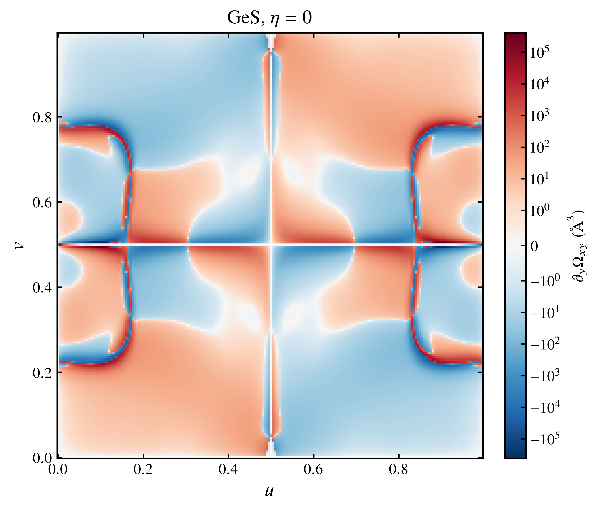
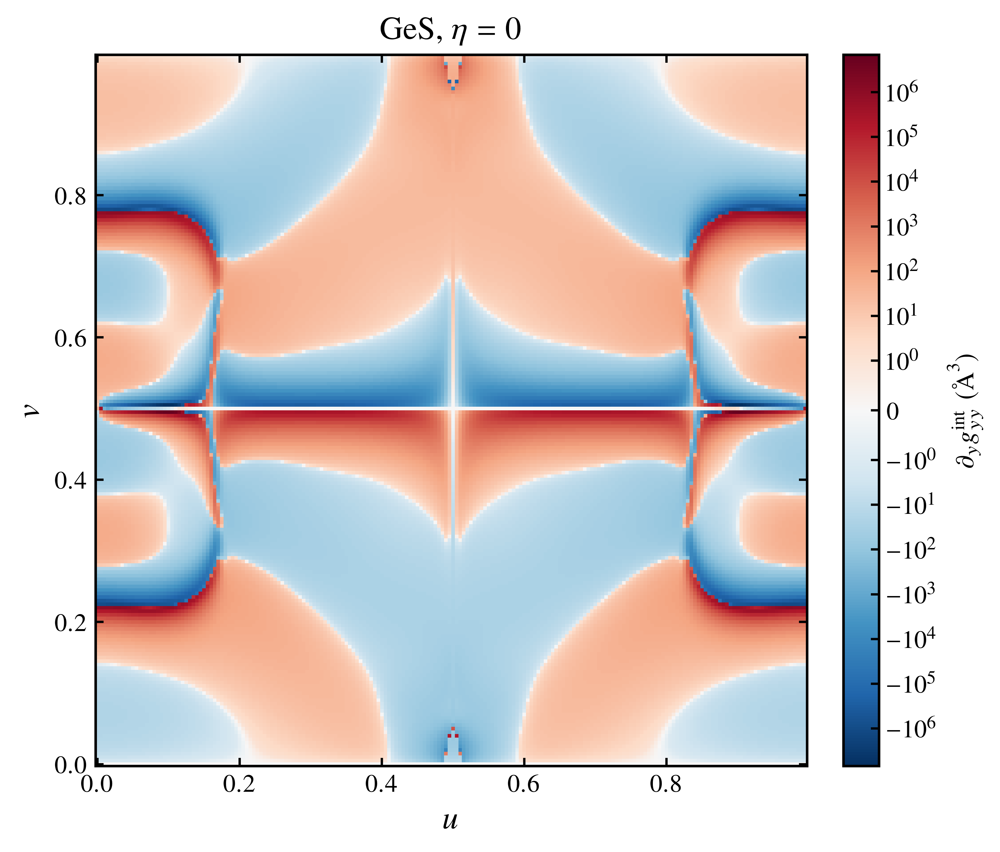
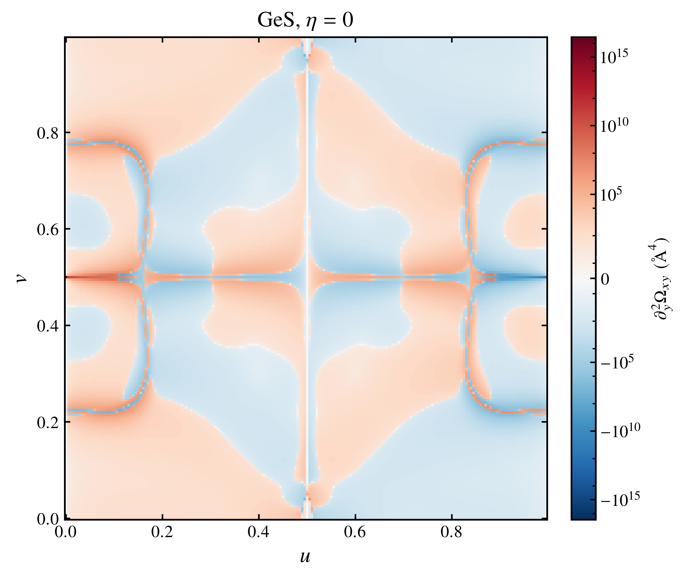
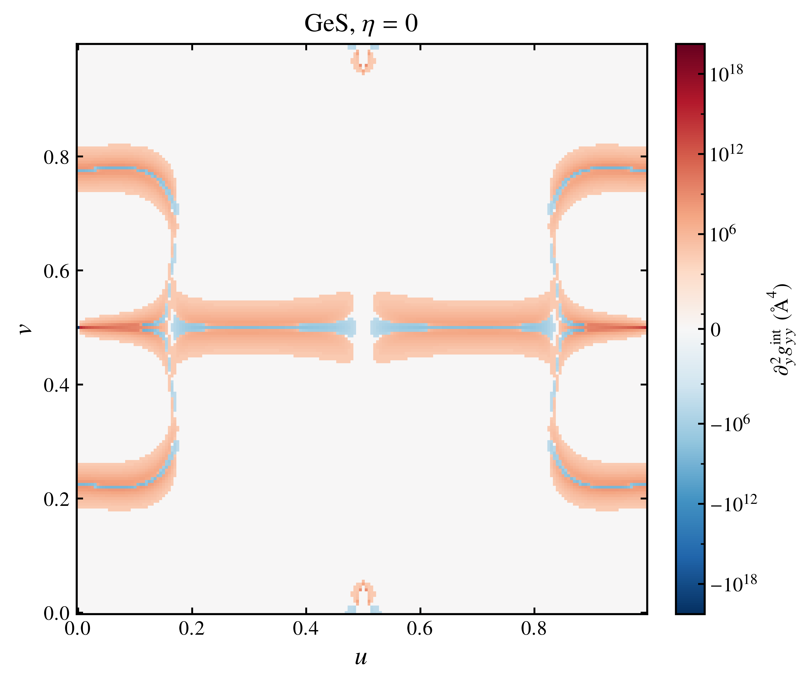

# Momentum derivatives of quantum geometry

## In this tutorial

- Connect dipoles and quadrupoles to momentum derivatives.
- Keep derivative indices and physical units explicit.
- Test finite-difference step and k-mesh resolution separately.

## Physics and model

A derivative emphasizes where geometry changes, rather than simply where it is large. Write $\partial_c=\partial/\partial k_c$, with Cartesian $k_c$ in Å$^{-1}$. For a selected subspace,

$$
\text{Dipoles:}\quad \partial_c\Omega_S^{ab},\ \partial_c g_S^{ab},
\qquad
\text{Quadrupoles:}\quad \partial_c\partial_d\Omega_S^{ab},\ \partial_c\partial_d g_S^{ab}.
$$

The component arrays place the geometry indices first and derivatives last: [a,b,c] for a dipole and [a,b,c,d] for a quadrupole. Thus [1,2,2] means the $y$ derivative of $\Omega^{xy}$. The underlying geometry has units Ų; its first and second derivatives have units ų and Å⁴.

The finite-difference kernels use Cartesian displacement $h$:

$$
\partial_c F(\mathbf k)\simeq
\frac{F(\mathbf k+h\mathbf e_c)-F(\mathbf k-h\mathbf e_c)}{2h},
\qquad
\partial_c^2 F(\mathbf k)\simeq
\frac{F(\mathbf k+h\mathbf e_c)-2F(\mathbf k)+F(\mathbf k-h\mathbf e_c)}{h^2}.
$$

$F$ is a selected curvature or metric component and $\mathbf e_c$ a Cartesian unit vector. Mixed derivatives use a four-corner stencil. The implementation converts Cartesian displacements into fractional-coordinate offsets; $h$ is not a reciprocal-lattice fraction.

The first-kind quantum Christoffel quantity is

$$
\Gamma_{r;lj}=\tfrac12\left(\partial_j g_{lr}+\partial_l g_{rj}-\partial_r g_{lj}\right).
$$

Its input order is [r,l,j] and its units are ų. For [2,2,2], it is one half of the $y$ derivative of $g_{yy}$. No inverse metric is applied. The derivative kernels in `QuantumGeometryDerivatives.jl` fix these stencils and index conventions. The metric-related inputs here differentiate the internal metric.

These local maps omit occupations and Brillouin-zone integration. They are not yet a nonlinear Hall coefficient or a magnetization response.

## Parameters

All examples use Materials/GeS/model_tb.dat with replica policy auto. Metric-related examples also request Materials/GeS/operators.h5 and set include_external=false.

Set up the shared files with the [material data guide](../../Materials/README.md).

| Parameter | Value | Meaning |
| --- | --- | --- |
| Selected subspace | [19,20] | Trace geometry, excluding intra-subspace transitions |
| Berry / metric dipole | [1,2,2] / [2,2,2] | Last index is the derivative direction |
| Berry / metric quadrupole | [1,2,2,2] / [2,2,2,2] | Last two indices are derivative directions |
| Christoffel component | [2,2,2] | Order [r,l,j] |
| finite_difference_step | 0.0001 Å⁻¹ | Cartesian displacement h |
| denominator_regularization | 0.0 eV | Distinct from the step |
| include_external | false for metric-related inputs | Internal metric derivatives |
| k mesh | [200,200] | Two-dimensional k-slice |
| Slice coordinates | origin=[0,0,0]; vectors [1,0,0], [0,1,0] | Fractional reciprocal-space sampling plane |
| Fourier backend | direct | Evaluation of the real-space model |

## Run

From the repository root, check the inputs, then run either example into a new output directory:

```bash
julia --project=.runtime/env scripts/run_group.jl 07 --check
julia --project=.runtime/env scripts/run_group.jl 07 --case=berry_curvature_dipole_conventional --output=.runtime/berry_curvature_dipole_conventional
julia --project=.runtime/env scripts/run_group.jl 07 --case=quantum_metric_dipole_conventional --output=.runtime/quantum_metric_dipole_conventional
```

The check command does not calculate the response. Use a fresh output directory for each run.

Start with [Berry curvature dipole](inputs/berry_curvature_dipole_conventional.toml) and [quantum metric dipole](inputs/quantum_metric_dipole_conventional.toml). Their component arrays are [1,2,2] and [2,2,2], respectively. The [Berry quadrupole](inputs/berry_curvature_quadrupole_conventional.toml), [metric quadrupole](inputs/quantum_metric_quadrupole_conventional.toml), and [Christoffel](inputs/quantum_christoffel_symbol_conventional.toml) inputs extend this exercise.

## Read the figures

The figures below use the supplied example data. Redrawing them does not execute the calculation inputs above.

### Berry curvature derivative

<a href="figures/kslice_berry_curvature_dipole_conventional.png"></a>

The displayed derivative is labeled as the y derivative of the xy Berry curvature, in cubic angstroms. Use its sign changes to distinguish increasing and decreasing regions. The signed-log scale is not a linear measure of the contrast. [Original PNG](figures/kslice_berry_curvature_dipole_conventional.png) · [PDF](figures/kslice_berry_curvature_dipole_conventional.pdf).

### Internal metric derivative

<a href="figures/kslice_quantum_metric_dipole_conventional.png"></a>

The map displays the y derivative of the internal yy metric, also in cubic angstroms. Although a diagonal metric is nonnegative, its derivative can have either sign. Compare this map with the metric map in Chapter 06 to understand the difference between magnitude and variation. [Original PNG](figures/kslice_quantum_metric_dipole_conventional.png) · [PDF](figures/kslice_quantum_metric_dipole_conventional.pdf).

## Redraw and check

Redraw either core figure into a new directory:

```bash
python examples/07_qg_multipoles/plot.py --figure=kslice_berry_curvature_dipole_conventional --output=.runtime/plot-kslice_berry_curvature_dipole_conventional
python examples/07_qg_multipoles/plot.py --figure=kslice_quantum_metric_dipole_conventional --output=.runtime/plot-kslice_quantum_metric_dipole_conventional
```

Try reducing the finite-difference step and increasing the k mesh separately, writing each calculation to a new directory. A stable derivative should not depend strongly on either choice within the accuracy you need.

Zero regularization and small gaps can produce very sharp features. Derivatives amplify numerical error, particularly at second order; the plotted peaks are not established converged values. Metric-related results here omit external contributions. Do not infer a large measurable transport response from a large local derivative alone.

[Reproducibility](reproduce.json)

## Second derivatives and the metric connection

<a href="figures/kslice_berry_curvature_quadrupole_conventional.png"></a>

[PDF](figures/kslice_berry_curvature_quadrupole_conventional.pdf)

<a href="figures/kslice_quantum_metric_quadrupole_conventional.png"></a>

[PDF](figures/kslice_quantum_metric_quadrupole_conventional.pdf)

<a href="figures/kslice_quantum_christoffel_symbol_conventional.png"></a>

[PDF](figures/kslice_quantum_christoffel_symbol_conventional.pdf)

The quadrupoles have units Å⁴ and the first-kind Christoffel symbol has units ų. For the shown component, $\Gamma_{y;yy}=\tfrac12\partial_y g_{yy}$; it is not the connection obtained after multiplying by an inverse metric. First and second differences amplify short-scale structure and numerical noise differently. The supplied peak heights are finite-step, finite-grid results, so a sharper quadrupole does not by itself establish a stronger physical response. Keep the Cartesian step, the selected subspace and the momentum mesh separate when testing stability.

```bash
python examples/07_qg_multipoles/plot.py --figure=kslice_berry_curvature_quadrupole_conventional --output=.runtime/berry-quadrupole
python examples/07_qg_multipoles/plot.py --figure=kslice_quantum_metric_quadrupole_conventional --output=.runtime/metric-quadrupole
python examples/07_qg_multipoles/plot.py --figure=kslice_quantum_christoffel_symbol_conventional --output=.runtime/christoffel
```

## References

- I. Sodemann and L. Fu, “Quantum Nonlinear Hall Effect Induced by Berry Curvature Dipole in Time-Reversal Invariant Materials,” *Physical Review Letters* **115**, 216806 (2015). [DOI](https://doi.org/10.1103/PhysRevLett.115.216806). Physical context for the occupation-weighted integrated dipole.
- J. P. Provost and G. Vallée, “Riemannian structure on manifolds of quantum states,” *Communications in Mathematical Physics* **76**, 289–301 (1980). [DOI](https://doi.org/10.1007/BF02193559). Geometric background for the metric.
