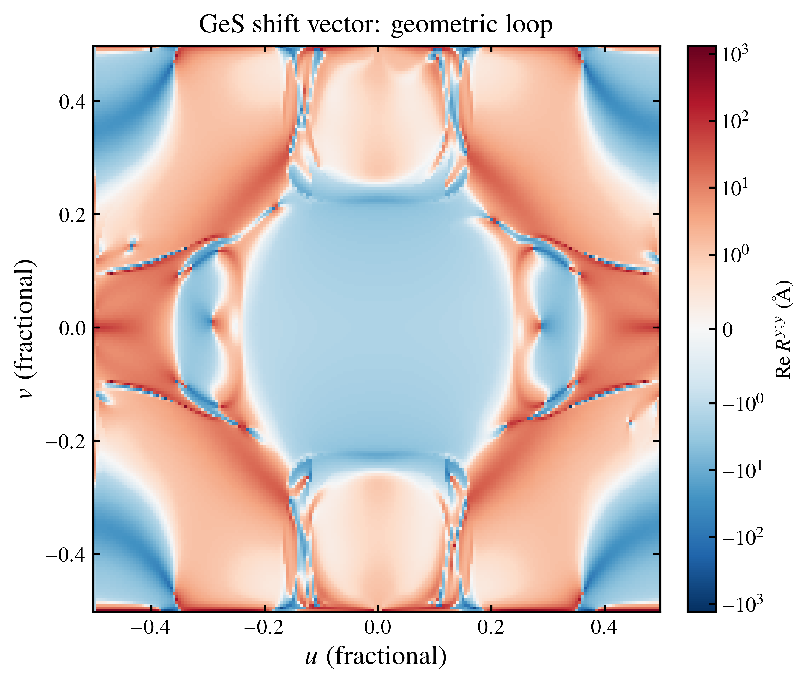
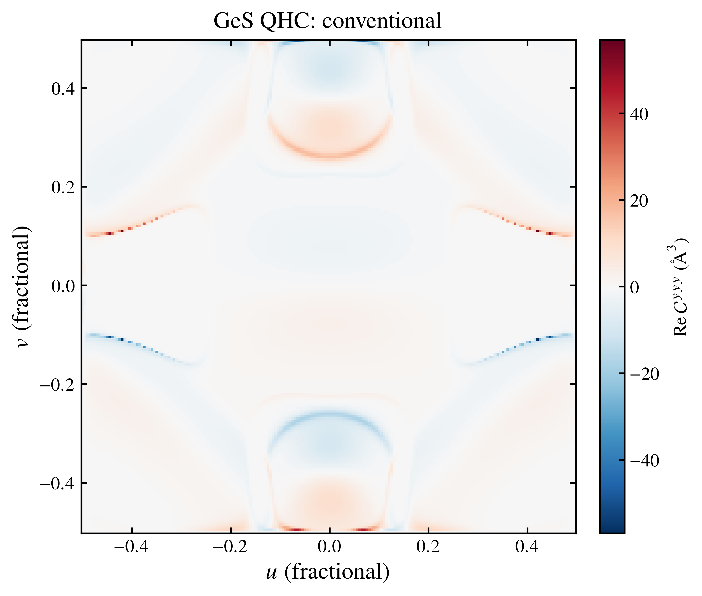
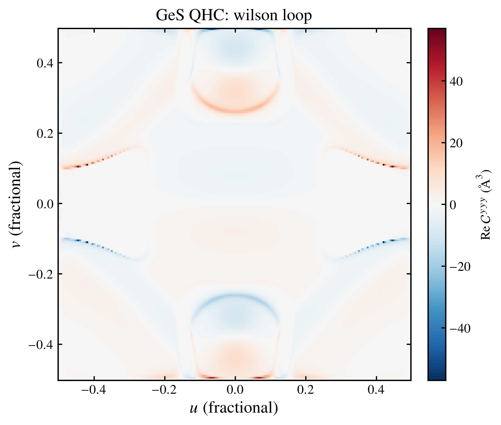

# Shift vectors and quantum Hermitian connections

## In this tutorial

- Relate a transition displacement to a covariant derivative of its optical matrix element.
- Distinguish shift vector, quantum Hermitian connection, and integrated current.
- Compare methods at fixed band groups and numerical conventions.

## Physics and model

For valence state $v$ and conduction state $c$, use the Hamiltonian-gauge position matrix $r^y_{mn}=i\langle u_m|\partial_yu_n\rangle$. The generalized derivative is written with the derivative direction after the semicolon. For the $vc$ matrix element used on the shifted leg of the loop,

$$
r_{vc}^{y;y}=\partial_y r^y_{vc}
-i(r^y_{vv}-r^y_{cc})r^y_{vc},
\qquad
R_{vc}^{y;y}=\frac{i r_{vc}^{y;y}}{r^y_{vc}}.
$$

$\partial_y$ differentiates with respect to Cartesian $k_y$ in Å$^{-1}$, so $r^y_{vc}$ and $R_{vc}^{y;y}$ have units Å, while $r_{vc}^{y;y}$ has units Ų. The phase-gradient and diagonal-connection terms depend separately on gauge; their combination does not. $R$ is generally complex; its real part gives the transition displacement. At a zero optical matrix element the ratio is undefined. A divergent shift vector need not produce a divergent current, because the transition weight also vanishes.

The main shift-vector example uses **Wilson Loop** at zero photon momentum. For an isolated transition, its closed product contains position matrix elements:

$$
\mathcal L_\pm=\langle v_k|v_{k\pm h}\rangle
r^y_{vc}(k\pm h)\langle c_{k\pm h}|c_k\rangle r^y_{cv}(k).
$$

Here the displacement is along Cartesian $k_y$. The symmetric complex logarithmic derivative is

$$
\mathcal R_h=\frac{i}{2h}\left[\log\mathcal L_+-\log\mathcal L_-\right],
\qquad R_h=\operatorname{Re}\mathcal R_h.
$$

The retained Geometric-loop comparison instead uses velocity insertions. At zero photon momentum and for isolated bands, its ordered factors are $\langle v_k|v_{k+h}\rangle V^y_{vc}(k+h)\langle c_{k+h}|c_k\rangle V^y_{cv}(k)$, up to a positive constant, with $V$ the velocity vertex. This fixes the $vc$ orientation above. On a smooth branch with a nonzero transition element, $\lim_{h\to0}R_h=\operatorname{Re}R_{vc}^{y;y}$. This real-part relation does not identify the full complex velocity- and position-based logarithmic derivatives.

The Wilson product is implemented in `WilsonLoopShiftVector.jl`; the shared logarithmic derivative and pair average are defined in `GeometricLoopShiftVector.jl`. The runtime averages the complex kernel over the requested conduction–valence pairs, and the figure displays its real part. These routines fix the logarithm branch and treatment of vanishing links. Differentiating an arbitrarily unwrapped phase is not the same operation. Degenerate groups require the complete block construction, not independently assigned eigenvector phases or ratios of group-averaged matrix elements.

The Conventional quantum Hermitian connection shown below has diagonal component

$$
\mathcal C_{CV}^{yyy}=
\frac{1}{N_C N_V}\sum_{c\in C,v\in V}r_{vc}^{y;y}r^y_{cv}.
$$

$C=\{21,22\}$ and $V=\{19,20\}$ give $N_C=N_V=2$. The connection kernel in `ConventionalQuantumGeometry.jl` is a generally complex pair average. It has dimensions ų, unlike the shift vector. Neither expression includes occupation differences, resonant energy selection, or momentum integration; a local geometric map is not a shift-current spectrum.

## Parameters

The examples use the unified `Materials/GeS/model_tb.dat` and matching `Materials/GeS/operators.h5` bundle, with replica policy `auto` and Fourier backend `direct`. The recorded public 1.2.0 calculation uses the original 200 × 200 mesh and the parameters below.

Set up the shared files with the [material data guide](../../Materials/README.md).

| Parameter | Value | Meaning |
| --- | --- | --- |
| Ordered observable groups | [[21,22], [19,20]] | Conduction first, valence second; four ordered pairs |
| Component | [2,2,2] | Derivative along y; both optical directions y |
| Loop finite_difference_step | 0.0001 Å⁻¹ | Cartesian displacement h |
| Shift-vector method | Wilson Loop | Main figure; Geometric Loop is the comparison |
| QHC methods | Conventional, Wilson Loop | Position-defined connection |
| Momentum transfer | q=0 | Vertical transitions |
| k mesh | [200,200] | Two-dimensional k-slice |
| Slice coordinates | origin=[0,0,0]; vectors [1,0,0], [0,1,0] | Fractional reciprocal-space sampling plane |
| Fourier backend | direct | Evaluation of the real-space model |

## Run

The migrated geometric inputs use `observable.kind = "kslice"` and
`groups = [[21,22], [19,20]]`: **conduction first, valence second**. This retains
the numerical ordering of the old geometric selector. It is different from the
source-then-target ordering of the optical response groups in chapters 04 and 05.
The geometric pair average, its units and its lack of occupation or resonance
weights remain unchanged. The supplied maps keep their recorded calculation
sources; converting an input is not a new calculation or a new all-point
degeneracy-block qualification. A selection that cuts a required complete block
must be reported rather than silently enlarged.


These geometric outputs are local pair averages, not mesh-weighted response
cells. Neither the saved QHC/shift-vector maps nor their group-key migration
requires the response-table $N_k$ conversion discussed in chapters 04 and 05.
Their units remain ų and Å, respectively. This distinction does not assert
basis-independent equivalence for a selection that cuts a required complete block.

From the repository root, check the inputs, then run either example into a new output directory:

```bash
julia --project=.runtime/env scripts/run_group.jl 08 --check
julia --project=.runtime/env scripts/run_group.jl 08 --case=shift_vector_wilson_loop --output=.runtime/shift_vector_wilson_loop
julia --project=.runtime/env scripts/run_group.jl 08 --case=quantum_hermitian_connection_conventional --output=.runtime/quantum_hermitian_connection_conventional
```

The check command does not calculate the response. Use a fresh output directory for each run.

Begin with the [Wilson Loop shift vector](inputs/shift_vector_wilson_loop.toml) and [Conventional connection](inputs/quantum_hermitian_connection_conventional.toml). The [Geometric Loop shift vector](inputs/shift_vector_geometric_loop.toml) and [Wilson Loop connection](inputs/quantum_hermitian_connection_wilson_loop.toml) remain available for method comparisons.

## Read the figures

The figures below use complete supplied calculations for the stated source, mesh, and band groups. Redrawing them does not execute the calculation inputs above. Both loop methods use adjacent-gap response groups with threshold 0.002 eV, including the numerical-equality safeguard. Grouping does not average individual energies; exact spectral guards remain independent.

### Shift vector

<table>
<tr>
<td><a href="figures/kslice_shift_vector_wilson_loop.png"></a><br>Wilson-loop shift vector</td>
<td><a href="figures/kslice_shift_vector_geometric_loop.png"></a><br>Geometric-loop shift vector</td>
</tr>
</table>


The core figure shows the **Wilson-loop** real $R^{y;y}$ in Å, averaged over the requested valence [19,20] and conduction [21,22] pairs. The 200 × 200 map uses $h=10^{-4}$ Å⁻¹ and a 0.002 eV adjacent-gap response-group threshold. Its symmetric logarithmic color scale is linear within ±1 Å; the full numerical range, −1321.43 to +647.89 Å, is retained without clipping. The axes follow the two sampling vectors, and pixel centers coincide with the actual sampled points.

Large values near weak optical links are sensitive to the finite-difference step and logarithm branch; they should not be read as converged transition displacements. This geometric pair average has no occupation or resonant-energy weight and is not an integrated photocurrent. The [Geometric-loop comparison](figures/kslice_shift_vector_geometric_loop.png) uses the same scale and differs by 5.61% in relative real-array $L^2$ norm on this grid. This finite-grid comparison does not establish equivalence at singular links. [Original PNG](figures/kslice_shift_vector_wilson_loop.png) · [PDF](figures/kslice_shift_vector_wilson_loop.pdf).

### Quantum Hermitian connection

<table>
<tr>
<td><a href="figures/kslice_quantum_hermitian_connection_conventional.png"></a><br>Conventional position-defined QHC</td>
<td><a href="figures/kslice_quantum_hermitian_connection_wilson_loop.png"></a><br>Wilson-loop position-defined QHC</td>
</tr>
</table>


This map displays the real connection in ų. The [Wilson-loop map](figures/kslice_quantum_hermitian_connection_wilson_loop.png) shares its linear full-range color limit, approximately ±56.99 ų. The shift-vector figure uses different dimensions and a different color normalization.

The Wilson-loop real array differs from Conventional by 1.02% in relative $L^2$ norm on this grid. This is a finite-model, selected-band comparison, not a material or convergence qualification. Near-degenerate selections require complete response blocks for a basis-independent subspace comparison; these retained maps do not establish such an all-point equivalence. Geometric Loop is not offered for position-defined QHC: its former velocity-insertion output represents a different object. This restriction does not remove the Geometric-loop shift-vector example above. [Original PNG](figures/kslice_quantum_hermitian_connection_conventional.png) · [PDF](figures/kslice_quantum_hermitian_connection_conventional.pdf).

## Redraw and check

Redraw either core figure into a new directory:

```bash
python examples/08_shift_geometry/plot.py --figure=kslice_shift_vector_wilson_loop --output=.runtime/plot-kslice_shift_vector_wilson_loop
python examples/08_shift_geometry/plot.py --figure=kslice_quantum_hermitian_connection_conventional --output=.runtime/plot-kslice_quantum_hermitian_connection_conventional
```

For a method comparison, compute the same object with the same model, band groups, sampling, and numerical settings. Compare the numerical arrays before judging differences from separately scaled images.

Near-degenerate bands and weak optical transitions require particular care when interpreting transition geometry. Check finite-difference and mesh stability, and preserve the defined band-group and threshold conventions. These maps do not establish method agreement or quantitative convergence of an integrated photocurrent.

[Reproducibility](reproduce.json)

## Companion loop maps


Compare the Geometric-loop shift vector with the Wilson-loop shift vector above, and compare the Wilson-loop QHC with the Conventional QHC. These are two separate comparisons, with different units and color normalizations. Weak optical links can make a logarithmic ratio or its phase unstable; a large shift vector alone does not imply a large weighted photocurrent. The position-defined QHC retains its complex transition amplitude rather than replacing a position insertion with a velocity insertion. Geometric Loop is therefore not a third method for the QHC shown here.

```bash
python examples/08_shift_geometry/plot.py --figure=kslice_shift_vector_geometric_loop --output=.runtime/geometric-shift-vector
python examples/08_shift_geometry/plot.py --figure=kslice_quantum_hermitian_connection_wilson_loop --output=.runtime/wilson-qhc
```

## References

- J. E. Sipe and A. I. Shkrebtii, “Second-order optical response in semiconductors,” *Physical Review B* **61**, 5337–5352 (2000). [DOI](https://doi.org/10.1103/PhysRevB.61.5337). Background for generalized derivatives and shift current.
- H. Wang, X. Tang, H. Xu, J. Li, and X. Qian, “Generalized Wilson loop method for nonlinear light-matter interaction,” *npj Quantum Materials* **7**, 61 (2022). [DOI](https://doi.org/10.1038/s41535-022-00472-4). Closed-loop optical geometry.
- Z. Lu, Z. Qian, Z. Guo, L. Shi, S. Liu, H. Wang, and K. Chang, “Giant Nonlinear Photon-Drag Currents in Moiré Bilayers,” arXiv:2511.16987 (2025; revised 2026). [arXiv](https://arxiv.org/abs/2511.16987). Geometric-loop formulation of nonlinear photon-drag currents.
