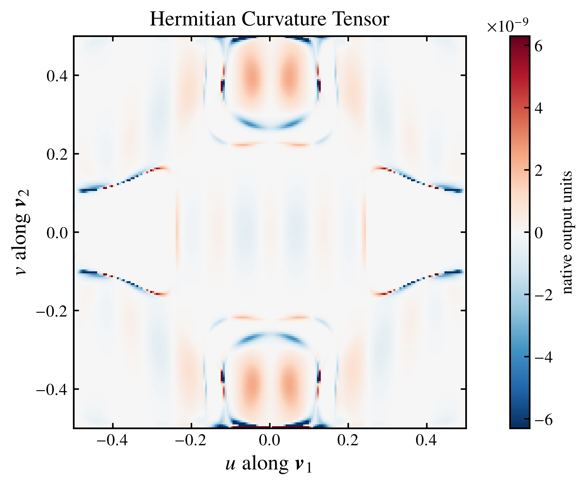
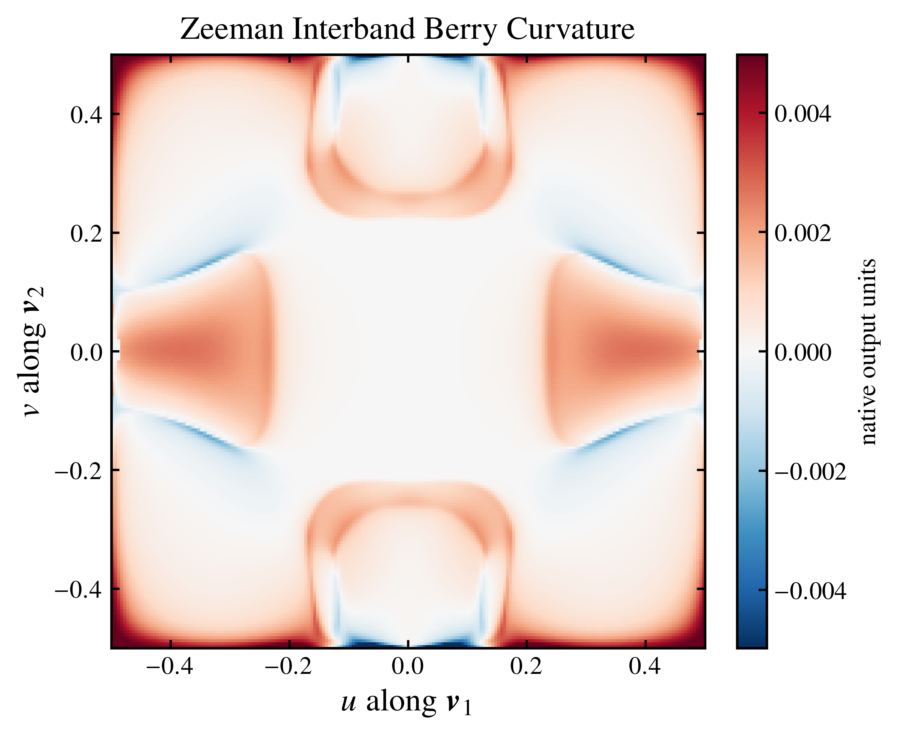
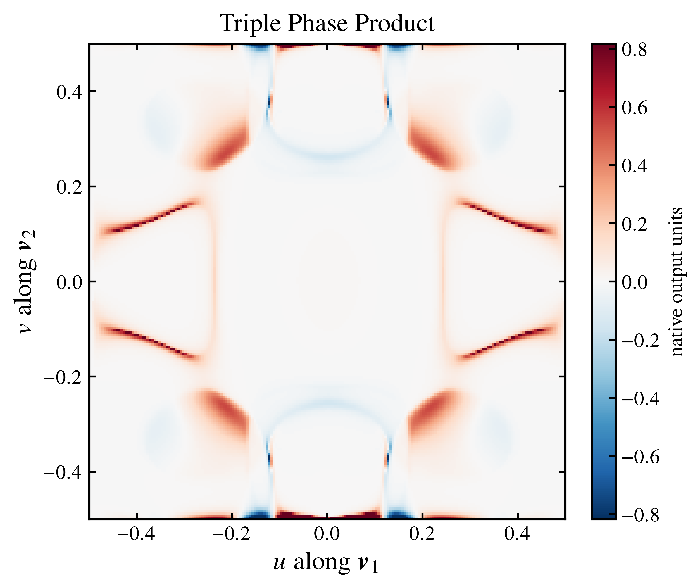
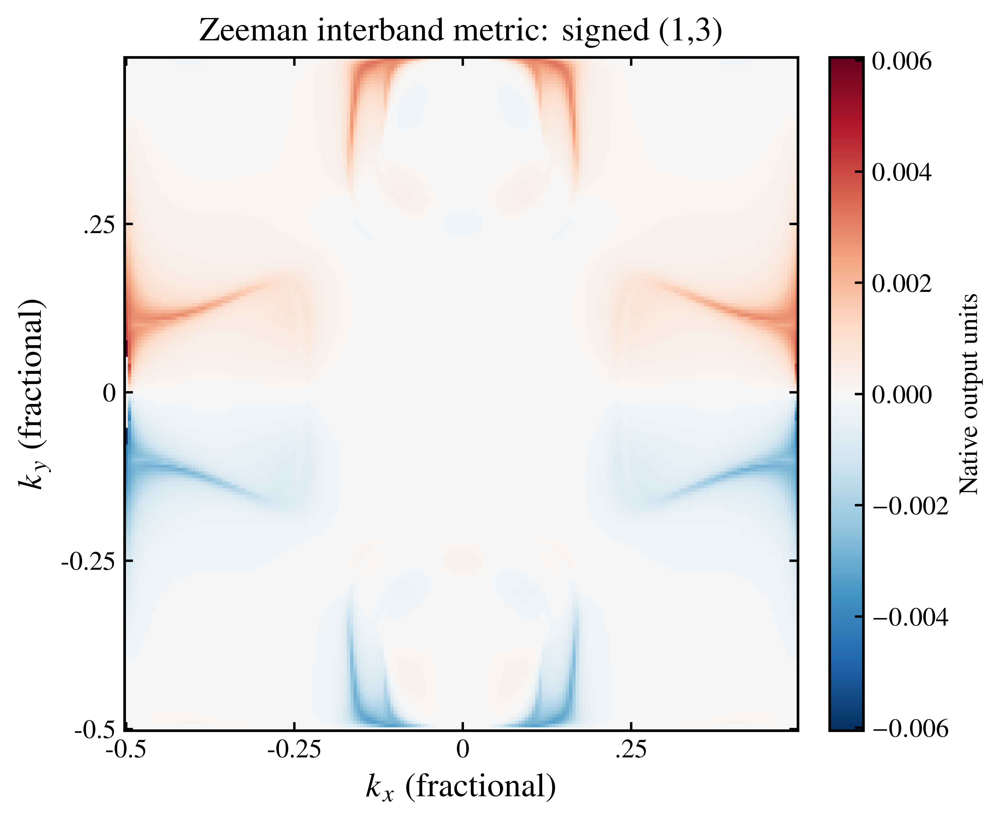

# Higher and Zeeman-weighted interband geometry

## In this tutorial

- Understand curvature acting on a transition between two subspaces.
- Distinguish an ordinary trace from pair-averaged mixed geometry.
- Interpret spatial and spin indices without treating them as interchangeable.

## Physics and model

Let $A=\{21,22\}$ and $B=\{19,20\}$. The Hamiltonian-gauge position block $r^a_{AB}$ maps $B$ to $A$. Within a subspace $S$, the non-Abelian curvature is $F_S^{dc}=\partial_d r_S^c-\partial_c r_S^d-i[r_S^d,r_S^c]$, with $r^a_{mn}=i\langle u_m|\partial_a u_n\rangle$. The Hermitian curvature tensor measures the curvature acting on the two ends of a transition:

$$
K_{AB}^{badc}
=-i\operatorname{Tr}_B\left[
r^b_{BA}\left(F_A^{dc}r^a_{AB}-r^a_{AB}F_B^{dc}\right)
\right].
$$

The input order is [b,a,d,c]: two optical legs, then the curvature-plane directions. Position has units Å and curvature Ų, so $K$ has units Å⁴. The ordinary trace is **not divided by either group size**. If both curvature blocks vanish, $K$ vanishes even for a nonzero transition matrix element.

Zeeman geometry replaces one momentum leg with a spin-operator leg. Write $s^b_{IJ}=\langle u_I|\hat S_b|u_J\rangle$ for the supplied spin matrix, retaining its recorded normalization. The mixed position–spin tensor is

$$
\mathcal Z_{A,B}^{aS_b}
=\frac{1}{N_A N_B}\sum_{I\in A,J\in B}r_{JI}^{a}s_{IJ}^{b}
=g_{A,B}^{aS_b}-\frac{i}{2}\Omega_{A,B}^{aS_b}.
$$

For Hermitian position and spin operators, the exchanged product is the complex conjugate. Thus the kernel's symmetric and antisymmetric pair averages give

$$
g_{A,B}^{aS_b}=\operatorname{Re}\mathcal Z_{A,B}^{aS_b},
\qquad
\Omega_{A,B}^{aS_b}=-2\operatorname{Im}\mathcal Z_{A,B}^{aS_b}.
$$

$a$ is an orbital Cartesian direction and $S_b$ labels the spin leg. Component [1,3] means $xS_z$, not an ordinary $xz$ Berry-curvature plane. For dimensionless Pauli matrices the mixed quantities have units Å. Replacing those matrices by physical spin multiplies them by $\hbar/2$; the geometry kernels in `ConventionalQuantumGeometry.jl` do not apply that conversion automatically.

The mixed metric need not be positive definite. The optional triple-phase example instead averages an ordered cyclic product of three position elements over three groups. These are distinct local geometric objects, not alternative algorithms for one integrated spin-current conductivity.

## Parameters

The examples use Materials/GeS/model_tb.dat with replica policy auto. Both Zeeman inputs additionally request Materials/GeS/operators.h5.

Set up the shared files with the [material data guide](../../Materials/README.md).

| Parameter | Value | Meaning |
| --- | --- | --- |
| Hermitian curvature | component=[2,2,1,2] | Order [b,a,d,c]; A=[21,22], B=[19,20] |
| Zeeman curvature / metric | component=[1,3] | Spatial x, spin z; the same A,B groups |
| Triple-phase groups | first=[21,22], second=[23,24], third=[19,20] | Ordered groups; component=[2,2,2] |
| Spin normalization | Retain the operator-bundle convention | No automatic factor of ℏ/2 |
| k mesh | [200,200] | Two-dimensional k-slice |
| Slice coordinates | origin=[0,0,0]; vectors [1,0,0], [0,1,0] | Fractional reciprocal-space sampling plane |
| Fourier backend | direct | Evaluation of the real-space model |

## Run

From the repository root, check the inputs, then run either example into a new output directory:

```bash
julia --project=.runtime/env scripts/run_group.jl 09 --check
julia --project=.runtime/env scripts/run_group.jl 09 --case=hermitian_curvature_tensor_conventional --output=.runtime/hermitian_curvature_tensor_conventional
julia --project=.runtime/env scripts/run_group.jl 09 --case=zeeman_interband_berry_curvature_conventional --output=.runtime/zeeman_interband_berry_curvature_conventional
```

The check command does not calculate the response. Use a fresh output directory for each run.

Start with [Hermitian curvature](inputs/hermitian_curvature_tensor_conventional.toml). Other choices are [Zeeman Berry curvature](inputs/zeeman_interband_berry_curvature_conventional.toml), [Zeeman metric](inputs/zeeman_interband_quantum_metric_conventional.toml), and [triple phase product](inputs/triple_phase_product_conventional.toml).

## Read the figures

The figures below use the supplied example data. Redrawing them does not execute the calculation inputs above.

### Hermitian curvature tensor

<a href="figures/kslice_hermitian_curvature_tensor_conventional.png"></a>

The figure displays the real part of the selected higher-rank component over the k-slice. Read its color-bar magnitude as well as its sign: a visible color pattern alone does not establish a physically significant nonzero response. [Original PNG](figures/kslice_hermitian_curvature_tensor_conventional.png) · [PDF](figures/kslice_hermitian_curvature_tensor_conventional.pdf).

### Zeeman-weighted interband Berry curvature

<a href="figures/kslice_zeeman_interband_berry_curvature_conventional.png"></a>

The selected ordered pair of band groups is weighted by operator information from the GeS bundle. Compare the structure of this map with ordinary interband geometry only after checking the observable and operator definitions; the two quantities are not interchangeable. [Original PNG](figures/kslice_zeeman_interband_berry_curvature_conventional.png) · [PDF](figures/kslice_zeeman_interband_berry_curvature_conventional.pdf).

## Redraw and check

Redraw either core figure into a new directory:

```bash
python examples/09_higher_and_spin_geometry/plot.py --figure=kslice_hermitian_curvature_tensor_conventional --output=.runtime/plot-kslice_hermitian_curvature_tensor_conventional
python examples/09_higher_and_spin_geometry/plot.py --figure=kslice_zeeman_interband_berry_curvature_conventional --output=.runtime/plot-kslice_zeeman_interband_berry_curvature_conventional
```

Use the triple-phase input to see how adding a third ordered band group changes the observable. Use the Zeeman metric input to examine a different operator-weighted quantity without treating it as another curvature calculation.

Operator completeness and consistency with the Hamiltonian are essential. A missing spin operator is not a zero contribution. The Zeeman-weighted metric need not obey the nonnegativity of an ordinary diagonal quantum metric. The displayed native-unit maps do not establish numerical convergence, a bulk transport coefficient, or an absolute comparison between different geometric quantities.

[Reproducibility](reproduce.json)

## Triple products and mixed-spin metric

<a href="figures/kslice_triple_phase_product_conventional.png"></a>

[PDF](figures/kslice_triple_phase_product_conventional.pdf)

<a href="figures/kslice_zeeman_interband_quantum_metric_conventional.png"></a>

[PDF](figures/kslice_zeeman_interband_quantum_metric_conventional.pdf)

The ordered triple position product averages the cyclic product over three supplied groups,

$$
T_{ABC}^{\alpha\beta\gamma}=\frac{1}{N_A N_B N_C}\sum_{a\in A,b\in B,c\in C}r^\alpha_{ba}r^\beta_{cb}r^\gamma_{ac}.
$$

Each admissible triple has three distinct band indices. This generally complex quantity has units ų and retains the input's group and Cartesian-index order; it is not the dimensionless argument of that product or a conductivity. The mixed position–spin metric contains one position leg. For dimensionless Pauli spin matrices its units are Å, not Ų; physical-spin units require the separately stated $\hbar/2$ conversion. Neither multiplication by an extra spin degeneracy nor reinterpreting a Cartesian index as another momentum derivative is implicit in the data. The Hermitian-curvature tensor uses its ordinary block trace, with no group-size division.

## References

- J. Ahn, G.-Y. Guo, N. Nagaosa, and A. Vishwanath, “Riemannian geometry of resonant optical responses,” *Nature Physics* **18**, 290–295 (2022). [DOI](https://doi.org/10.1038/s41567-021-01465-z). Transition-space geometry and Hermitian curvature.
- L. Xiang, J. Jia, F. Xu, Z. Qiao, and J. Wang, “Intrinsic Gyrotropic Magnetic Current from Zeeman Quantum Geometry,” *Physical Review Letters* **134**, 116301 (2025). [DOI](https://doi.org/10.1103/PhysRevLett.134.116301). Mixed momentum–spin geometry.
