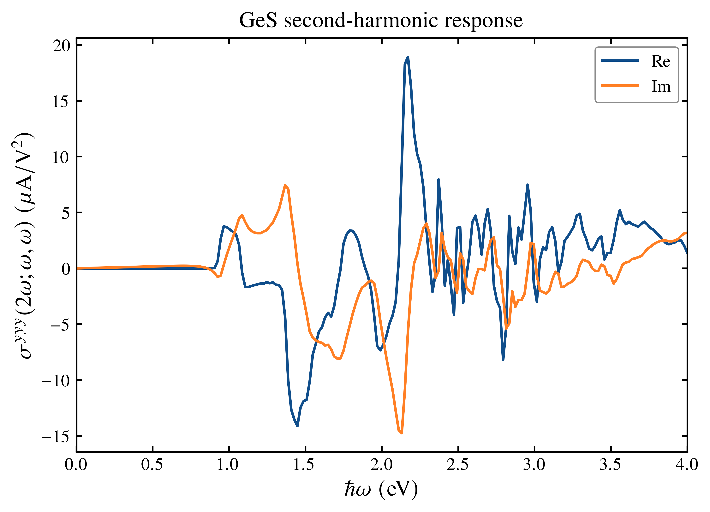
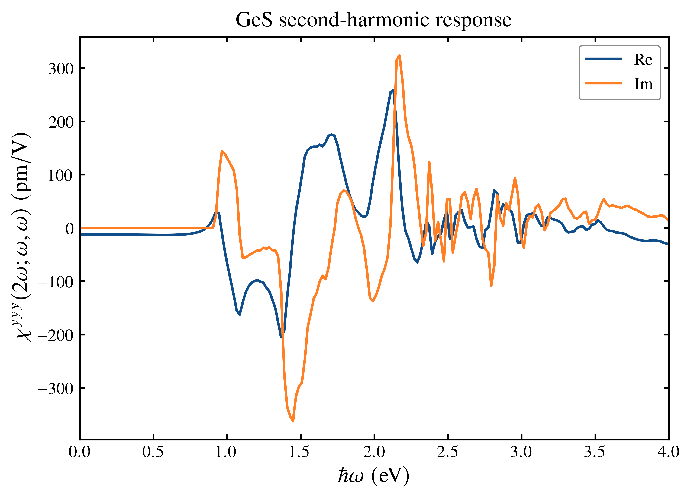

# 10 · Second-harmonic generation in GeS

## In this tutorial

- Distinguish the incident photon energy from the output frequency of second-harmonic generation.
- Read conductivity and susceptibility as different response coefficients.
- Understand why energy broadening and low-frequency regularization are separate controls.

## Physics and model

In second-harmonic generation (SHG), two incident fields at frequency $\omega$ generate a response at $2\omega$. With time dependence $e^{-i\omega t}$, define the polarization response by

$$
P^a(2\omega)
=\epsilon_0\sum_{bc}\chi^{abc}(-2\omega;\omega,\omega)
E^b(\omega)E^c(\omega).
$$

Here $a$ is the output direction, $b,c$ are the incident-field directions, and $\epsilon_0$ is the vacuum permittivity. The corresponding current coefficient is defined by

$$
J^a(2\omega)
=\sum_{bc}\sigma^{abc}(-2\omega;\omega,\omega)
E^b(\omega)E^c(\omega).
$$

These definitions follow the v1.2.0 SHG theory and implementation, without an additional factorial. They specify the convention for this lesson; the manuscript does not supply a corresponding SHG derivation. The yyy component places all three directions along y. In the clean analytic theory, current is the time derivative of polarization. The finite-width implementation nevertheless evaluates conductivity and susceptibility with separate kernels: do not generate one numerical output by multiplying or dividing the other by a complex frequency.

The Gaussian energy-selection kernel uses

$$
g_\gamma(x)=\frac{\exp[-(x/\gamma)^2]}{\sqrt{\pi}\gamma},
\qquad x,\gamma\ \text{in eV}.
$$

Thus $\gamma$ is the width parameter, not the Gaussian standard deviation. The response contains both one- and two-photon resonant structures. Low-frequency factors have a separate regularization and are not replaced by this Gaussian.

## Parameters

Use [second_harmonic_generation_conventional.toml](inputs/second_harmonic_generation_conventional.toml) with the GeS material installed through the [material setup guide](../../Materials/README.md).

| Parameter | Value | Meaning |
| --- | --- | --- |
| Model | Materials/GeS/model_tb.dat | GeS Wannier Hamiltonian |
| k mesh | [100, 100] | Brillouin-zone sampling in the input |
| spatial_dimension | 3 | Cartesian response dimension |
| Incident photon energy $\hbar\omega$ | 0–4 eV, 200 points | The plotted frequency axis |
| Chemical potential | −2.5 eV | Occupation reference |
| Temperature | 0 K | Electronic occupations |
| broadening | 0.04 eV | Gaussian resonance width; omitted broadening_type defaults to Gaussian |
| low_frequency_broadening | 0.001 eV | Separate low-frequency control |
| response / output | both / total | Conductivity and susceptibility totals |
| Fourier / replica policy | direct / auto | Interpolation and representation handling |

Parameters absent from the input retain the selected software version's defaults; they should not be inferred from the plotted linewidth alone.

## Run

From the repository root:

```bash
julia --project=.runtime/env scripts/run_group.jl 10 --check
julia --project=.runtime/env scripts/run_group.jl 10 --case=second_harmonic_generation_conventional --output=.runtime/second_harmonic_generation_conventional
```

Use a fresh output directory for each calculation. The check command verifies configuration and dependencies, not numerical convergence. For a sampling study, change the mesh in a copy of the input while keeping the physical model and broadening fixed.

## Read the figures

The supplied spectra illustrate the output convention. Redrawing them does not execute the calculation input.

### 1. SHG conductivity

<a href="figures/shg_sigma_yyy.png"></a>

Read the real and imaginary parts separately. The horizontal axis is the incident energy $\hbar\omega$, although the output is at $2\omega$. The plot converts A/V² to μA/V² with a factor $10^6$; it does not fit the amplitude.

[Original PNG](figures/shg_sigma_yyy.png) · [PDF](figures/shg_sigma_yyy.pdf)

### 2. SHG susceptibility

<a href="figures/shg_chi_yyy.png"></a>

The susceptibility is displayed in pm/V. Its amplitude and frequency dependence cannot be compared directly with conductivity values in μA/V². Retain the specified response and normalization conventions when comparing another code or an experiment.

[Original PNG](figures/shg_chi_yyy.png) · [PDF](figures/shg_chi_yyy.pdf)

## Redraw and check

```bash
python examples/10_second_harmonic_generation/plot.py --figure=shg_sigma_yyy --output=.runtime/plot-shg_sigma_yyy
python examples/10_second_harmonic_generation/plot.py --figure=shg_chi_yyy --output=.runtime/plot-shg_chi_yyy
```

These examples are not a converged material prediction. Test momentum sampling and each numerical width separately. A yyy result does not validate every tensor component, and an effective sheet normalization must not be introduced merely by changing an axis label.

[Reproducibility](reproduce.json)

## Resolution and width

The supplied spectrum uses the stated 100 × 100 grid, Gaussian optical width and separate low-frequency control. It is a fixed numerical example, rather than a joint mesh-and-linewidth convergence study. Narrowing the optical peak without refining the momentum grid can produce sampling structure. Compare real and imaginary components at fixed units, measure and tensor convention. An equal-rate Lorentzian calculation or an alternative cell-image prescription would be a different input problem, not another label for these Gaussian curves.

## References

- C. Aversa and J. E. Sipe, “Nonlinear optical susceptibilities of semiconductors: Results with a length-gauge analysis,” *Physical Review B* **52**, 14636–14645 (1995). [DOI](https://doi.org/10.1103/PhysRevB.52.14636). Background for independent-particle length-gauge nonlinear response.
