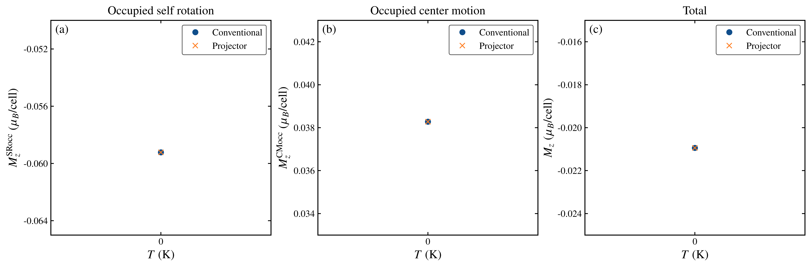
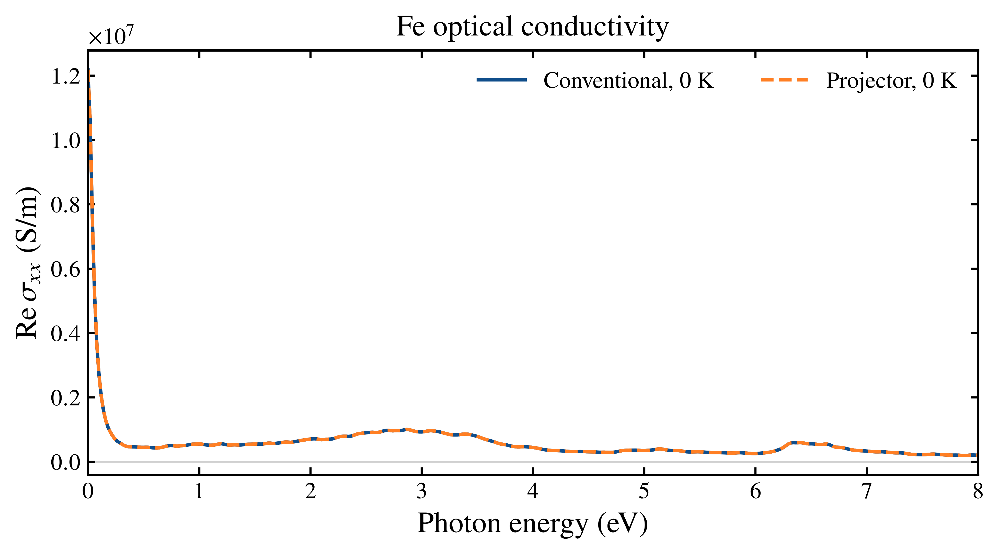
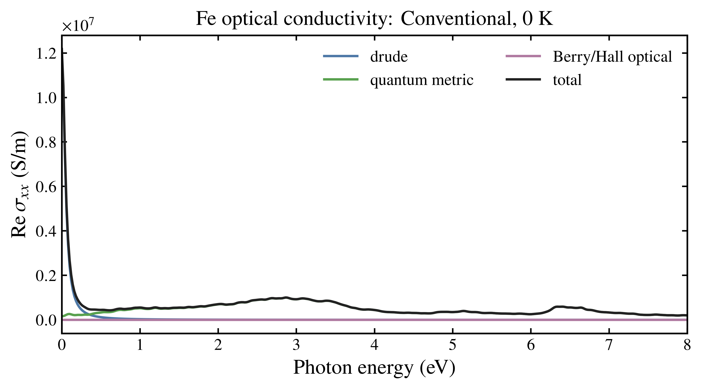
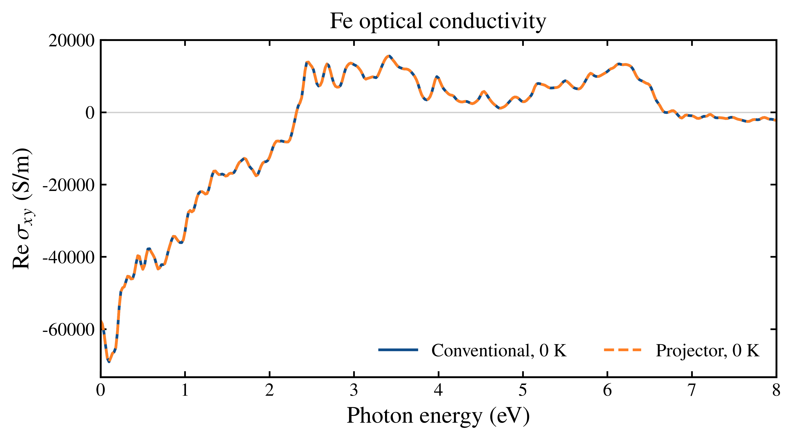
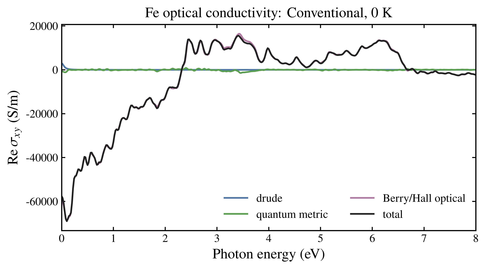
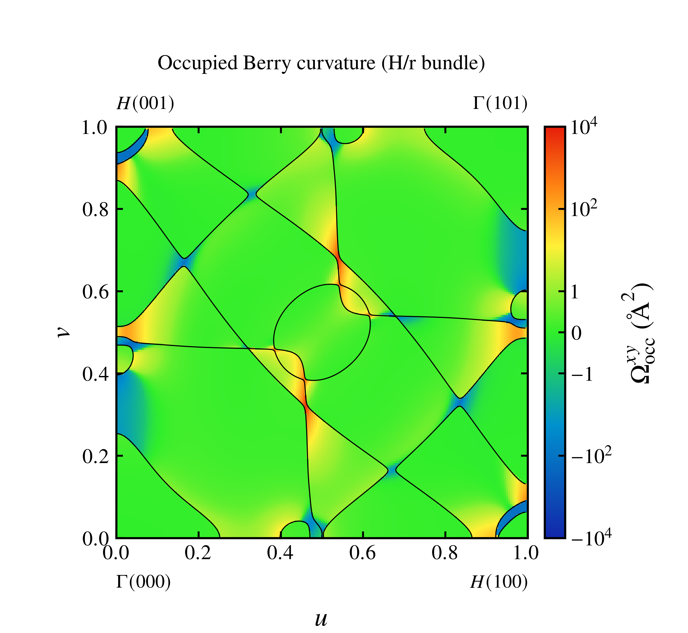
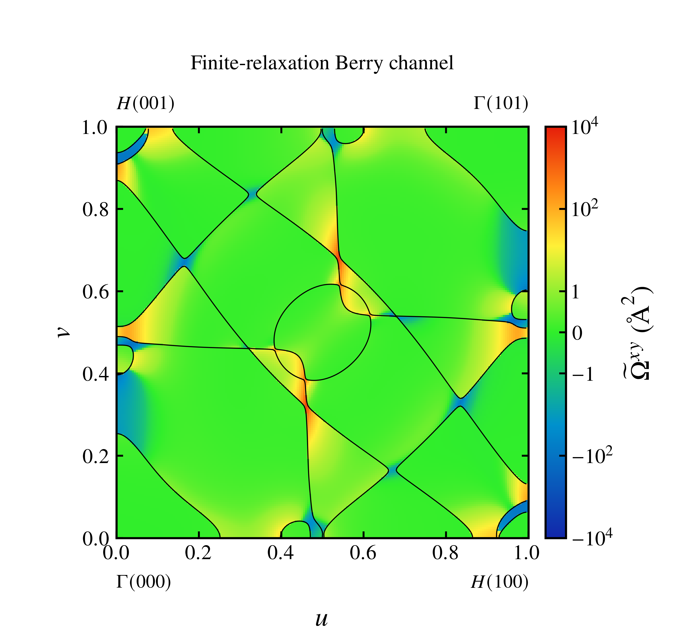

# 11 · Orbital magnetization and linear response in Fe

## In this tutorial

Examine three response calculations and how to interpret their results.

## Common model and settings

This chapter compares modern orbital magnetization, finite-frequency optical conductivity, and Berry geometry and dc transport in the same Fe Wannier model. Install the material using the [material setup guide](../../Materials/README.md). The common model is `Materials/Fe/model_tb.dat`, with chemical potential $\mu=5.7156290716733436$ eV, direct Fourier interpolation and automatic replica handling. The H/r operator-bundle route also uses `Materials/Fe/operators.h5`. No extra spin factor or energy-zero shift is introduced in these comparisons.

The integrated examples use a $40^3$ Brillouin-zone mesh at 0 K. Conventional and Projector are compared at fixed settings. The figures and table below reuse supplied results: opening or redrawing the chapter does not compute responses.

## Orbital magnetization

Modern orbital magnetization is an integrated magnetic moment per primitive cell, not an on-site orbital-angular-momentum matrix. The implementation resolves occupied self rotation (SRocc), occupied center motion (CMocc), and

$$
\mathbf M_{\mathrm{total}}=\mathbf M_{\mathrm{SRocc}}+\mathbf M_{\mathrm{CMocc}}.
$$

The names describe this implementation's decomposition and are not automatically interchangeable with another program's LC/IC convention. Conventional and Projector evaluate their own trace expressions using the same complete-velocity prescription and `denominator_regularization = 0.001` eV. Projector uses complete occupied spectral subspaces; finite-temperature traces use analytic thermal convolutions. This regularization is distinct from both optical relaxation and the zero setting in the static geometry inputs.

The two **orbital** inputs use `projected_energy_overlap` and the matching seven-class completion bundle, including H, position, energy-weighted connection, derivative-overlap and weighted axial operators. They retain the recorded uncentered periodic Wannier frame and once-only center conversion. This operator requirement is specific to the relevant orbital inputs, not a description of every Fe case.

Run [Conventional 0 K](inputs/oam_conventional_T000.toml) or [Projector 0 K](inputs/oam_projector_T000.toml) using the case-name command pattern below.

<a href="figures/fe_orbital_magnetization_z.png"></a>

**Orbital moment:** $M_z^{\rm SRocc}$, $M_z^{\rm CMocc}$ and total in $\mu_B$/cell, for both methods at 0 K. At 0 K the terms are approximately −0.05922 and +0.03828, giving −0.02094 $\mu_B$/cell. Their sign follows the model's axis and moment convention. Method agreement for this fixed model and prescription does not establish convergence or an independent material benchmark. [PNG](figures/fe_orbital_magnetization_z.png) · [PDF](figures/fe_orbital_magnetization_z.pdf)

## Finite-frequency linear optical conductivity

The current response and exported channels are

$$
J^a(\omega)=\sum_b\sigma^{ab}(\omega)E^b(\omega),\qquad
\sigma^{ab}_{\rm total}=\sigma^{ab}_{\rm Drude}+\sigma^{ab}_{\rm metric}+\sigma^{ab}_{\rm Berry}.
$$

The Drude channel describes intraband relaxation; the metric channel is an interband geometric contribution. The Berry/Hall optical channel includes ambient contact and dispersive interband Hall contributions. It is a conductivity in S/m, not the static curvature in Ų. The plots show real parts. The supplied spectra use 0–8 eV in 401 points, $\Gamma_{\rm intra}=\Gamma_{\rm inter}=0.05$ eV, and Gaussian `eta_fs_ev = 0.05` eV for the 0 K Fermi-surface regularizer. The latter is distinct from either relaxation width.

Inputs: [Conventional 0 K](inputs/linear_optical_conventional_T000.toml) and [Projector 0 K](inputs/linear_optical_projector_T000.toml). Select the corresponding case name to run one.

### Longitudinal xx

<a href="figures/fe_linear_optical_xx_spectra.png"></a>

**Total xx:** Conventional and Projector at 0 K. [PNG](figures/fe_linear_optical_xx_spectra.png) · [PDF](figures/fe_linear_optical_xx_spectra.pdf)

<a href="figures/fe_linear_optical_decomposition_xx.png"></a>

**xx decomposition:** Conventional, 0 K only. The Berry/Hall optical conductivity channel is in S/m. [PNG](figures/fe_linear_optical_decomposition_xx.png) · [PDF](figures/fe_linear_optical_decomposition_xx.pdf)

### Transverse xy

<a href="figures/fe_linear_optical_xy_spectra.png"></a>

**Total xy:** Conventional and Projector at 0 K. This tensor component carries different information from xx. [PNG](figures/fe_linear_optical_xy_spectra.png) · [PDF](figures/fe_linear_optical_xy_spectra.pdf)

<a href="figures/fe_linear_optical_decomposition_xy.png"></a>

**xy decomposition:** Conventional, 0 K only. The Berry/Hall optical conductivity channel is in S/m. A small total can contain substantial signed channel contributions. [PNG](figures/fe_linear_optical_decomposition_xy.png) · [PDF](figures/fe_linear_optical_decomposition_xy.pdf)

## Static Berry geometry and dc Hall transport

For a nondegenerate band, with Cartesian derivatives,

$$
r_{nn}^a=i\langle u_n|\partial_{k_a}u_n\rangle,\quad
\Omega_n^{ab}=\partial_{k_a}r_{nn}^b-\partial_{k_b}r_{nn}^a,\quad
\Omega_{\rm occ}^{ab}=\sum_n f_n\Omega_n^{ab}.
$$

With $k$ in inverse Å, curvature is in Ų. Degeneracies require the implementation's subspace treatment; a finite Wannier window can also carry an ambient frame contribution, so an interband sum alone must not silently replace complete curvature. The local map has no Brillouin-zone integration normalization.

### Local slice

The [H/r bundle static input](inputs/berry_sos_occupied_xy.toml) and [Wannier TB static input](inputs/berry_tb_occupied_xy.toml) are two reading routes for the same occupied curvature; the TB route also contains H and r and is not an H-only approximation. Both use zero denominator regularization. Their retained $200\times200$ tables differ by at most $6.8624\times10^{-9}$ Ų, with relative L2 difference $5.8075\times10^{-13}$. This is a route cross-check for these data, not a convergence test. The [TB figure](figures/berry_tb_occupied_xy.png), [PDF](figures/berry_tb_occupied_xy.pdf), input, and data remain available for reproduction; only the bundle route is displayed here.

<a href="figures/berry_sos_occupied_xy.png"></a>

**Static occupied $\Omega^{xy}$:** H/r bundle, 0 K. [PNG](figures/berry_sos_occupied_xy.png) · [PDF](figures/berry_sos_occupied_xy.pdf)

The distinct [finite-relaxation dc slice input](inputs/berry_transport_equivalent_xy.toml) has `kind = linear_transport`. Its plotted field is

$$
\widetilde\Omega^{xy}=-K_{\rm Berry}^{xy}/[(e^2/\hbar)\times10^{-20}],
$$

where the native local kernel $K_{\rm Berry}$ is in S m²; there is no additional mesh division. $\Gamma_{\rm inter}=0.05$ eV affects its interband Hall weight. The separately specified $\Gamma_{\rm intra}$ and $\eta_{\rm FS}$ concern other transport channels. This finite-width field is not pointwise equivalent to the zero-regularization static curvature.

<a href="figures/berry_transport_equivalent_xy.png"></a>

**Finite-width dc Berry/Hall local field**, 0 K. [PNG](figures/berry_transport_equivalent_xy.png) · [PDF](figures/berry_transport_equivalent_xy.pdf)

Both displayed slices use uncentered $u,v$ nodes, $k=u(-0.5,0.5,0.5)+v(0.5,0.5,-0.5)$ in fractional reciprocal coordinates, the same $\mu$ and $200\times200$ sampling. $u,v$ are not Cartesian $k_x,k_y$. Γ/H labels and black Fermi contours use the same model; the contours are interpolated zero-energy lines on the plane, not an independently converged Fermi surface. Both maps share a signed-log scale with a linear region within ±1 Ų, green zero, and limits ±$10^4$ Ų. A two-dimensional slice is not the full three-dimensional anomalous Hall conductivity.

### Full Brillouin-zone dc response

The [Conventional 0 K](inputs/linear_transport_conventional_T000.toml) and [Projector 0 K](inputs/linear_transport_projector_T000.toml) inputs use $40^3$ sampling, the common $\mu$, $\Gamma_{\rm intra}=\Gamma_{\rm inter}=0.05$ eV and Gaussian $\eta_{\rm FS}=0.05$ eV. Run each using its case name. Define the antisymmetric Hall response as $\sigma_{\rm H}^{xy}=(\sigma^{xy}_{\rm total}-\sigma^{yx}_{\rm total})/2$.

| Method | $T$ (K) | Berry xy | total xy | total yx | Hall xy |
| --- | ---: | ---: | ---: | ---: | ---: |
| Conventional | 0 | −59965.66 | −57645.37 | 62285.96 | −59965.66 |
| Projector | 0 | −59965.66 | −57645.37 | 62285.96 | −59965.66 |

All entries are S/m. In these tables Hall agrees with the Berry channel to numerical precision, while **total xy is not pure Hall**: for Conventional at 0 K, Drude xy is +3032.18 and metric xy is −711.88 S/m. These are symmetric to numerical precision in this example. The values are existing complete results from `Fe-tutorial-linear-20261106-002` (development producer, source manifest `93c862fd…`), reused under the recorded unified-material evidence, not newly calculated here. [Reproducibility](reproduce.json) preserves the recorded execution and current input associations. Agreement between methods and one mesh do not prove convergence or material accuracy.

## Run, redraw and limitations

For the static Berry maps, `berry_sos_occupied_xy` and
`berry_tb_occupied_xy` now use `observable.kind = "kslice"` with
`occupied_sum = "only"` and **no** `groups`. This keeps the original sum over
all occupied states; adding a selected group would change that request.
The finite-width `berry_transport_equivalent_xy` input uses `kind = "kslice"`
with omitted `groups`, retaining the total linear-transport response and its
selected Cartesian component. These are input-shape changes; the static
curvature, finite-width transport kernel and supplied integral tables keep
their distinct definitions, units and recorded calculation identities.

From the repository root, check configuration and use a fresh output directory for any case listed above:

```bash
julia --project=.runtime/env scripts/run_group.jl 11 --check
julia --project=.runtime/env scripts/run_group.jl 11 --case=linear_transport_conventional_T000 --output=.runtime/fe-dc-conventional-T000
```

The check does not calculate a response. To redraw an existing figure without re-integrating, use its figure ID, for example:

```bash
python examples/11_fe_oam_and_linear_response/plot.py --figure=fe_linear_optical_decomposition_xy --output=.runtime/fe-optical-parts-xy
python examples/11_fe_oam_and_linear_response/plot.py --figure=berry_tb_occupied_xy --output=.runtime/fe-berry-tb
```

The [reproducibility record](reproduce.json) maps all figure IDs, data, inputs, execution identities and display selections. Orbital tables were read back with the current v1.2.0 reader; that reader update and the redraws did not recompute integrals. Quantitative use requires convergence checks for the observable, mesh, occupations, relaxation and finite-band model. Neither route agreement nor method agreement is a material or convergence qualification.

## References

- D. Xiao, M.-C. Chang, and Q. Niu, “Berry phase effects on electronic properties,” *Reviews of Modern Physics* **82**, 1959–2007 (2010). [DOI](https://doi.org/10.1103/RevModPhys.82.1959).
- X. Wang, J. R. Yates, I. Souza, and D. Vanderbilt, “Ab initio calculation of the anomalous Hall conductivity by Wannier interpolation,” *Physical Review B* **74**, 195118 (2006). [DOI](https://doi.org/10.1103/PhysRevB.74.195118); erratum **76**, 169902(E) (2007). [Erratum](https://doi.org/10.1103/PhysRevB.76.169902).
