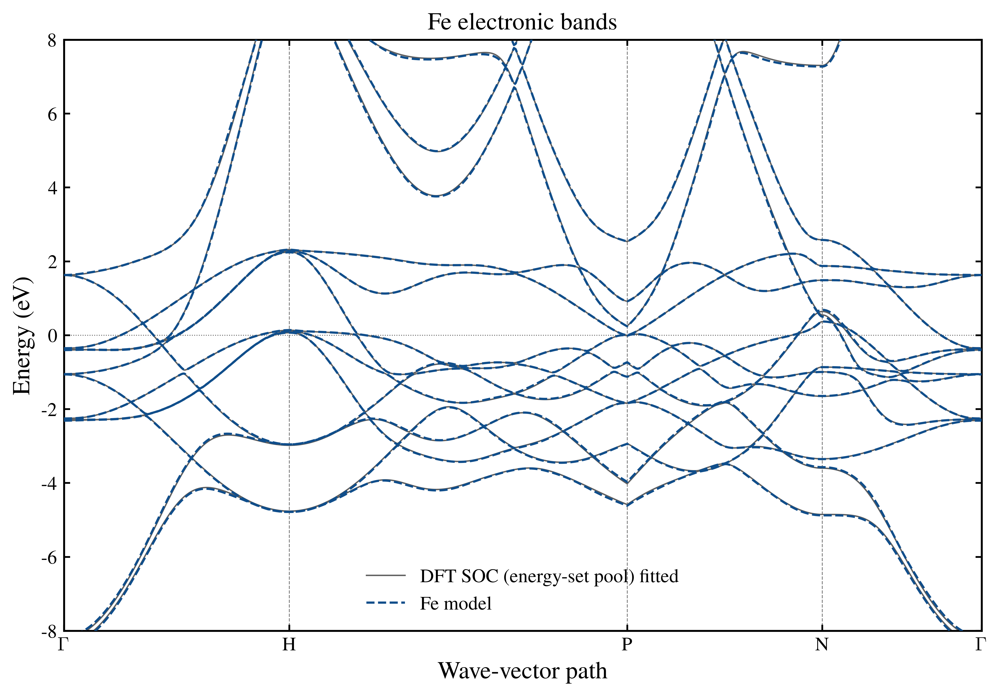
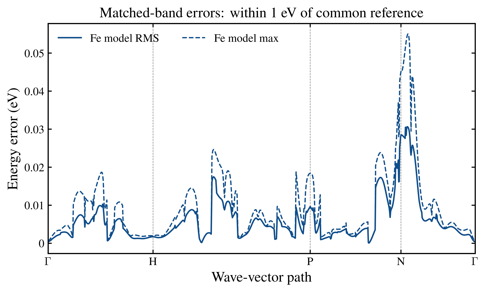

# 12 · Fe Wannierization and band assessment

## In this tutorial

- Prepare a native spinor Fe Wannierization and calculate its band path.
- Calculate a band path from an available Wannier model.
- Compare a finite model subspace with a larger DFT energy pool.
- Interpret matched-band RMS and maximum errors without confusing them with solver convergence.

## Physics and model

This lesson provides a native Wannierization input and separately evaluates an available Fe model. The band entry point does not run DFT or construct Wannier functions. The reciprocal-space Hamiltonian and its eigenvalues satisfy

```math
H^{(\mathrm{W})}(\mathbf k)
=\sum_{\mathbf R}\frac{H(\mathbf R)}{d_{\mathbf R}}
e^{2\pi i\mathbf k_{\mathrm{frac}}\cdot\mathbf R},
\qquad
H^{(\mathrm{W})}(\mathbf k)U(\mathbf k)=U(\mathbf k)\mathrm{diag}[\epsilon_n(\mathbf k)].
```

The positive phase uses fractional reciprocal coordinates, integer lattice vectors and the loaded real-space degeneracy weights $`d_{\mathbf R}`$. The phase equals $`e^{i\mathbf k_{\mathrm{cart}}\cdot\mathbf R_{\mathrm{cart}}}`$ in Cartesian coordinates; the divisor accounts for the loaded finite-file representation rather than changing the Fourier convention. A finite Wannier subspace cannot be expected to reproduce every DFT state. The supplied comparison matches the 18-band TB spectrum to a 64-band DFT energy pool.

For each matched pair, define the signed energy error

```math
\Delta \epsilon_{n\mathbf k}
=\epsilon^{\mathrm{TB}}_{n\mathbf k}
-\epsilon^{\mathrm{DFT}}_{\mathrm{matched},n\mathbf k}.
```

Both datasets use the same energy reference. Matching is an energy-comparison procedure; it does not prove that wavefunctions or optical matrix elements agree. At each momentum, the selected states give

```math
\mathrm{RMS}(\mathbf k)
=\sqrt{\frac{1}{N_{\mathbf k}}\sum_{n\in W_{\mathbf k}}(\Delta \epsilon_{n\mathbf k})^2},
\qquad
\mathrm{Max}(\mathbf k)
=\max_{n\in W_{\mathbf k}}|\Delta \epsilon_{n\mathbf k}|.
```

$`W_{\mathbf k}`$ selects matched DFT energies within the comparison window and $`N_{\mathbf k}`$ is their count. If that set is empty, no statistic is defined there. RMS summarizes typical squared error; the maximum identifies the worst matched state.

## Environment and calculation routes

Use Julia 1.11 or later, a WannierNLQG 1.2 source checkout, and Python 3.11 or later. The plotting and comparison tools also require the packages and system tools listed in the [repository setup](../../README.md). From the repository root, choose the source explicitly and prepare its matching environment:

```bash
export WN_SOURCE=/path/to/WannierNLQG-v1.2.0
julia --project=. scripts/bootstrap.jl "$WN_SOURCE"
```

The native route below builds a model from five user-supplied, same-calculation VASP files; it does not require the separate GeS/Fe asset set. The previous-model route later in this chapter instead reads an existing Fe TB file through an explicit private binding. Neither route downloads material data.

The native example was actually run with source-manifest SHA-256 `725ed8e66c2429c94bf299a5db38343ee39ba8b94d3c7fb0f35de6dae791d230`. A later local manifest `63d9520199dc47579fcbbd2d677e2081d3f42d9a6ef989e4e4fa1fb426fd0305` differs in documentation entries; its source, scripts and dependency manifest match the recorded version. This is compatibility evidence, not a new run.

## Route 1: construct a new Fe model

The [native input](wannierization/fe_native_ordinary.toml) starts from one self-consistent, spinor bcc Fe VASP calculation with 64 bands on a 10 × 10 × 10 full mesh. It requires matching POSCAR, POTCAR, INCAR, OUTCAR and WAVECAR files from that same calculation. Supply these files yourself under `inputs/` next to a working copy of the input. The tutorial does not distribute VASP wavefunctions or potential; use them only under the terms applicable to your installation and data. Do not mix files from different calculations.

The input prepares native overlap, energy and Fe s/p/d projection matrices for 18 spinor Wannier functions. The outer and frozen windows are [−8, 50] eV and [−8, 20] eV. Disentanglement selects an 18-dimensional subspace by minimizing the gauge-invariant spread $`\Omega_I`$; localization then varies its gauge to minimize the total spread $`\Omega=\Omega_I+\widetilde\Omega`$. The serial streaming preparation requests a 24 GiB internal memory budget; this is a preparation setting, not a measured peak or a universal hardware requirement.

For each stage the input permits up to 1000 accepted steps, with tolerance $`10^{-10}`$ and a window of three changes. The Z test is the relative change between successive accepted $`\Omega_I`$ values; the U test is the absolute change in total spread in Ų. Three qualifying changes require at least four accepted objective values; a previous zero Z objective is stable only if the current value is exactly zero. A stage reaching its iteration limit is not convergence. A normal process exit or an exported file alone also does not prove a qualified material: inspect both stage terminations, retained accepted state, warnings, structural checks and the output readback.

Use the current source and its matching installed Julia environment. From the repository root, with `WN_SOURCE` set to that source directory and user-supplied files in the working input directory:

```bash
mkdir -p .runtime/fe-native/inputs .runtime/fe-native/results
cp examples/12_fe_wannierization/wannierization/fe_native_ordinary.toml .runtime/fe-native/fe_native.toml
# Place the five same-calculation files in .runtime/fe-native/inputs/.
julia --project=.runtime/env "$WN_SOURCE/scripts/wanniernlqg.jl" check .runtime/fe-native/fe_native.toml
julia --project=.runtime/env "$WN_SOURCE/scripts/wanniernlqg.jl" run .runtime/fe-native/fe_native.toml --records .runtime/fe-native-records
```

Use a fresh working and records directory. The output profile requests an H/r model and a Wannierization checkpoint. The output paths in the input are relative to its working copy; check their actual locations and qualification before reuse. The 10 × 10 × 10 native overlap topology and projection labels have been compared against the available source set; this is an input check, not proof that solver trajectories are equivalent. A zero-step trial produced an H/r bundle that the band reader accepted for the 801-point path. That trial had warnings and no established scientific qualification; it is a workflow check, not a converged model.

Once the exported H/r bundle is checked, prepare a separate band-path input without changing the path or energy reference:

```bash
python examples/12_fe_wannierization/wannierization/prepare_fe_bands.py --template examples/12_fe_wannierization/inputs/fe_bands.toml --bundle .runtime/fe-native/results/fe-ordinary.h5 --output .runtime/fe-native-band-input.toml
julia --project=.runtime/env scripts/tutorial_input.jl check .runtime/fe-native-band-input.toml
julia --project=.runtime/env scripts/tutorial_input.jl run .runtime/fe-native-band-input.toml .runtime/fe-native-bands
```

The band output must be compared with a same-reference DFT path. An earlier nearest-energy-set metric allowed multiple model bands to select the same DFT energy; its near-Fermi RMS of approximately 0.00981 eV is not the same statistic as the one-to-one matched-band errors below.

With the plotting environment installed, prepare and validate a separate diagnostic comparison:

```bash
python examples/12_fe_wannierization/wannierization/prepare_fe_comparison.py --bands .runtime/fe-native-bands/outputs/fe_bands/Fe_bands.dat --reference examples/12_fe_wannierization/data/dft_absolute-59c64881.dat --template examples/12_fe_wannierization/plot_configs/audited_previous_new_Fe_review.json --output .runtime/fe-native-comparison
python scripts/plot_support/nlqg_band.py validate .runtime/fe-native-comparison/comparison.json
python scripts/plot_support/nlqg_band.py render .runtime/fe-native-comparison/comparison.json
```

The [comparison helper](wannierization/prepare_fe_comparison.py) verifies the generated band file’s 801 fractional path points and energy reference, records all input hashes, and preserves the raw band file. The DFT table does not encode fractional coordinates, so its identity as a reference for the same path must be established independently. The DFT and generated cumulative distances can differ slightly because of the lattice representation: after checking the path and a 3 × 10⁻⁷ Å⁻¹ maximum difference, it uses the DFT distances only for the shared plotting axis and records the actual difference. This does not fit or shift the energies. Its default model status remains unqualified; inspect the solver evidence and comparison window before drawing any accuracy conclusion.

## Route 1: recorded result and band comparison

The recorded run reached 1000 Z steps with a last relative change of $`8.13\times10^{-9}`$, above the $`10^{-10}`$ tolerance. U localization converged after 561 accepted steps from the retained structurally valid but nonconverged Z projector. The overall status is `MAX_ITERATIONS`, and scientific qualification is **not established**, despite successful H/r export. Structural checks passed; two PAW quality measurements passed, while eight were unavailable and retained quality-review warnings.

The exported model was evaluated on the 801-point path. The following figures show that new model, not the separately supplied reference model. The plots compare energies only and do not establish model qualification.

<a href="figures/native_fe_diagnostic_review_bands.png"></a>

New native-model band comparison. [PDF](figures/native_fe_diagnostic_review_bands.pdf).

<a href="figures/native_fe_diagnostic_review_errors.png"></a>

Matched-band errors within ±1 eV of the common reference. [PDF](figures/native_fe_diagnostic_review_errors.pdf).

At each k point, one-to-one energy matching selects 18 states from the 64-band DFT pool. Within ±1 eV of the common reference, the RMS is 9.908358 meV over all 2462 matched pairs, with maximum absolute error 55.041 meV. This energy-only comparison does not establish wavefunction equivalence or qualify the model; the Z stage did not converge.

The [raw band path](data/native_fe_band_path_raw.dat) and [plot table](data/native_fe_bands_absolute_aligned.dat) retain the numerical data. Redraw the figures without rerunning Wannierization:

```bash
python examples/12_fe_wannierization/plot.py --figure=native_fe_diagnostic_review --output=.runtime/plot-native-fe-diagnostic
```

## Route 2: previous reference-model parameters

Use [fe_bands.toml](inputs/fe_bands.toml) after following the [material setup guide](../../Materials/README.md).

| Parameter | Value | Meaning |
| --- | --- | --- |
| Model | Materials/Fe/model_tb.dat | Supplied 18-orbital Fe model |
| Path | Γ–H–P–N–Γ | High-symmetry path |
| Points per segment | 201 | Momentum resolution |
| Common reference | 5.7156290716733436 eV | Energy subtracted from every dataset |
| spatial_dimension | 3 | Cartesian dimension |
| Fourier / replica policy | direct / auto | Interpolation and representation handling |
| Display window | −8 to 8 eV | Energies relative to the common reference |
| Error window | −1 to 1 eV | Selects the matched DFT states entering the statistics |

The final two entries belong to the comparison, not to an independent band calculation. They do not change the underlying model or the response-calculation thresholds.

## Running the previous reference model

Create a private bindings file with the exact Fe TB asset, for example `.runtime/private-fe-paths.toml`:

```toml
[paths]
"Materials/Fe/model_tb.dat" = "/path/to/the/verified/Fe/model_tb.dat"
```

Then run from the repository root:

```bash
julia --project=.runtime/env scripts/run_group.jl 12 --check --data-paths=.runtime/private-fe-paths.toml
julia --project=.runtime/env scripts/run_group.jl 12 --case=fe_bands --output=.runtime/fe_bands --data-paths=.runtime/private-fe-paths.toml
```

Choose a fresh output directory for each calculation. The check command verifies inputs and dependencies without calculating bands. The single-model run does not generate the DFT reference tables.

The supplied [previous-model band figure](figures/audited_previous_new_Fe_review_bands.png) and [error figure](figures/audited_previous_new_Fe_review_errors.png) belong to this separate reference-model route. They are retained for comparison and are not the new native-model figures above.

## Redraw and check

```bash
python examples/12_fe_wannierization/plot.py --figure=audited_previous_new_Fe_review --output=.runtime/plot-audited_previous_new_Fe_review
```

This diagnostic example is not a certificate of quantitative material accuracy. Solver convergence and energy agreement do not establish the correctness of wavefunctions, position matrix elements or orbital-response operators. A high-symmetry path also leaves most of the Brillouin zone untested.

[Reproducibility](reproduce.json)

## Full-spectrum comparison

The [full band plot](figures/audited_previous_new_Fe_full_bands.png) and [full error plot](figures/audited_previous_new_Fe_full_errors.png) retain the complete comparison in addition to the review window above. Both views use the same declared energy reference and matching rules.

```bash
python examples/12_fe_wannierization/plot.py --figure=audited_previous_new_Fe_full --output=.runtime/fe-full-bands
```

An interpolation fit compares selected bands. It does not certify a Wannierization solver's stopping condition or the completeness of derivative, spin or orbital operators required by a response calculation. Reproducing the figures uses the supplied model and audited band data; a newly constructed model needs its own solver qualification and band comparison.

## References

- N. Marzari, A. A. Mostofi, J. R. Yates, I. Souza, and D. Vanderbilt, “Maximally localized Wannier functions: Theory and applications,” *Reviews of Modern Physics* **84**, 1419–1475 (2012). [DOI](https://doi.org/10.1103/RevModPhys.84.1419). Background for finite Wannier subspaces and interpolation.
