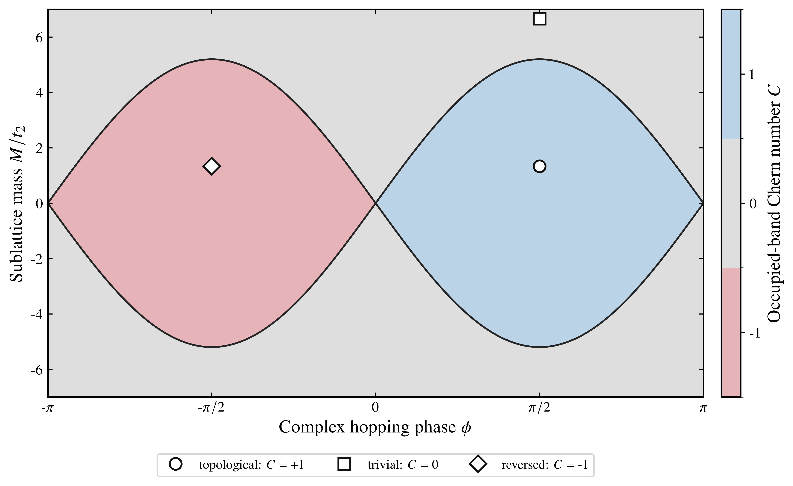
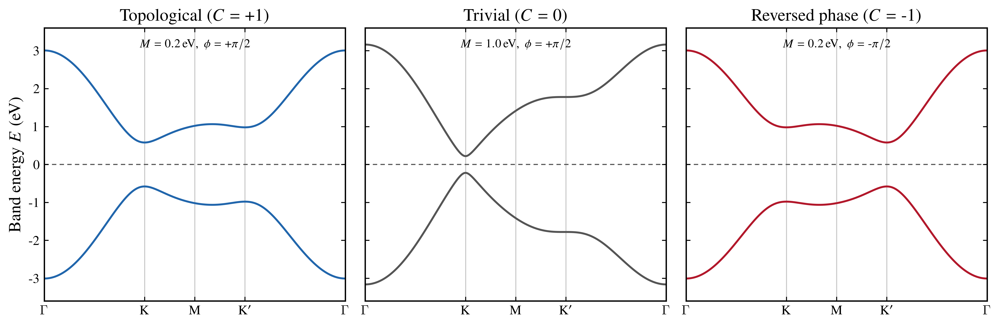
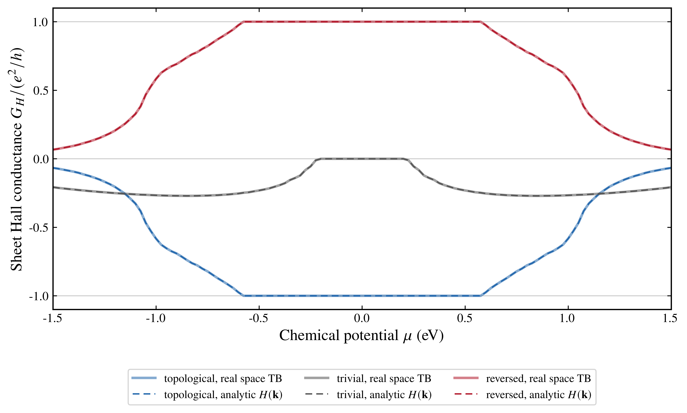
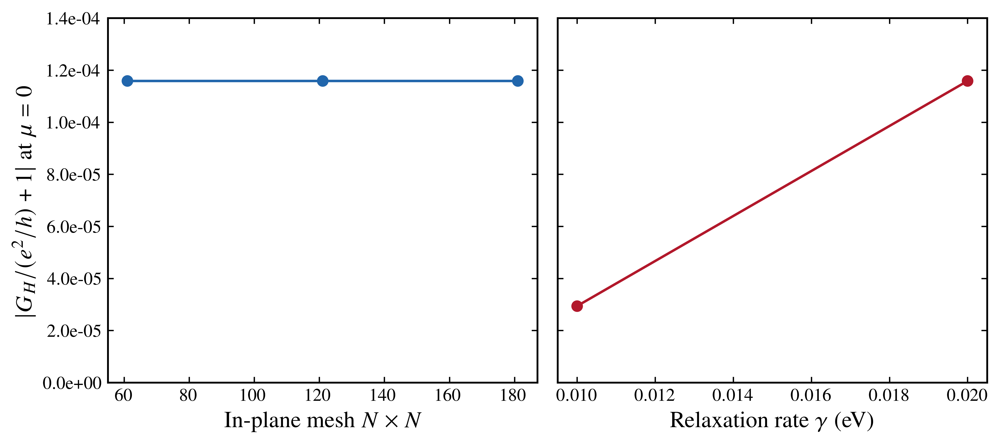

# 13 · Haldane model and anomalous Hall conductance

## In this tutorial

- Relate a two-band Hamiltonian to its gap and topological phase.
- Compare real-space TB and analytic inputs for the same model.
- Distinguish an insulating Hall plateau from finite-width and mesh effects.

## Physics and model

The model in [HaldaneModel.jl](../../models/haldane/HaldaneModel.jl) uses two orbitals and complex next-nearest-neighbor hopping. Define $`u=\mathbf{k}\cdot\mathbf{a}_1`$, $`v=\mathbf{k}\cdot\mathbf{a}_2`$, and $`\Theta=\{u,v-u,-v\}`$. In its periodic Convention-II basis,

```math
H(\mathbf{k})=
\begin{pmatrix}
h_A & f\\ f^* & h_B
\end{pmatrix},
\qquad
f=t_1(1+e^{-iu}+e^{-iv}),
```

```math
h_A=-M+2t_2\sum_{\theta\in\Theta}\cos(\theta-\phi),
\qquad
h_B=M+2t_2\sum_{\theta\in\Theta}\cos(\theta+\phi).
```

The sign of $`M`$ here follows this source: the A-site energy is $`-M`$. With $`d_0=(h_A+h_B)/2`$ and $`d_z=(h_A-h_B)/2`$,

```math
E_\pm=d_0\pm\sqrt{d_z^2+|f|^2}.
```

The gap can close at $`|M|=3\sqrt{3}|t_2\sin\phi|`$. This separates the trivial and topological regions for the model. Reversing $`\phi`$ changes the transverse response without requiring a visibly different band spectrum. The orbitals sit at $`0`$ and $`(\mathbf{a}_1+\mathbf{a}_2)/3`$; those centers are part of the optical and geometric input, not an optional plotting choice.

## Parameters

No external material files are needed.

| Parameter | Value | Role |
| --- | --- | --- |
| $`\mathbf{a}_1,\mathbf{a}_2`$ | $`(1,0,0)`$, $`(1/2,\sqrt{3}/2,0)`$ Å | In-plane primitive vectors |
| Auxiliary cell height | 20 Å | Embedding of the two-dimensional model |
| $`t_1,t_2`$ | −1.0 eV, 0.15 eV | Nearest and next-nearest hopping |
| Topological case $`(M,\phi)`$ | (0.2 eV, $`\pi/2`$) | Gapped topological example |
| Trivial case $`(M,\phi)`$ | (1.0 eV, $`\pi/2`$) | Larger sublattice mass |
| Reversed case $`(M,\phi)`$ | (0.2 eV, $`-\pi/2`$) | Reversed complex hopping phase |
| Basic mesh | [121, 121, 1] | TOML spatial_dimension = 3; no third-direction dispersion |
| Chemical potentials | −1.5 to 1.5 eV, 121 points | Occupation scan |
| Temperature | 0 K | Occupation temperature |
| Interband / intraband widths | 0.02 / 0.02 eV | Finite relaxation |
| eta_fs_ev | 0.01 eV | Gaussian Fermi-surface width |

The plotted observable is sheet Hall conductance in units of $`e^2/h`$. The third lattice direction is an embedding convention; it does not turn the model into a three-dimensional dispersive material.

## Run

From the repository root, check the inputs and run [tb_topological](inputs/tb_topological.toml):

```bash
julia --project=.runtime/env scripts/run_group.jl 13 --check
julia --project=.runtime/env scripts/run_group.jl 13 --case=tb_topological --output=.runtime/tb_topological
```

Use a new output directory for each run. The check command inspects inputs and dependencies; it does not calculate a response.

Other inputs: [analytic_reversed](inputs/analytic_reversed.toml), [analytic_topological](inputs/analytic_topological.toml), [analytic_trivial](inputs/analytic_trivial.toml), [tb_reversed](inputs/tb_reversed.toml), [tb_topological_n121_g001](inputs/tb_topological_n121_g001.toml), [tb_topological_n181_g002](inputs/tb_topological_n181_g002.toml), [tb_topological_n61_g002](inputs/tb_topological_n61_g002.toml), [tb_trivial](inputs/tb_trivial.toml). Replace the case and output name to select one of them.

## Read the figures

These example figures use the supplied data. The plotting command below redraws them; it does not run the calculation inputs above.

### Phase diagram

<a href="figures/haldane_phase_diagram.png"></a>

Read the topological and trivial regions before following their dispersions.

### Band dispersion

<a href="figures/haldane_bands.png"></a>

Compare the gaps along the same high-symmetry path. Similar-looking band dispersions do not determine the topology: the wavefunctions and their Berry curvature matter too. [Original PNG](figures/haldane_bands.png) · [PDF](figures/haldane_bands.pdf).

### Connect the gap to the Hall response

<a href="figures/haldane_hall_vs_mu.png"></a>

Solid and dashed curves compare the tight-binding and analytic input routes. Follow the insulating plateau and its departure as the chemical potential enters a band. Reversing the complex hopping phase reverses the transverse response in the model convention. [Original PNG](figures/haldane_hall_vs_mu.png) · [PDF](figures/haldane_hall_vs_mu.pdf).

Explore the [phase diagram](figures/haldane_phase_diagram.png) and the [mesh/relaxation-width comparison](figures/haldane_convergence.png).

### Mesh and relaxation

<a href="figures/haldane_convergence.png"></a>

The two controls vary a fixed-domain mesh and a relaxation width independently.

## Redraw the examples

Run from the repository root, using a new output directory:

`python examples/13_haldane_anomalous_hall/plot.py --figure=chapter_reference_figures --output=.runtime/plot-chapter_reference_figures`

## Physical and numerical limits

The sign of Hall conductance depends on the stated charge and tensor convention; do not identify it with the Chern label without checking that convention. A finite relaxation width can shift the plateau away from an exact integer. Varying that width and refining the mesh test different limits.

[Reproducibility](reproduce.json)

## Topology, dispersion and numerical resolution


Read the phase diagram first, then the bands and chemical-potential Hall plateau, and finally the numerical checks. In the sign convention used here, an insulating clean-limit plateau obeys $`G_{xy}=-C e^2/h`$. The finite-width topological example gives approximately −0.999884 $`e^2/h`$ for $`C=+1`$; reversing the topological mass reverses the Hall sign. A finite-width plateau need not be exactly an integer. Refining a fixed grid and narrowing relaxation are separate limits.

The supplied independent plaquette-Chern check uses the gauge-invariant lattice construction of [Fukui, Hatsugai and Suzuki, JPSJ 74, 1674 (2005)](https://doi.org/10.1143/JPSJ.74.1674). This checks the model's integer topology independently of a broadened transport curve; it does not turn the entire finite-width spectrum into a quantized observable.

## References

- F. D. M. Haldane, “Model for a Quantum Hall Effect without Landau Levels: Condensed-Matter Realization of the ‘Parity Anomaly’,” *Physical Review Letters* **61**, 2015–2018 (1988). [DOI](https://doi.org/10.1103/PhysRevLett.61.2015). Background for the model.
- D. Xiao, M.-C. Chang, and Q. Niu, “Berry phase effects on electronic properties,” *Reviews of Modern Physics* **82**, 1959–2007 (2010). [DOI](https://doi.org/10.1103/RevModPhys.82.1959). Background for Berry curvature and Hall transport.

The response tables and figures use the current 1.2.0 implementation at the input meshes listed above. Independent model and analytic reference data are retained with their original provenance; these checks do not establish material convergence.
