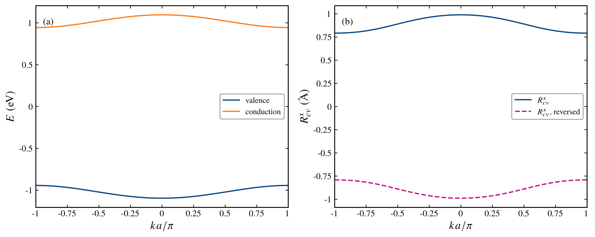
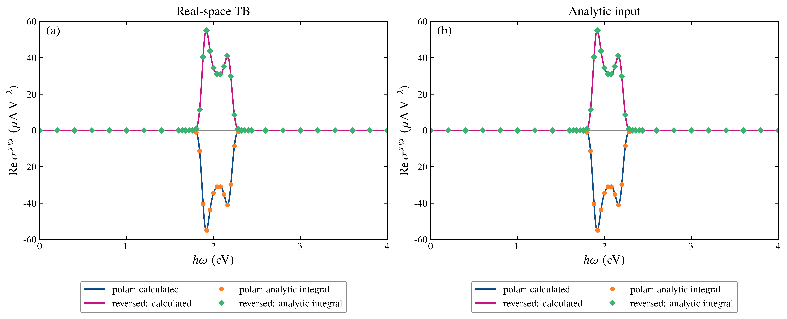
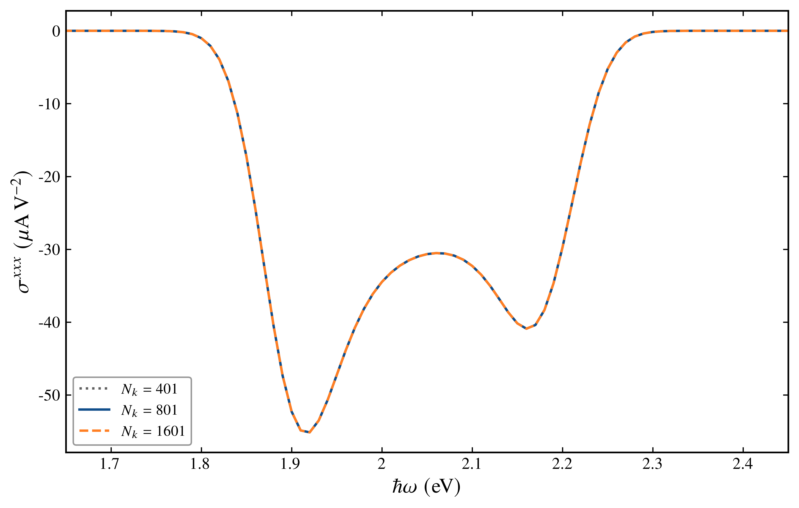

# 14 · Rice–Mele model and shift current

## In this tutorial

- Connect broken inversion symmetry to a second-order photocurrent.
- Distinguish the band energy, transition shift vector, and integrated response.
- Compare real-space tight-binding and analytic Hamiltonian inputs with an independent reference integral.

## Physics and model

The Rice–Mele chain has two orbitals per cell, alternating hoppings, and alternating site energies. In the periodic Convention-II basis used by [RiceMeleModel.jl](../../models/rice_mele/RiceMeleModel.jl),

```math
H(k)=
\begin{pmatrix}
m & t_1+t_2 e^{-ika}\\
t_1+t_2 e^{ika} & -m
\end{pmatrix},
\qquad
t_1=\frac{t+\delta}{2},\quad t_2=\frac{t-\delta}{2}.
```

Here $`k`$ is the Cartesian wavevector along the chain, $`a`$ is the cell period, and $`t,\delta,m`$ are energies. The orbital centers are $`0`$ and $`a/2`$; their positions are supplied separately to the model and must be retained when evaluating optical geometry.

The eigenvalues follow from $`E^2=m^2+|t_1+t_2e^{-ika}|^2`$:

```math
E_\pm(k)=\pm\sqrt{
t^2\cos^2(ka/2)+\delta^2\sin^2(ka/2)+m^2}.
```

Changing $`m`$ to $`-m`$ leaves these energies unchanged. It does not leave the optical geometry unchanged: the polar and reversed cases illustrate how similar bands can accompany opposite shift-current responses. Setting $`m=0`$ gives the SSH limit; setting $`\delta=0`$ gives the ionic limit. These provide different inversion-symmetric controls.

The shift vector $`R_{cv}^x`$ describes a transition-associated displacement, in Å. The integrated current also depends on the transition dipole, occupations, and energy selection. The independent [reference implementation](reference_checks.py) weights the product $`R_{cv}^x|r_{cv}^x|^2`$ with the Gaussian

```math
g_\eta(\Delta E)=\frac{\exp[-(\Delta E/\eta)^2]}{\sqrt{\pi}\eta},
\qquad
\Delta E=\hbar\omega-[E_c(k)-E_v(k)].
```

Here $`\eta=0.05`$ eV is the reference energy width, not its standard deviation. The reference sum retains terms with $`|\Delta E|<5\eta`$. This describes that reference function's convention; it does not assign the same line shape to every response kernel.

## Parameters

The model is supplied by Julia callbacks in this repository; no external material files are needed.

| Parameter | Polar example | Meaning |
| --- | --- | --- |
| $`a`$ | 4 Å | Chain period |
| $`t`$ | −1.0 eV | Hopping scale |
| $`\delta`$ | −0.83 eV | Hopping alternation |
| $`m`$ | −0.45 eV | Alternating site energy; reversed case: +0.45 eV |
| Orbital centers | 0, $`a/2`$ | Positions within the cell |
| Transverse area | 9.37 Ų | Fixed normalization for the embedded chain |
| $`\mu`$, $`T`$ | 0 eV, 0 K | Chemical potential and temperature |
| k mesh | [801, 1] | Actual TOML sampling; spatial_dimension = 2 |
| Photon energies | 0–4 eV, 401 points | Current input spectrum |
| broadening | 0.05 eV | Optical broadening; the omitted broadening_type defaults to Gaussian |
| denominator_regularization | 0.0001 | Current TOML value; distinct from the Gaussian width |

The physical model is one-dimensional even though its cell and sampling use an embedded representation. Do not reinterpret its response as a differently normalized bulk or sheet coefficient by changing the axis label.

## Run

From the repository root, check the inputs and run the polar tight-binding case:

```bash
julia --project=.runtime/env scripts/run_group.jl 14 --check
julia --project=.runtime/env scripts/run_group.jl 14 --case=tb_polar --output=.runtime/tb_polar
```

Use a new output directory for each run. The check command inspects inputs and dependencies; it does not calculate a response.

Start with [tb_polar](inputs/tb_polar.toml). Other choices are [analytic_polar](inputs/analytic_polar.toml), [tb_reversed](inputs/tb_reversed.toml), [analytic_reversed](inputs/analytic_reversed.toml), [tb_ssh](inputs/tb_ssh.toml), [analytic_ssh](inputs/analytic_ssh.toml), [tb_ionic](inputs/tb_ionic.toml), and [analytic_ionic](inputs/analytic_ionic.toml). For mesh tests, use [tb_polar_n401](inputs/tb_polar_n401.toml) or [tb_polar_n1601](inputs/tb_polar_n1601.toml), replacing the case and output name in the command above.

## Read the figures

The figures below use the supplied example data. Redrawing them does not execute the calculation input above.

### 1. Bands and transition geometry

<a href="figures/rice_mele_bands_shift_vector.png"></a>

First compare the band energies, then the shift vector. Reversing the mass leaves the energy formula unchanged but changes the transition geometry. A displacement curve alone is not a photocurrent spectrum: the dipole weight and energy-selection factor still enter the integral.

[Original PNG](figures/rice_mele_bands_shift_vector.png) · [PDF](figures/rice_mele_bands_shift_vector.pdf)

### 2. Shift-current spectrum

<a href="figures/rice_mele_shift_current.png"></a>

The curves show WannierNLQG results, and the markers show an independent analytic integral. The two panels show real-space TB and analytic-input results for $`\mathrm{Re}\,\sigma^{xxx}`$, in μA/V². Compare each polar/reversed curve with its reference markers. Those markers select points from the supplied reference integral; they are not new calculations performed when this page is opened. The factor $`10^6`$ in the plot converts A to μA, without fitting the response amplitude.

[Original PNG](figures/rice_mele_shift_current.png) · [PDF](figures/rice_mele_shift_current.pdf)

## Redraw and check

Redraw the supplied figure set into a new directory:

```bash
python examples/14_rice_mele_shift_current/plot.py --figure=chapter_reference_figures --output=.runtime/plot-chapter_reference_figures
```

Use the [mesh comparison](figures/rice_mele_convergence.png) to examine numerical resolution. Agreement at one mesh and broadening does not establish convergence for every frequency or parameter set. Keep the transverse area, orbital positions, response convention, and broadening fixed when comparing amplitudes.

[Reproducibility](reproduce.json)

## Mesh, symmetry and the two absorption features

<a href="figures/rice_mele_convergence.png"></a>

[PDF](figures/rice_mele_convergence.pdf)

The band-edge transition energies are $`2\sqrt{m^2+\delta^2}`$ at the zone edge and $`2\sqrt{m^2+t^2}`$ at the zone center. For the supplied parameters these are about 1.888 and 2.193 eV; broadened spectral maxima need not lie exactly at either threshold. The two features therefore connect the spectrum to different parts of the one-dimensional band structure.

The independent Eq. (21) integral comparison uses the same orbital embedding, area and Gaussian width. The supplied maximum relative discrepancy is about 0.2975%; the two WannierNLQG model routes differ by about 0.1000% under their stated check. Polarization reversal changes the shift-current sign, while the inversion-symmetric controls are null within the recorded tolerance. These are distinct tests of normalization, implementation and symmetry. Mesh agreement at this width is not a statement about the zero-width spectrum.

## References

- M. J. Rice and E. J. Mele, “Elementary Excitations of a Linearly Conjugated Diatomic Polymer,” *Physical Review Letters* **49**, 1455–1459 (1982). [DOI](https://doi.org/10.1103/PhysRevLett.49.1455). Background for the model.
- J. E. Sipe and A. I. Shkrebtii, “Second-order optical response in semiconductors,” *Physical Review B* **61**, 5337–5352 (2000). [DOI](https://doi.org/10.1103/PhysRevB.61.5337). Background for second-order optical response.
- H. Wang, X. Tang, H. Xu, J. Li, and X. Qian, “Generalized Wilson loop method for nonlinear light-matter interaction,” *npj Quantum Materials* **7**, 61 (2022). [DOI](https://doi.org/10.1038/s41535-022-00472-4). Further reading on shift geometry and nonlinear response.

The response tables and figures use the current 1.2.0 implementation at the input meshes listed above. Independent model and analytic reference data are retained with their original provenance; these checks do not establish material convergence.
