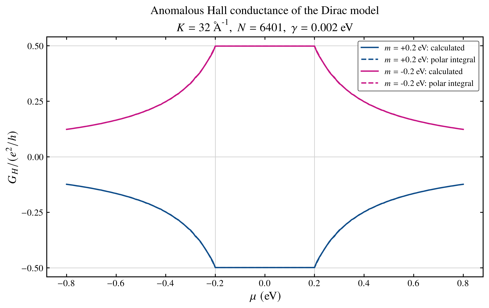
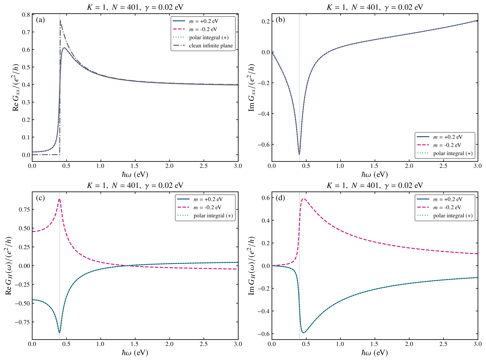
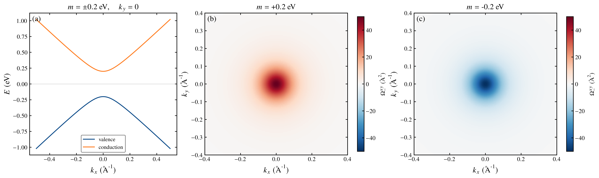
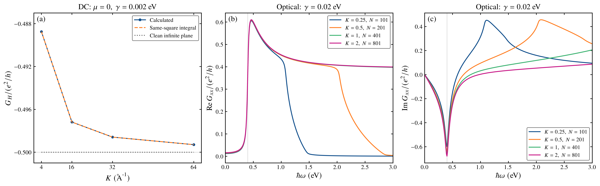
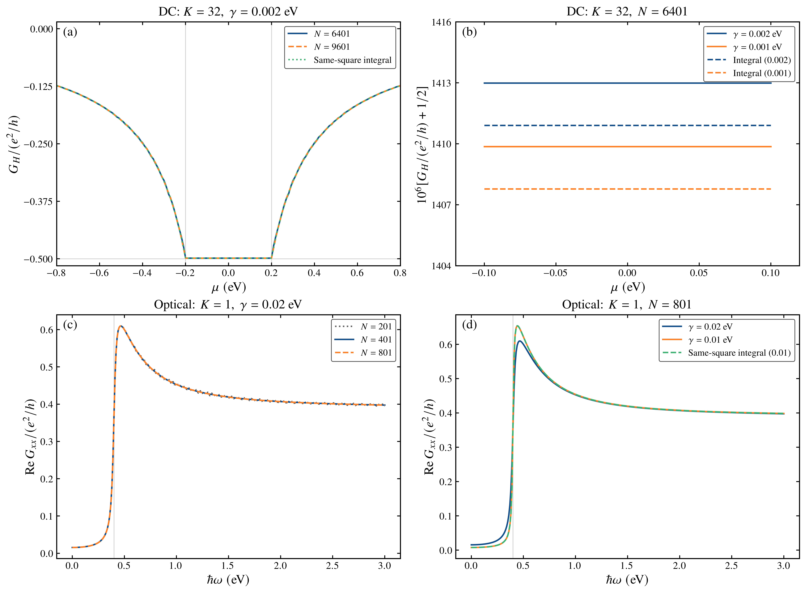

# 15 · Nonperiodic Dirac model: integration domains and response limits

## In this tutorial

- Derive the dispersion and Berry curvature of a massive Dirac cone.
- Separate integration-region truncation, mesh resolution, and relaxation effects.
- Compare DC and complex optical responses with a reference using the same region.

## Physics and model

The current [model loader](../../models/TutorialModels.jl) calls [DCModel.jl](../../models/dirac/DCModel.jl). In a fixed two-orbital basis,

$$
H(\mathbf{k})=
\begin{pmatrix}
m & v(k_x-i k_y)\\
v(k_x+i k_y) & -m
\end{pmatrix}
=v k_x\sigma_x+v k_y\sigma_y+m\sigma_z,
$$

$$
E_\pm(\mathbf{k})=\pm E(\mathbf{k}),
\qquad E=\sqrt{m^2+v^2(k_x^2+k_y^2)}.
$$

Here $k_x,k_y$ are in Å$^{-1}$, $m$ is in eV, and $v=2$ eV Å is $\hbar$ times a physical velocity, not a velocity in m/s. In the connection convention $r_{nn}^a=i\langle u_n|\partial_{k_a}u_n\rangle$, where the diagonal Hamiltonian-gauge position-matrix element is the Berry connection, the [reference implementation](reference_checks.py) uses

$$
\Omega_-^{xy}(\mathbf{k})=\frac{m v^2}{2E^3},
\qquad \Omega_+^{xy}=-\Omega_-^{xy}.
$$

The curvature has units Ų and changes sign with $m$, while the energies do not. Unlike a periodic lattice band, this single cone has no finite Brillouin zone. Its integration region is explicitly $[-K,K]^2$. The infinite-plane half-integer flux is a continuum limit, not the integer Chern number of an isolated periodic lattice band.

## Parameters

No external material files are needed. The two orbitals have coincident centers.

| Parameter | Basic DC case | Basic optical case |
| --- | --- | --- |
| Mass $m$ | ±0.2 eV | ±0.2 eV |
| $v=\hbar v_F$ | 2 eV Å | 2 eV Å |
| Region cutoff $K$ | 32 Å$^{-1}$ | 1 Å$^{-1}$ |
| Mesh | [6401, 6401] | [401, 401] |
| Sampling | k_region; spatial_dimension = 2 | k_region; spatial_dimension = 2 |
| Chemical potential | −0.8 to 0.8 eV, 161 points | 0 eV |
| Photon energies | DC response | 0–3 eV, 301 points |
| Temperature | 0 K | 0 K |
| Interband / intraband widths | 0.002 / 0.002 eV | 0.02 / 0.02 eV |
| eta_fs_ev | 0.01 eV | 0.01 eV |

Finite-region, infinite-plane, finite-width, and clean-limit results are different reference problems. Match these conditions before interpreting a difference as a numerical error. The DC meshes are substantial reference calculations, not small smoke tests.

## Run

From the repository root, check the inputs and run [optical_positive](inputs/optical_positive.toml):

```bash
julia --project=.runtime/env scripts/run_group.jl 15 --check
julia --project=.runtime/env scripts/run_group.jl 15 --case=optical_positive --output=.runtime/optical_positive
```

Use a new output directory for each run. The check command inspects inputs and dependencies; it does not calculate a response.

Other inputs: [hall_negative](inputs/hall_negative.toml), [hall_positive](inputs/hall_positive.toml), [hall_positive_g0001](inputs/hall_positive_g0001.toml), [hall_positive_n9601](inputs/hall_positive_n9601.toml), [optical_negative](inputs/optical_negative.toml), [optical_positive_g001](inputs/optical_positive_g001.toml), [optical_positive_k025](inputs/optical_positive_k025.toml), [optical_positive_k050](inputs/optical_positive_k050.toml), [optical_positive_k200](inputs/optical_positive_k200.toml), [optical_positive_n201](inputs/optical_positive_n201.toml), [optical_positive_n801](inputs/optical_positive_n801.toml). Replace the case and output name to select one of them.

## Read the figures

These example figures use the supplied data. The plotting command below redraws them; it does not run the calculation inputs above.

### Read the DC Hall response

<a href="figures/dirac_hall_vs_mu.png"></a>

Compare the calculated curves with an integral over the same square region. The conductance is measured in e²/h. The ±1/2 guide lines describe a single-cone limiting value, not an exact requirement for a finite region at finite relaxation width. [Original PNG](figures/dirac_hall_vs_mu.png) · [PDF](figures/dirac_hall_vs_mu.pdf).

### Separate longitudinal and transverse optical response

<a href="figures/dirac_optical_conductivity.png"></a>

Real and imaginary components answer different questions and must both be retained. The same-region reference and the clean infinite-plane curve use different limits; their separation is not automatically a numerical error. [Original PNG](figures/dirac_optical_conductivity.png) · [PDF](figures/dirac_optical_conductivity.pdf).

Compare [integration-region dependence](figures/dirac_cutoff_dependence.png) with the [mesh and relaxation-width tests](figures/dirac_convergence.png).

## Redraw the examples

Run from the repository root, using a new output directory:

`python examples/15_nonperiodic_dirac_response/plot.py --figure=chapter_reference_figures --output=.runtime/plot-chapter_reference_figures`

## Physical and numerical limits

The available checks support the in-gap DC plateau and selected optical comparisons, but DC mesh convergence over the entire chemical-potential axis remains unresolved. Increasing the momentum cutoff is not the same as refining a fixed integration region. Keep the region and relaxation width matched when comparing a calculation with an independent integral.

[Reproducibility](reproduce.json)

## Geometry, cutoff and mesh

<a href="figures/dirac_bands_berry.png"></a>

[PDF](figures/dirac_bands_berry.pdf)

<a href="figures/dirac_cutoff_dependence.png"></a>

[PDF](figures/dirac_cutoff_dependence.pdf)

<a href="figures/dirac_convergence.png"></a>

[PDF](figures/dirac_convergence.pdf)

For the clean, in-gap single cone on the square $[-K,K]^2$, the stated convention gives

$$
\frac{G_{xy}}{e^2/h}=-\frac{\operatorname{sgn}m}{\pi}\arctan\!\frac{(vK)^2}{|m|\sqrt{m^2+2(vK)^2}}.
$$

It tends to $-\operatorname{sgn}(m)/2$ only as the cutoff tends to infinity. With $m=0.2$ eV, $v=2$ eV Å and $K=32$ Å$^{-1}$ the clean finite-square value is approximately −0.498593; finite relaxation defines another reference problem. Mass reversal reverses the transverse response without reversing the longitudinal response. At zero chemical potential the interband optical threshold is $2|m|=0.4$ eV.

Use the matched-parameter DC/optical control when discussing a zero-frequency relation; the two main plots have different cutoffs and relaxation settings. The continuum optical reference is related to [Gusynin, Sharapov and Carbotte, arXiv:0706.3016](https://arxiv.org/abs/0706.3016). Their graphene spin/valley multiplicities must not be inserted into this single-cone model without an explicit change of convention. The failed full-axis Hall mesh check and the restricted antisymmetric-Hall reuse bound above remain in force.

## References

- D. Xiao, M.-C. Chang, and Q. Niu, “Berry phase effects on electronic properties,” *Reviews of Modern Physics* **82**, 1959–2007 (2010). [DOI](https://doi.org/10.1103/RevModPhys.82.1959). Background for two-level Berry geometry and anomalous Hall response.
- F. D. M. Haldane, “Model for a Quantum Hall Effect without Landau Levels: Condensed-Matter Realization of the ‘Parity Anomaly’,” *Physical Review Letters* **61**, 2015–2018 (1988). [DOI](https://doi.org/10.1103/PhysRevLett.61.2015). Background for the distinction between continuum-cone physics and a lattice realization.

Current linear optical curves and the narrow-rate three-chemical-potential Hall control were recalculated with the current 1.2.0 implementation at the unchanged input meshes. Their tensors are saved alongside the display tables. Retained supplementary cutoff and matched-parameter controls retain their original provenance. The finite-square full-axis Hall mesh test remains a failed accuracy test; it is not promoted by this update.

The two 6401 × 6401, 161-point chemical-potential Hall curves also use current calculated tensors. The supplementary 9601 × 9601 Hall curve retains its checked source. For this fixed, gapped two-band cone, the current finite-position regularization changes the antisymmetric Hall response by at most 0.00125% at any listed chemical potential: its curvature has one sign, so positive quadrature weights cannot amplify the pairwise bound through cancellation. This statement is specific to the Hall channel and does not certify a new full-axis calculation or the longitudinal columns. The failed full-axis mesh comparison remains a failed accuracy test.
