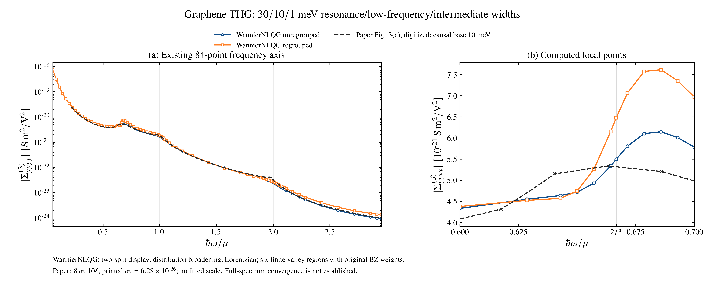
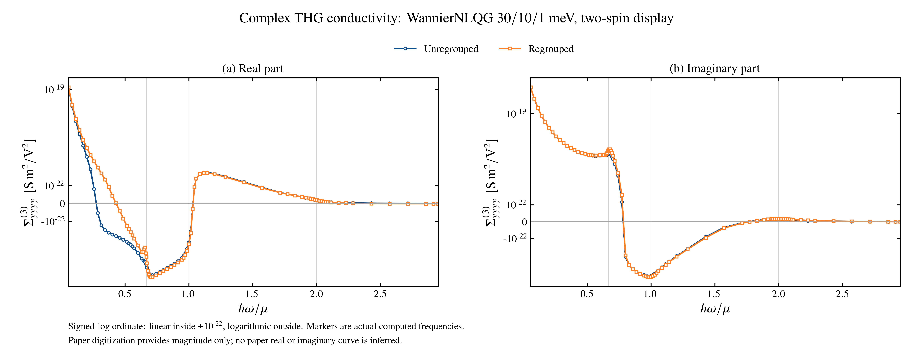

# 16 · Monolayer graphene: third-harmonic generation

## In this tutorial

- Build the nearest-neighbor graphene Hamiltonian with explicit orbital positions.
- Compare two expressions for the third-harmonic response.
- Identify low-frequency cancellation and mesh sensitivity separately.

## Physics and model

The [graphene model](../../models/graphene/GrapheneModel.jl) contains one spin copy of two point orbitals per cell. With carbon–carbon bond length $a$,

$$
\mathbf{a}_1=(\sqrt{3}a/2,3a/2,0),\qquad
\mathbf{a}_2=(-\sqrt{3}a/2,3a/2,0).
$$

In its periodic Convention-II basis,

$$
H_{\mathrm{per}}(\mathbf{k})=
\begin{pmatrix}0&f(\mathbf{k})\\f^*(\mathbf{k})&0\end{pmatrix},
\quad
f=t[1+e^{-i\mathbf{k}\cdot\mathbf{a}_1}
       +e^{-i\mathbf{k}\cdot\mathbf{a}_2}],
\quad E_\pm=\pm|f|.
$$

The orbital centers are $\boldsymbol{\tau}_A=0$ and $\boldsymbol{\tau}_B=(0,a,0)$. Including their phases with $P=\mathrm{diag}(e^{i\mathbf{k}\cdot\boldsymbol{\tau}_A},e^{i\mathbf{k}\cdot\boldsymbol{\tau}_B})$ gives $H_{\mathrm{emb}}=P^\dagger H_{\mathrm{per}}P$. For example, its off-diagonal entry is

$$
f_{\mathrm{emb}}=t\left[e^{ik_y a}
+2e^{-ik_y a/2}\cos(\sqrt{3}k_x a/2)\right].
$$

These are representations of the same model, not different dispersions. Keep orbital embedding consistent when comparing optical quantities.

Third-harmonic generation couples three fields at $\omega$ to a response at $3\omega$. The examples plot the magnitude of the third-order sheet conductivity $\Sigma^{(3)}_{yyyy}$, in A m²/V³. It is not a susceptibility $\chi$; conversions require a stated Fourier and polarization convention. “A4” and “Regrouped” label the two expressions in the supplied data, not two different materials.

## Parameters

No external material files are needed. The chapter input is [valley_input.toml](valley_input.toml). It defines six disjoint Cartesian rectangles obtained by folding two K/K′ windows, each of side 1.46 Å⁻¹, into the selected reciprocal cell. The integration preserves their original Brillouin-zone weights: the six fractions sum to 0.5657239247980235. Contributions outside these windows are omitted. Sum the six native outputs directly; dividing by the selected area, or adding another valley factor, changes the observable.

| Parameter | Actual value |
| --- | --- |
| Replay runtime | Julia 1.13.0; exact replay source pin in [valley_input.toml](valley_input.toml) |
| Supplied data source | Recorded calculation and unit-conversion identities in [reproduce.json](reproduce.json) |
| Bond length / hopping | 1.42 Å / −3.0 eV |
| Orbital embedding | Two point orbitals, Convention II; centers 0 and (0,1.42,0) Å |
| Chemical potential / temperature | 0.35 eV / 10 K |
| Photon energies | 84 explicit values, 0.02–1.0331337560200193 eV |
| Tensor and raw normalization | yyyy; volume conductivity A m/V³ and susceptibility m²/V² |
| Quadrature | h-adaptive cubature, 32 declared vector frequency batches, six regions each |
| Initial subdivisions / estimate controls | 16 / rtol $10^{-6}$, atol 0 |
| Evaluation cap | 1,920,000 per original valley per frequency batch, distributed by rectangle area |
| Broadening prescription | distribution_broadening, Lorentzian |
| Resonance / low-frequency width | 0.03 / 0.01 eV |
| Intermediate regularization | 0.001 eV, positive as required by this implementation |
| eta_correction / occupation derivatives | false / exact Fermi–Dirac |
| Model / display spin count | One explicit model spin copy / display factor 2 |
| Extra valley or field multiplier | 1; native field and permutation normalization retained |

The adaptive nodes refine the original rectangles; the driver's placeholder `k_mesh=(4,4)` is not a fixed 4 × 4 integration grid. Every input batch keeps the same evaluation cap and initial subdivisions as its corresponding selected-valley setup. The software uses the stated resonance width at each harmonic and separate broadened low-frequency poles. This is the currently supported prescription, not a causal resolvent with cumulative widths $\eta,2\eta,3\eta$. The positive intermediate width is also retained explicitly. THG has no response-grouping threshold.

## Run

First prepare the environment as described in the [repository setup](../../README.md). Use Julia 1.13.0 for the recorded replay; the `julia` command below must resolve to that executable, rather than an unrelated default version. From the repository root, check all declared batches without integrating:

```bash
julia --project=.runtime/env --threads=1 examples/16_monolayer_graphene_thg/run_valleys.jl --input=examples/16_monolayer_graphene_thg/valley_input.toml --batch=all --check=true
```

The package loaded by `.runtime/env` must match `reproduction.source_manifest_sha256` in the input for either a new run or `--check`. This is the expected replay source pin. Its source binding has been checked by constructing six configurations without response integration. The supplied numerical tables retain their original calculation source, and their volume-derived companions retain the separate normalization-validation source. Updating the replay pin does not relabel those records or promise a bitwise repeat.

With an allocated resource window, run one three-frequency batch into a fresh directory:

```bash
julia --project=.runtime/env --threads=1 examples/16_monolayer_graphene_thg/run_valleys.jl --input=examples/16_monolayer_graphene_thg/valley_input.toml --batch=turnover-base_new30 --output=.runtime/thg-turnover
```

Use `--batch=all` for the complete declared input. The saved 84-point result combines 72 newly evaluated frequencies with 12 exactly reused points from a separately checked 30 meV local calculation. The input preserves their **actual vector shapes**: 29 vectors supply the 72 points, and three local vectors contain 27 values, of which 12 belong to the target spectrum. A clean replay therefore computes 99 unique frequencies and selects the specified 84 only during collection. The extra 15 local values do not receive separate per-frequency budgets. This preserves the controls and original vector grouping; changing the grouping can change adaptive nodes, so bitwise replay is not promised.

For six workers, use a fresh directory per worker, with `--batch=all --worker=0 --workers=6 --output=.runtime/thg30-worker0` through worker 5. After every worker has completed, collect their indexes without another response calculation:

```bash
python examples/16_monolayer_graphene_thg/collect_valleys.py --input=examples/16_monolayer_graphene_thg/valley_input.toml --roots .runtime/thg30-worker0 .runtime/thg30-worker1 .runtime/thg30-worker2 .runtime/thg30-worker3 .runtime/thg30-worker4 .runtime/thg30-worker5 --output=.runtime/thg30-summary
```

The collector checks input/source/model hashes, all six regional records per vector, exact frequency arrays and native output hashes, then sums the one-spin tables in the declared region order. Its output contains four volume-normalized conductivity/susceptibility tables, two-spin volume tables and termination diagnostics. The plotting entry accepts either these source-bound clean outputs or the explicitly recorded volume-derived tables; it multiplies by the same 10 Å height only for surface display. It refuses incomplete, duplicate, nonfinite or mismatched data and existing output directories. The WannierNLQG adaptive backend supports MPI evaluation of rule nodes under one root-owned adaptive tree. This chapter wrapper remains a **single-rank entry**: its output-directory creation and index writing are not coordinated across ranks. Do not prepend `mpiexec` to the commands above; backend MPI support does not make this wrapper a collective entry. The supplied full result used six independent one-thread workers, selecting `--worker=0` through `--worker=5` with `--workers=6`; each has its own output directory. These workers are independent tasks, not a six-rank adaptive collective. A separate serial/2-rank comparison on the same six regions and a 16 × 16 uniform grid produced identical numerical tables at 0.19 eV; that checks the supported uniform MPI path, not adaptive convergence.

The [T10](inputs/T10.toml) and [T300](inputs/T300.toml) single-task inputs remain available for a different full-BZ Gaussian problem. Their 121 × 121 sampling, energy array and complete-derivative setting differ from the selected-valley calculation above.

The auxiliary T10/T300 inputs retain their separate 121 × 121 Gaussian settings. Their native output is now volume normalized; saved auxiliary comparisons retain their recorded surface units and require the same explicit height conversion for comparison. They are distinct from the 30/10/1 meV valley spectrum.

## Runtime and plotted units

The periodic graphene model has a three-dimensional reference cell with normal height
$h=10$ Å. Cartesian valley rectangles select a finite region of this periodic model;
they do not make it a nonperiodic continuum model. Raw THG conductivity is volume
normalized, in A m/V³, and the corresponding susceptibility is in m²/V².
For the paper's surface-conductivity comparison, use the explicit external conversion
$\Sigma^{(3)}=h\,\sigma^{(3)}$ with $h=10^{-9}$ m; surface susceptibility likewise
equals $h$ times volume susceptibility. This is postprocessing, not a response option.

Keep the six rectangles, original BZ weights and omitted outside region unchanged.
Their summed BZ fraction is 0.5657239247980234; do not renormalize by that fraction or
add a valley factor. For an absolute integration tolerance stated in surface units,
the matching volume tolerance is $a_{\mathrm{vol}}=a_{\mathrm{surface}}/h$;
relative tolerance is unchanged. This example uses zero absolute tolerance, so its
value remains zero. Keep 30/10/1 meV widths and the spin/field conventions unchanged.

The recorded 84-point volume-derived tables and their conversion records are in [the volume data summary](data/valley_volume_migration425/summary.json). They retain their actual calculation and reuse identities.
An external unit conversion does not constitute a new response calculation or remove
the finite-domain, finite-budget, expression or paper-prescription limitations.

## Read the figures

### Magnitude and doping-related energy scales

<a href="figures/thg_valley_magnitude.png"></a>

The two supplied curves evaluate the recorded unregrouped and regrouped expressions separately with resonance/low-frequency/intermediate widths of **30/10/1 meV**. The right panel resolves the same spectrum near the three-photon scale using actual calculated points, not extra interpolated WannierNLQG samples. They use the same model, rectangles, frequency batches and numerical controls. The x axis is photon energy divided by $\mu=0.35$ eV. Guides at $2/3$, 1 and 2 identify the doping-related transition scales; a broadened local maximum need not sit exactly on a guide. The plotted surface conductivities are reconstructed externally from volume-derived tables with the stated 10 Å height and include exactly two spin copies. The saved numerical results retain their original calculation identities; this unit conversion is not a new integration. The black dashed curve is the published $\mu=0.35$ eV curve from Fig. 3(a), digitized from its PDF vector path, with the field conversion below. It is not an author-supplied numerical table. Only its retained 0.07729–1.03313 eV range is drawn; no extrapolation or amplitude fit is applied. [PDF](figures/thg_valley_magnitude.pdf).

### Complex response

<a href="figures/thg_valley_complex.png"></a>

Real and imaginary components are retained separately across all 84 frequencies with a common physical normalization. The signed-log ordinate is linear inside ±10⁻²² A m²/V³ and logarithmic outside. The full-spectrum relative complex $L^2$ difference is about **1.064%**, but this is dominated by the low-frequency response and does not establish pointwise agreement. At the exact three-photon energy $2\mu/3=0.2333333333333333$ eV, the relative complex difference is about **26.95%**. The largest relative value, about **138.17%**, occurs at 1.0331337560200193 eV where the two-spin magnitudes are only about $9.18\times10^{-25}$ and $1.36\times10^{-24}$ A m²/V³. Thus a large relative tail difference is not the same as a large absolute response error.

These are differences observed under this prescription and these numerical settings; available evidence does not separate integration error from prescription or expression effects. The denominator is $\max(|u|,|r|)$ without an artificial floor, with zero assigned only when both values vanish. [Pointwise absolute and relative differences](data/valley_distribution402/formulation_differences.csv) accompany the [native one-spin conductivity and susceptibility tables](data/valley_distribution402/summary.json). Individual complex-channel magnitudes do not sum to the magnitude of their total. [PDF](figures/thg_valley_complex.pdf).

## Redraw saved results

Both figure commands read only the saved 30 meV tables and the recorded plotting contract. To draw a freshly collected result instead, use `python examples/16_monolayer_graphene_thg/plot_valleys.py --figure magnitude --data=.runtime/thg30-summary --output=.runtime/thg30-redraw`.

The saved paper display is rebuilt, without a response calculation, by `python examples/16_monolayer_graphene_thg/prepare_paper_curve.py`. Its raw digitization and constants are hash-bound in the provenance record.

```bash
python examples/16_monolayer_graphene_thg/plot.py --figure=thg_valley_magnitude402 --output=.runtime/thg-valley-magnitude
python examples/16_monolayer_graphene_thg/plot.py --figure=thg_valley_complex402 --output=.runtime/thg-valley-complex
```

## Numerical scope and literature comparison

The 84-point spectrum has complete six-region source records: 174 newly executed region/vector integrations and 18 reused local region/vector integrations. Across these sources, 64 ended at the declared evaluation budget and 128 reached the backend's estimated tolerance. The 12 reused target points passed two independent external complex-stability checks (budget refinement and initial-partition refinement) at 0.1% for both expressions. The remaining 72 frequencies were not independently refined in the full-spectrum calculation; local stability cannot be extended to the whole spectrum. The embedded estimates are not rigorous error bounds; this calculation establishes neither mesh nor selected-region convergence. The finite-window formulas also retain the implementation's omission of finite-boundary corrections. Preserve this domain limitation when comparing two expressions or an independent full-BZ result.

The overlaid reference is Hipólito, Taghizadeh and Pedersen, *Physical Review B* **98**, 205420 (2018), Fig. 3(a). Its 122 retained vector vertices are calibrated to the printed energy axis and $\log_{10}(|\bar\sigma_{22}^{(3)}|/\sigma_3)$ axis. Effective index $22$ denotes $yyyy$. The 122-point literature line is a digitized approximation independently redrawn from the published PDF vector path, not an author-supplied raw array. This third-party reference is excluded from the CC BY 4.0 grant on the separately distributed GeS/Fe material datasets; no publisher permission is asserted. [Reference reuse and attribution notice](data/paper_fig3a382/REUSE_NOTICE.md). [Digitized points](data/paper_fig3a382/digitized_log10.dat) and [source, calibration and convention record](data/paper_fig3a382/provenance.json) accompany the figure.

For a common Fourier-field coefficient, write

$$
E(t)=\mathcal E e^{-i\omega t}+\mathrm{c.c.},\qquad
\mathcal E=E^{\mathrm{ph}}/2,\qquad
j^{(+)}(3\omega)=\Sigma_F^{(3)}\mathcal E^3
=\bar\sigma^{(3)}(E^{\mathrm{ph}})^3.
$$

Thus, under the field convention of the paper's Eqs. (2) and (5), $\Sigma_F^{(3)}=8\bar\sigma^{(3)}$. If a digitized ordinate is $y_p$, the displayed paper magnitude is

$$
|\Sigma_{F,\mathrm{paper}}^{(3)}|
=8(6.28\times10^{-26})10^{y_p}\;\mathrm{A\,m^2/V^3}.
$$

The conversion uses **the printed Fig. 3 unit**, $\sigma_3=6.28\times10^{-26}$ S·m²/V². Evaluating its stated definition $e^4a_0^2/(8\gamma_0^2\hbar)$ with $e=1.602176634\times10^{-19}$ C, $\hbar=1.054571817\times10^{-34}$ J·s, $a_0=1.42\times10^{-10}$ m and $|\gamma_0|=4.806529902\times10^{-19}$ J instead gives $6.81692976\times10^{-26}$ S·m²/V², a ratio of 1.08549837. That alternative unit is recorded but **not substituted** into the plotted curve. The WannierNLQG curves remain $2|\Sigma_{F,\mathrm{one\ spin}}^{(3)}|$ exactly as before. The paper already includes spin degeneracy two. Neither curve receives another valley, factorial or mixed-index multiplicity factor: the six input permutations are averaged and are identical for equal-frequency $yyyy$.

The unit discrepancy is separate from the unresolved factor-four conflict between literal A4d and printed Eqs. (10), (11b) and (12), identified by the independent Dirac-limit coefficient audit. No factor-four correction is applied. The authors' Fig. 3 generator and raw arrays are unavailable here, so the overlay explicitly assumes that the plotted coefficient follows Eqs. (2)/(5); its absolute normalization is not independently established.

| Comparison item | Paper curve | Current WannierNLQG curves |
| --- | --- | --- |
| Model / occupation | Gapless nearest-neighbor graphene, 1.42 Å, −3 eV; $\mu=0.35$ eV, 10 K | Same Hamiltonian and occupation values; explicit point-orbital embedding |
| Integration domain | Full-dispersion BZ sum; numerical nodes and budget not supplied | Six valley rectangles, 56.57% of the BZ; original weights, no area renormalization or finite-boundary correction |
| Frequency prescription | Adiabatic $\omega+i\eta$, $\hbar\eta=0.01$ eV; cumulative harmonic widths | distribution_broadening/Lorentzian; resonance width 0.03 eV, low-frequency width 0.01 eV, intermediate width 0.001 eV |
| Numerical evidence | Digitized published line, not original integration data | 84 source-bound frequencies, 72 new plus 12 reused; 64 source-region budget terminations |

This comparison shows the published magnitude and resonance structure alongside the current calculation. It is not an exact paper reproduction or a convergence test. Differences may involve the prescription, omitted regions, numerical integration and the unresolved publication normalization; this overlay does not isolate those contributions. The retained digitization envelope is about 0.0015 eV horizontally and 0.03 in the logarithmic ordinate, not a statistical or integration error bound.

[Reproducibility](reproduce.json) · [Integration estimates and termination](data/valley_distribution402/integration_diagnostics.json)

## References

- F. Hipólito, Alireza Taghizadeh, and T. G. Pedersen, “Nonlinear optical response of doped monolayer and bilayer graphene: Length gauge tight-binding model,” *Physical Review B* **98**, 205420 (2018). [DOI](https://doi.org/10.1103/PhysRevB.98.205420). Fig. 3(a) is the intended literature comparison.
- J. L. Cheng, N. Vermeulen, and J. E. Sipe, “Third order optical nonlinearity of graphene,” *New Journal of Physics* **16**, 053014 (2014). [DOI](https://doi.org/10.1088/1367-2630/16/5/053014). Background for graphene nonlinear optics.
