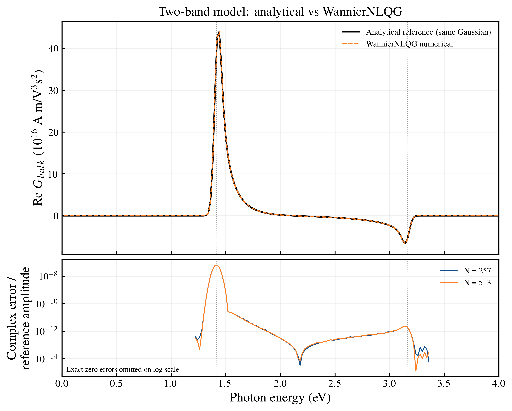
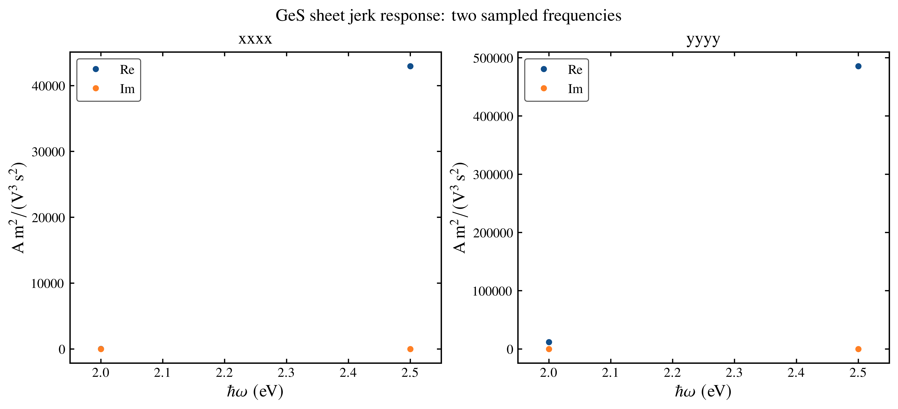
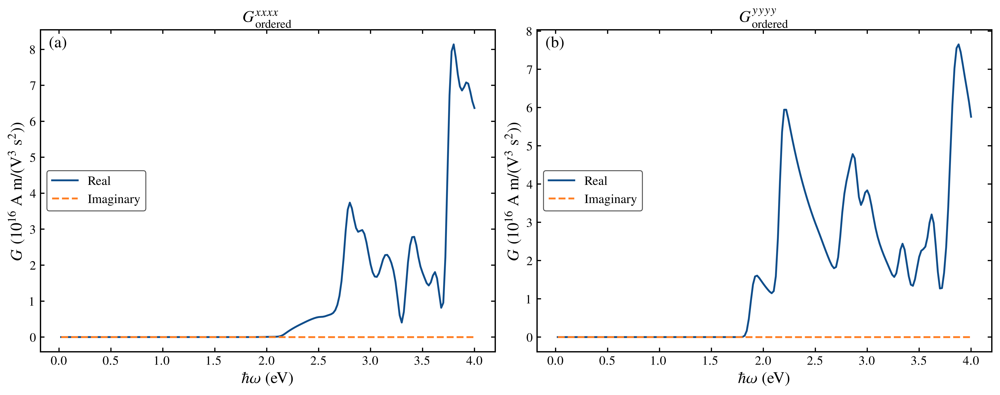
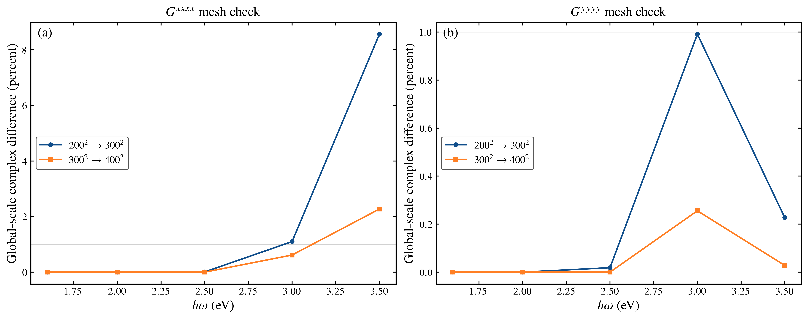

# Jerk current: a model comparison and a material example

## In this tutorial

- Identify the model and directional indices behind a jerk-current coefficient.
- Compare a two-band numerical spectrum with an independent reference.
- Relate volume-normalized GeS output to a separately derived surface coefficient.

## Physics and model

Jerk current is a third-order response involving optical excitation and a static electric field. In the idealized absence of momentum relaxation and saturation, its current can grow quadratically with illumination time. The exported $G$ tensor is therefore not a steady current: its interpretation also requires the temporal, field-amplitude, and permutation conventions.

The two-band Hamiltonian in [TutorialModels.jl](../../models/TutorialModels.jl) is

$$
H(k_x)=
\begin{pmatrix}
\Delta & t_0+t_1e^{-iak_x}\\
t_0+t_1e^{iak_x} & -\Delta
\end{pmatrix}.
$$

Its eigenvalues are

$$
E_\pm(k_x)=\pm\sqrt{\Delta^2+t_0^2+t_1^2+2t_0t_1\cos(ak_x)}.
$$

With the parameters below, the direct transition energy $E_c-E_v=2|E_+|$ ranges from $\sqrt{2}$ to $\sqrt{10}$ eV. These edges help interpret the spectral window; finite Gaussian broadening can give tails beyond the unbroadened edges.

The real-space and analytic inputs describe this same model. Both orbital centers are zero, so do not substitute the Rice–Mele embedding from chapter 14. The task requests the **ordered** $G^{xxxx}$ projection; an index-symmetrized coefficient would be a different convention.

## Parameters

| Parameter | Two-band model | GeS pilot |
| --- | --- | --- |
| Model | jerk/tb or jerk/analytic | Materials/GeS/model_tb.dat |
| $\Delta,t_0,t_1$ | 0.5, 1.0, 0.5 eV | Defined by the material model |
| Cell lengths | 4, 3, 3 Å | Defined by the material model |
| Chain period $a$ | 4 Å | Not a one-dimensional chain model |
| Orbital centers | Both at 0 | Supplied by the material model |
| Mesh | [129, 1, 1] | [7, 5, 1] |
| spatial_dimension | 3 | 3 |
| Chemical potential | 0 eV | −2.5 eV |
| Temperature | 0 K | 0 K |
| Photon energies | 1.7, 2.0, 2.35, 2.75, 3.0 eV | 2.0, 2.5 eV |
| Components | xxxx | xxxx and yyyy |
| Projection | ordered | ordered |
| Raw normalization | cell volume | cell volume; surface conversion is external |
| Replica policy | Native model input | auto |

The current five-point inputs do not specify every numerical default. Use their resolved execution settings when comparing calculations. The dense two-band figure uses 200 supplied frequencies and N=257/513 comparisons, not the five-point N=129 input.

See the [material setup guide](../../Materials/README.md) before running GeS. The model comparison and material pilot serve different purposes: agreement in a two-band example does not qualify a material response.

## Run

From the repository root, check the inputs and run [two_band_tb](inputs/two_band_tb.toml):

```bash
julia --project=.runtime/env scripts/run_group.jl 17 --check
julia --project=.runtime/env scripts/run_group.jl 17 --case=two_band_tb --output=.runtime/two_band_tb
```

Use a new output directory for each run. The check command inspects inputs and dependencies; it does not calculate a response.

Use [ges_pilot_bulk](inputs/ges_pilot_bulk.toml) for native volume output and the stated external height conversion for surface reporting. The parallel [ges_pilot_sheet input](inputs/ges_pilot_sheet.toml) is retained for its data association and now has the same native normalization; do not run both as if they were two independent physical calculations. The [two-band analytic input](inputs/two_band_analytic.toml) supplies the matching analytic model.

## Response normalization and surface conversion

Periodic Jerk output is normalized by the three-dimensional cell volume and has units
A m/(V³ s²). The GeS cell has normal height $h=25.3960572$ Å for the first two lattice
vectors. A separately reported surface coefficient is $G_{\mathrm{surface}}=hG_{\mathrm{vol}}$,
with $h=2.53960572\times10^{-9}$ m. This is an explicit postprocessing conversion;
there is no kernel measure or thickness selector. A two-dimensional reciprocal mesh
does not by itself change the normalization or the model's periodicity.

The existing 200-point volume companion is derived from the same saved surface table
by division by $h$, not independently calculated. Its provenance must remain intact.
Relative mesh differences are invariant under this constant conversion: the original
xxxx failures of the 1% criterion remain failures. The finite-grid xxxx spectrum is presented without claiming grid convergence.
No new convergence or material qualification is implied.

## Read the figures

### Two-band reference comparison

<a href="figures/two_band_analytical_vs_wanniernlqg.png"></a>

The upper panel compares saved numerical and analytical spectra with matched Gaussian broadening. The lower panel shows complex errors normalized by the reference amplitude for N=257 and N=513. Exact zero errors are omitted only from the logarithmic display. This dense comparison uses different sampling from the five-point runnable input above. [Original PNG](figures/two_band_analytical_vs_wanniernlqg.png) · [PDF](figures/two_band_analytical_vs_wanniernlqg.pdf).

### GeS surface coefficient at two photon energies

<a href="figures/ges_pilot_sheet.png"></a>

The two-frequency calculation shows real and imaginary xxxx and yyyy components in A m²/(V³ s²). Keep the points discrete: two photon energies do not define a continuous spectrum. [Original PNG](figures/ges_pilot_sheet.png) · [PDF](figures/ges_pilot_sheet.pdf).

## Plot saved results

Plotting uses the supplied numerical tables and does not run a material calculation. Select the figure and a new output directory:

```bash
python examples/17_jerk_current/plot.py --figure=two_band_analytical_comparison --output=.runtime/plot-two_band_analytical_vs_wanniernlqg
python examples/17_jerk_current/plot.py --figure=ges_pilot_sheet --output=.runtime/plot-ges_pilot_sheet
```

## What to check

The GeS example is intentionally small and does not establish convergence. Native volume output has units A m/(V³ s²); an external surface conversion multiplies it by the cell-normal height in meters to give A m²/(V³ s²). Changing only the label is not a valid conversion. The two-band comparison is limited to its stated model and settings.

[Reproducibility](reproduce.json) records the figure inputs and calculation sources.

## What the two-band controls establish

The dense two-band comparison retains its 200 photon energies and separate 257/513-point checks against the independently broadened analytic reference. Its recorded finite-regularization sweep and momentum refinement serve different purposes: the former tests the approach to the isolated-band analytic geometry, while the latter resolves the same optical line shape. Agreement belongs to this explicit two-band model, orbital embedding, Gaussian width and ordered tensor; it does not transfer automatically to GeS.

The supplied five-frequency two-band controls give the following complex errors relative to a common independent analytic scale. These are the stated control points, not a 200-frequency mesh scan.

| Mesh $N$ | Geometry width (eV) | Relative global-scale error |
| --- | --- | --- |
| 129 | 0.001 | 1.68212e-05 |
| 129 | 0.0001 | 1.59747e-05 |
| 129 | 1.0e-5 | 1.59662e-05 |
| 257 | 0.001 | 8.5511e-07 |
| 257 | 0.0001 | 8.55952e-09 |
| 257 | 1.0e-5 | 9.40128e-11 |

Reducing the width at N=129 reaches a sampling floor near $1.6\times10^{-5}$, whereas N=257 resolves the small-width result much more accurately. Thus width and mesh errors should be separated. [Control values and scope](data/two_band_controls358.json).

The supplied two-energy material pilot and the dense spectrum below are separate sampling contracts on the same unified GeS model. The pilot alone does not establish the dense spectrum or its mesh accuracy.

## Material spectrum on the unified GeS model

<a href="figures/ges_dense_current.png"></a>

The 200 actual photon energies span 0.02–4 eV on a 400 × 400 × 1 full-BZ mesh. This is a material spectrum, in addition to the two-energy pilot above. The panels resolve the ordered xxxx and yyyy volume coefficients; the imaginary parts are retained as calculated. The unified 32-state SOC Hamiltonian and its position matrix elements use the same Convention-II frame, chemical potential −2.5 eV and replica policy `auto`. Count each explicit spinor state once: an additional spin factor 2 would double the result. The source and input identities are recorded in [the data summary](data/ges_current370/summary.json). [PDF](figures/ges_dense_current.pdf).

The spectrum uses Gaussian width 0.04 eV (standard deviation $0.04/\sqrt2$ eV), a five-width transition window and geometry denominator regularization 0.001 eV. The Fourier route is Mixed, with NKFFT [5,5,1] and NKdiv [80,80,1]. Eight MPI ranks evaluated this spectrum; two independent eight-rank applications evaluated the companion 200 × 200 and 300 × 300 five-frequency controls concurrently. These are response calculations on the fixed model, not new self-consistent material calculations.

The displayed [volume table](data/ges_current370/bulk_derived_spectrum.dat) is derived from exactly the same saved surface table by division by the cell height $25.3960572\times10^{-10}$ m. It is not an independent spectrum or an extra accuracy check. The coefficients exclude lifetimes; a measured time-dependent current also needs the illumination and relaxation model.

## Five-frequency material mesh check

<a href="figures/ges_mesh_current.png"></a>

The five photon energies are 1.6, 2.0, 2.5, 3.0 and 3.5 eV. For each component and adjacent mesh pair, the complex difference is normalized by the largest complex magnitude across the two five-point arrays, rather than by each possibly near-zero datum. The horizontal line is the original 1% criterion. The xxxx maxima are approximately 8.56% for 200→300 and 2.27% for 300→400; the yyyy maxima are 0.991% and 0.255%. The combined material check therefore remains **NOT_CONVERGED** under that criterion. This does not invalidate the finite-grid spectrum, but it limits a quantitative interpretation; it also does not check mesh accuracy at all 200 photon energies. [PDF](figures/ges_mesh_current.pdf).

Run the corresponding current inputs with a fresh output directory and an allocated MPI window:

```bash
julia --project=.runtime/env scripts/run_group.jl 17 --case=ges_spectrum_sheet --output=.runtime/ges-spectrum-sheet
julia --project=.runtime/env scripts/run_group.jl 17 --case=ges_mesh200_sheet --output=.runtime/ges-mesh200-sheet
julia --project=.runtime/env scripts/run_group.jl 17 --case=ges_mesh300_sheet --output=.runtime/ges-mesh300-sheet
python examples/17_jerk_current/plot.py --figure=ges_dense_current370 --output=.runtime/ges-dense-plot
python examples/17_jerk_current/plot.py --figure=ges_mesh_current370 --output=.runtime/ges-mesh-plot
```

The 400 × 400 five-frequency values are extracted from the 200-frequency calculation, so that mesh endpoint is not recomputed. The supplied tables contain actual calculated frequencies, with no added zero-energy endpoint. Preserve the model, occupations, broadening and tensor convention when changing the sampling.

## References

- B. M. Fregoso, R. A. Muniz, and J. E. Sipe, “Jerk Current: A Novel Bulk Photovoltaic Effect,” *Physical Review Letters* **121**, 176604 (2018). [DOI](https://doi.org/10.1103/PhysRevLett.121.176604). Background for the response and its idealized time growth; the publisher page also links a subsequent Comment and Reply. The ordered coefficient used here must be compared using its own stated conventions.
